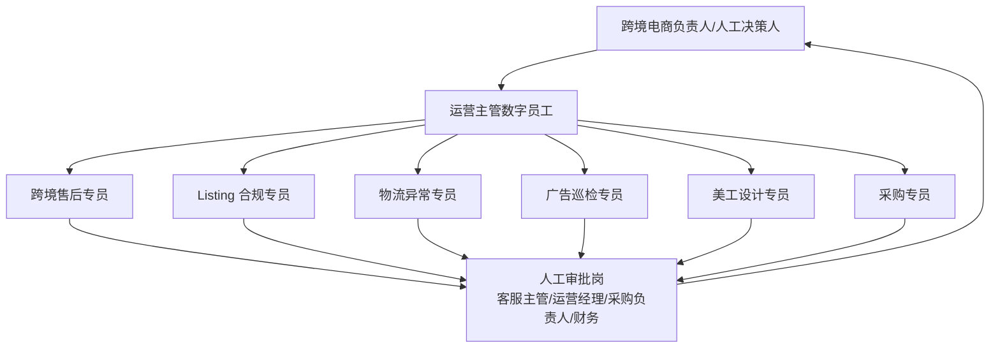
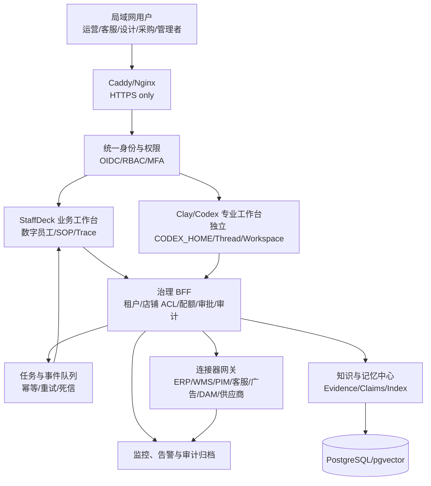

# 跨境电商数字员工部门综合建设方案（2026）

> 版本：V1.0  
> 日期：2026-08-27  
> 适用对象：拥有多个店铺、站点或品牌，已使用 ERP/WMS/PIM/客服/广告平台，希望在局域网或内网部署企业 AI 的跨境电商公司。  
> 方案依据：在《[局域网多用户共享 Codex 与记忆知识库方案调研（2026）](./lan-multiuser-codex-memory-2026.md)》的身份隔离、会话隔离、知识治理与审计架构上，增加 StaffDeck 业务数字员工工作台，并形成跨境售后、Listing 合规、物流、广告、设计、采购和运营管理的完整部门闭环。

## 一、执行摘要

建议建设一个“**7 个数字岗位 + 人工审批岗 + 统一知识与审计底座**”的跨境电商数字员工部门：

1. 跨境售后专员：处理客服与售后工单。
2. Listing 合规专员：检查商品内容与平台规则。
3. 物流异常专员：监控履约、库存流转和物流异常。
4. 广告巡检专员：分析广告数据并提出操作建议。
5. 美工设计专员：生成设计需求、检查素材合规与版本完整性，辅助产出和验收图片/视频素材。
6. 采购专员：分析补货需求、供应商信息、采购交期、成本与质量风险。
7. 运营主管：接收其他数字员工的结构化结果，处理跨岗位冲突，生成日报、周报与待决策清单。

系统不应设计成七个彼此独立的聊天机器人，而应形成一个受控的业务部门：每个岗位拥有独立档案、SOP、知识域、工具权限、工作记录和 KPI；运营主管负责协调，但不能绕过退款、发布、调价、下单等高风险动作的人工审批。

### 核心决策

- **业务执行面使用 StaffDeck**：承载数字员工、岗位权限、SOP、知识检索、工具调用、Trace、人工接管与反馈迭代。
- **专业工作面使用隔离后的 Clay/Codex**：服务真人运营、技术人员和审核人员，承担表格/文件分析、脚本开发、连接器维护和复杂调研；每位真人使用独立身份、`CODEX_HOME`、工作区和 Thread。
- **统一治理底座**：身份与权限、审批中心、连接器网关、事件总线、知识与记忆、审计日志、监控告警共用一套服务端边界。
- **先建议、后执行**：第一阶段所有数字员工只读或生成草稿；达到质量门槛后，逐类开放低风险写操作；资金、库存承诺、商品发布和客户补偿始终保留确定性规则与人工审批。

## 二、建设目标、边界与假设

### 2.1 业务目标

- 将分散在员工经验、平台规则、表格和聊天记录中的流程固化为可运行、可追踪的 SOP。
- 降低售后、Listing 检查、物流巡检、广告巡检、设计协同和采购跟单的重复劳动。
- 建立跨岗位协作链路，避免同一异常在运营、客服、物流、采购之间反复转述。
- 让每项 AI 结论都能回答“用了什么数据、依据哪条规则、调用了什么工具、谁批准了动作”。
- 将个人经验蒸馏为可审核、可撤回、可过期、可检索的团队知识，而不是无边界共享聊天历史。

### 2.2 明确不做

- 不让大模型独立决定大额退款、采购下单、广告预算变更、Listing 发布或账号申诉。
- 不把一个个人 ChatGPT/Codex 登录提供给多人共用。
- 不允许浏览器直接访问 Codex app-server、宿主机 Shell、数据库或平台密钥。
- 不把客户个人信息、平台凭据、供应商银行信息直接沉淀为通用向量知识。
- 不在首期追求覆盖所有平台、国家、店铺和业务流程。

### 2.3 容量假设（需在项目启动时替换为真实数据）

以下为中小型跨境电商团队的首期估算，不是容量承诺：

| 输入 | 试点假设 | 12 个月扩展假设 |
|---|---:|---:|
| 真人用户 | 10-30 人 | 30-100 人 |
| 品牌/店铺 | 3-10 个 | 10-30 个 |
| 订单量 | 1,000-3,000 单/日 | 5,000-15,000 单/日 |
| 客服工单 | 200-500 单/日 | 1,000-3,000 单/日 |
| 活跃 Listing | 2,000-10,000 个 | 10,000-50,000 个 |
| 广告明细 | 2万-10万行/日 | 10万-100万行/日 |
| AI/SOP 任务 | 800-2,000 次/日 | 5,000-15,000 次/日 |

若试点为 1,500 次任务/日，平均请求率约为 `1500 / 86400 = 0.017 次/秒`。按 20 倍峰值、平均任务占用 30 秒估算，峰值并发约为 `0.017 × 20 × 30 ≈ 10`。首期可配置 8-12 个受控 Worker，并通过队列吸收突发任务；当队列 P95 等待时间连续 7 天超过 60 秒，或 Worker 利用率连续超过 70%，再扩容或拆分高负载任务。

## 三、部门组织架构



运营主管是信息聚合和任务协调角色，不是超级管理员。它可以读取经授权的岗位摘要、创建任务和升级异常，但不能直接获得全部底层客户数据、平台凭据或高风险工具写权限。

## 四、岗位设计

### 4.1 跨境售后专员

**职责**

- 接收并分类售前咨询、订单查询、退换货、补发、破损、错发、物流延迟和使用问题。
- 查询订单、物流、SKU、保修与店铺政策，生成当地语言回复草稿。
- 根据金额、责任归属、客户等级和平台时限给出处理建议。
- 将产品缺陷、包装问题、物流问题分别反馈给采购、美工/Listing、物流和运营主管。

**知识域**：平台客服规则、国家/站点政策、店铺售后政策、SKU FAQ、保修范围、历史优秀案例、禁用表达。

**工具权限**：订单/物流只读、客服工单读写、模板回复、内部任务创建；首期禁止直接退款、补发和关闭争议。

**人工审批条件**：退款或补偿超过阈值、重复索赔、平台争议、法律/安全投诉、负面舆情、客户个人数据导出。

**KPI**：首次响应时长、平均处理时长、建议采纳率、一次解决率、误判率、人工接管率、退款损失率、政策引用正确率。

### 4.2 Listing 合规专员

**职责**

- 检查标题、五点、描述、A+、关键词、属性、变体、图片文字和视频脚本。
- 按平台、国家、类目和时间版本检查禁限词、认证、尺寸、标签、知识产权与宣传表述。
- 对多语言内容做事实一致性检查，不只做翻译质量检查。
- 在发布前生成问题清单、风险等级、证据来源和修改建议。

**知识域**：平台规则、类目政策、国家合规要求、品牌词库、SKU 参数、证书及有效期、历史下架/警告案例。

**工具权限**：PIM/Listing 只读、规则库读取、合规任务创建；初期不直接发布或修改线上 Listing。

**人工审批条件**：医疗/安全/环保宣称、受限品类、认证缺失、知识产权冲突、主图/标题/类目变更。

**KPI**：检查覆盖率、规则命中准确率、误报率、漏报率、发布返工率、违规/下架事件数、平均检查时长。

### 4.3 物流异常专员

**职责**

- 监控待发货、超时未上网、轨迹停滞、清关异常、妥投争议、仓库缺货和预约异常。
- 按承运商、渠道、国家、仓库和 SKU 聚类异常并判断影响面。
- 创建跟进任务，向售后专员提供客户沟通建议，向采购专员提供交期风险。
- 对重复异常形成承运商、仓库和 SKU 根因报告。

**知识域**：物流渠道 SLA、仓库截单规则、国家清关要求、承运商状态码、赔付规则、节假日日历。

**工具权限**：ERP/WMS/TMS/承运商轨迹只读、内部工单创建、告警推送；禁止自行改地址、拦截包裹或创建补发单。

**人工审批条件**：改派/拦截、批量补发、库存调拨、渠道切换、异常赔付和客户承诺变更。

**KPI**：异常发现时延、漏检率、误报率、超期订单占比、异常闭环时长、重复异常率、物流索赔率。

### 4.4 广告巡检专员

**职责**

- 汇总广告花费、销售、ACOS/ROAS、CTR、CVR、搜索词、预算耗尽、断货和价格变化。
- 识别异常花费、低转化词、搜索词浪费、预算错配、广告商品不可售和数据断流。
- 输出原因假设、证据、建议动作、预计影响和风险级别。
- 将素材疲劳交给美工设计专员，将 Listing 转化问题交给 Listing 合规专员，将断货风险交给采购专员。

**知识域**：广告策略、目标利润率、店铺/ASIN 生命周期、活动日历、历史实验、品牌词/竞品词边界。

**工具权限**：广告报表和业务报表只读、建议单创建；首期禁止自动调价、否词、暂停活动或修改预算。

**人工审批条件**：任何预算/竞价/状态变更，品牌防御策略调整，涉及断货或大促的批量动作。

**KPI**：异常发现率、建议采纳率、建议后 7/14 天增益、误操作数、浪费花费识别额、数据新鲜度。

### 4.5 美工设计专员

**职责**

- 将运营需求转化为结构化 Creative Brief：目标平台、受众、核心卖点、尺寸、语言、素材清单和截止时间。
- 基于品牌规范、SKU 事实、平台图片规则和历史高转化素材生成构图/文案建议。
- 辅助生成草图、场景图、信息图、A+ 模块和短视频分镜，但必须保留素材来源和 AI 生成标识流程。
- 对交付素材执行尺寸、清晰度、文字安全区、品牌一致性、卖点真实性和多语言一致性检查。
- 管理版本、审批状态、使用范围和过期素材，避免错误版本被再次发布。

**知识域**：品牌视觉规范、字体/色彩/Logo 规则、SKU 素材、平台图片/视频规则、已授权素材、历史实验结果。

**工具权限**：DAM/素材库读写、设计任务系统、图像生成或编辑工具的受控调用、PIM 只读；不得直接覆盖线上主图或删除源文件。

**人工审批条件**：主图和品牌资产发布、人物肖像/版权素材、AI 生成商业素材、功效对比图、平台敏感类目素材。

**KPI**：Brief 完整率、一次验收通过率、平均交付周期、版本错误率、素材复用率、合规退回率、素材上线后转化变化。

### 4.6 采购专员

**职责**

- 综合销量、在途、库存、广告计划、促销日历、供应商 MOQ、交期和资金约束提出补货建议。
- 监控采购单延期、供应商回复、价格变化、质检异常、缺件和包装变更。
- 对供应商报价和历史履约做结构化比较，输出谈判准备材料。
- 将质量问题回传售后与 Listing，将交期风险回传物流、广告和运营主管。

**知识域**：供应商档案、报价历史、MOQ、交期、付款条款、质检标准、BOM、包装要求、合同摘要和风险事件。

**工具权限**：ERP 采购/库存只读、供应商协同系统、询价草稿、采购建议单；首期禁止自动下 PO、改价、确认付款或发送具有合同效力的承诺。

**人工审批条件**：新增供应商、价格/条款变更、采购下单、付款、超预算补货、质量让步、合同和银行信息相关操作。

**KPI**：缺货率、预测偏差、采购准交率、补货建议采纳率、加急采购占比、成本偏差、质量异常率、库存周转天数。

### 4.7 运营主管

**职责**

- 汇总六个执行岗位的结构化结果，生成日报、周报、风险清单和待审批事项。
- 识别跨岗位冲突，例如广告建议加预算但采购预测会断货，或设计卖点与合规规则冲突。
- 按严重度、金额、客户影响、平台时限和库存影响分派任务并跟踪闭环。
- 对重复问题提出 SOP、知识库和工具权限的改进建议。

**知识域**：经营目标、利润口径、店铺/品牌目标、风险分级、审批矩阵、部门 KPI、活动日历。

**工具权限**：读取岗位摘要和授权业务指标、创建/升级/关闭内部任务、生成管理报告；不能无条件读取客户明细、供应商敏感字段或跨租户私人记忆。

**KPI**：风险闭环率、逾期任务数、跨岗位冲突发现率、报告准时率、重大事故漏报数、SOP 改进落地率。

## 五、跨岗位核心流程

### 5.1 售后与质量闭环

```text
客户工单
→ 售后专员查询订单、政策与物流
→ 物流专员确认履约状态
→ 售后专员生成处理建议
→ 超阈值动作进入人工审批
→ 执行并记录 Trace
→ 同类问题聚类
   ├─ 商品质量问题 → 采购专员
   ├─ 包装/说明不清 → 美工设计 + Listing 合规
   ├─ 承运商问题 → 物流专员
   └─ 重大风险 → 运营主管
```

### 5.2 新品上线闭环

```text
采购专员建立供应商、BOM、成本、交期和认证资料
→ Listing 合规专员核验事实与准入要求
→ 美工设计专员生成并验收素材
→ Listing 合规专员执行发布前终审
→ 人工运营批准发布
→ 广告巡检专员建立监控基线
→ 物流异常专员监控首批履约
→ 售后专员收集首批 VOC
→ 运营主管生成 7/14/30 天复盘
```

### 5.3 补货与广告协同闭环

```text
采购专员输出可售天数和补货建议
→ 物流专员补充在途与入仓风险
→ 广告专员提出预算/流量计划
→ 运营主管检测冲突
   ├─ 库存安全 → 进入广告审批
   ├─ 临界库存 → 限制增量建议
   └─ 高断货风险 → 建议降速并升级采购
→ 人工批准预算和采购动作
```

### 5.4 日报与周报闭环

- 每日固定时间，各岗位提交结构化摘要：已完成、异常、待审批、逾期、数据缺失和建议动作。
- 运营主管按店铺、站点、品牌、SKU 和风险等级去重归并，不复制完整底层记录。
- 日报强调“今日必须处理”；周报强调趋势、重复根因、KPI 变化、SOP 改进和知识过期。
- 管理者的批注进入候选记忆，经审核后更新团队政策或岗位 SOP，不直接修改历史证据。

## 六、总体技术架构

### 6.1 推荐架构：双工作台、一个治理底座



### 6.2 组件边界

| 组件 | 主要责任 | 明确不负责 |
|---|---|---|
| StaffDeck | 数字员工档案、SOP、知识调用、业务工具调用、Trace、人工接管 | 不作为 Codex 的 OS/Shell 安全沙箱 |
| Clay/Codex | 真人的多会话 AI 工作台、深度分析、脚本和连接器开发 | 不直接承载客服退款、采购下单等生产业务授权 |
| 治理 BFF | 身份映射、店铺/品牌/项目 ACL、审批、配额、幂等、审计 | 不让前端决定 `user_id`、知识 scope 或凭据 |
| 连接器网关 | 统一封装 ERP/WMS/PIM/客服/广告/DAM API，隐藏密钥和平台差异 | 不允许 Agent 持有平台主账号凭据 |
| 任务与事件队列 | 削峰、重试、超时、取消、死信和跨岗位事件 | 不保存唯一业务真相 |
| 知识与记忆中心 | 证据、审核知识、索引、个人/岗位/团队记忆及生命周期 | 不把相似度当成授权或事实证明 |
| PostgreSQL/pgvector | 用户、岗位、任务、审批、审计、知识元数据和向量索引 | 大型原始素材存对象存储/DAM，不塞数据库 |

### 6.3 为什么不只部署一个平台

| 方案 | 优点 | 主要不足 | 结论 |
|---|---|---|---|
| 仅 StaffDeck | 业务岗位、SOP、工具与 Trace 统一 | 不能自动替代原方案中的 Codex 多用户工作区和 OS 级代码执行隔离 | 可做纯业务试点，不覆盖完整需求 |
| 仅 Clay/Codex | 多用户专业工作台、代码与文件能力强 | 业务 SOP、岗位运营、连接器治理与高风险审批需大量自建 | 不适合直接作为业务执行平台 |
| StaffDeck + 隔离 Codex + 统一治理 | 业务执行和专业工作各自使用合适工具；共用身份、知识、审批与审计 | 集成工作量更高，需要明确双平台边界 | **推荐** |

## 七、身份、租户与权限模型

### 7.1 主体模型

- **真人用户**：每人独立登录，拥有角色、店铺/品牌范围和审批权限。
- **数字员工**：使用服务身份，绑定唯一岗位、版本、创建人、工具范围和知识范围。
- **租户/业务域**：至少使用 `company_id + brand_id + store_id + marketplace + region` 作为授权维度。
- **任务**：任务继承发起人的业务范围，同时受数字岗位范围限制；二者取交集，不能取并集。
- **Codex 工作区**：真人用户绑定独立 `CODEX_HOME`、Thread owner 和工作区白名单；非互信用户使用 OS 用户、容器或 VM 隔离。

### 7.2 权限矩阵

| 岗位 | 客户/订单 | Listing/PIM | 物流/WMS | 广告 | DAM 素材 | 采购/供应商 | 高风险写操作 |
|---|---|---|---|---|---|---|---|
| 售后 | 订单与必要客户字段只读 | SKU 事实只读 | 轨迹只读 | 无 | 说明素材只读 | 无 | 退款/补发需审批 |
| Listing 合规 | 无客户明细 | 读，草稿建议 | 无 | 只读转化摘要 | 读 | 认证资料只读 | 发布/类目变更需审批 |
| 物流异常 | 订单履约字段只读 | SKU/包装只读 | 读，任务写 | 无 | 无 | 交期摘要只读 | 拦截/调拨/补发需审批 |
| 广告巡检 | 聚合销售只读 | Listing 状态只读 | 库存摘要只读 | 明细只读 | 素材效果只读 | 补货风险摘要 | 调价/否词/启停需审批 |
| 美工设计 | 无 | SKU 事实只读 | 无 | 素材效果摘要 | 版本化读写 | 包装规格只读 | 发布/覆盖主素材需审批 |
| 采购 | 退货原因聚合 | SKU/BOM/认证只读 | 库存与在途只读 | 需求预测摘要 | 包装资料只读 | 读，建议单写 | 下单/改价/付款需审批 |
| 运营主管 | 聚合与授权抽样 | 汇总 | 汇总 | 汇总 | 状态汇总 | 汇总 | 仍按审批矩阵执行 |

### 7.3 高风险动作控制

高风险工具不直接暴露给模型。推荐采用“模型提出动作 → 确定性规则校验 → 生成审批单 → 有权真人确认 → 连接器执行 → 回写结果与审计”的链路。

至少包含：动作类型、目标资源、旧值、新值、金额/影响范围、模型理由、证据来源、SOP 版本、工具版本、发起身份、审批身份、幂等键和回滚/补偿方式。

## 八、知识库与记忆治理

### 8.1 五级知识域

1. **会话上下文**：单次任务临时信息，任务结束后按策略清理。
2. **个人记忆**：真人用户的偏好、工作习惯和草稿，默认仅本人可见。
3. **岗位知识**：某一数字岗位可用的 SOP、规则、案例和指标定义。
4. **业务域知识**：按品牌、店铺、平台、国家和 SKU 隔离的事实与政策。
5. **公司团队知识**：经授权人员审核后发布的公司级标准，不由聊天自动晋升。

### 8.2 推荐目录与元数据

```text
公司政策
├─ 平台
│  ├─ Amazon / TikTok Shop / Shopify / 其他
│  └─ 规则版本与生效日期
├─ 国家/站点
├─ 品牌
├─ 店铺
├─ SKU
├─ 供应商
└─ 岗位 SOP
```

每条知识至少包含：`claim_id`、内容、证据来源、所有者、租户/店铺范围、岗位范围、数据分类、创建/审核人、有效期、置信说明、冲突状态、替代关系和删除策略。

### 8.3 写入与检索规则

- 原始文档、聊天和接口返回值是“证据”，不是自动生效的事实。
- `turn/completed` 或业务任务完成后只生成候选记忆；个人记忆默认私有，团队知识必须显式提交和审核。
- 检索顺序必须是先身份和范围过滤，再关键词/向量召回，再按权威性、新鲜度和适用范围重排。
- 返回给数字员工的知识必须携带稳定来源 ID；若存在冲突或过期，应显示冲突而不是悄悄选择一条。
- 删除必须覆盖原文、结构化记录、切片、向量、缓存和备份生命周期，不只删除界面记录。
- 客户 PII、平台密钥、供应商银行信息、未公开价格和合同原文按敏感级别决定“不入库、脱敏入库或仅受控原文库保存”。

## 九、关键运行链路

### 9.1 售后工单链路

1. 客服渠道通过连接器网关创建任务，治理 BFF 从登录/渠道身份解析公司、店铺和客户范围。
2. 售后专员按 SOP 查询订单、物流和政策，所有查询带服务端注入的 scope。
3. 知识中心先做授权和有效期过滤，再返回带来源的候选知识。
4. 数字员工生成分类、处理建议和回复草稿，同时写入 Trace。
5. 若命中金额、争议、安全或隐私阈值，进入人工审批；否则由人工一键发送或在成熟阶段自动发送低风险模板。
6. 工具执行使用幂等键；超时不盲目重试有副作用动作，而是查询执行状态或进入人工核对。
7. 完成后写业务事件，触发 VOC 聚类、质量问题和物流问题的跨岗位任务。

### 9.2 定时巡检链路

1. 调度器按店铺和任务类型产生巡检任务。
2. 队列实施每租户并发上限和优先级：客户时限任务 > 履约异常 > 合规检查 > 广告/管理报表。
3. 连接器从外部系统增量取数，记录游标、时间范围和数据完整性。
4. 数字岗位产出结构化异常，不直接修改外部系统。
5. 运营主管去重并升级重大异常；低优先级结果进入日报或周报。

### 9.3 人工/Codex 专业工作链路

1. 真人通过 SSO 进入 Clay/Codex，BFF 解析用户与项目。
2. 系统启动该用户独立的 app-server/profile；Thread 的 list/read/resume/fork/archive 全部复核 owner。
3. 工作区限定在白名单目录，MCP capability 绑定 `user_id + session_id + project_id`。
4. 完成 Turn 后异步蒸馏个人候选记忆；只有人工提交和审核后才进入岗位/团队知识域。

## 十、SLO、可靠性与降级策略

### 10.1 建议质量目标

| 能力 | 试点目标 | 正式运行目标 | 说明 |
|---|---:|---:|---|
| 登录与工作台可用性 | 99.5%/月 | 99.9%/月 | 排除预告维护窗口 |
| 交互任务首个进度事件 P95 | < 5 秒 | < 3 秒 | 不等于模型最终完成时间 |
| 普通售后建议完成 P95 | < 120 秒 | < 90 秒 | 排除外部平台明确故障 |
| 物流异常发现新鲜度 | < 30 分钟 | < 10 分钟 | 受平台数据更新频率约束 |
| 已审核知识索引新鲜度 | < 30 分钟 | < 15 分钟 | 从审核通过到可检索 |
| 审计事件持久化 | 不允许静默丢失 | 不允许静默丢失 | 审计失败时高风险动作失败关闭 |
| 未授权跨租户读取 | 0 | 0 | 任何一次均触发停用与调查 |
| RPO / RTO | 24 小时 / 8 小时 | 15 分钟 / 4 小时 | PostgreSQL、对象存储和配置分别演练 |

### 10.2 依赖失败与降级

| 故障 | 检测 | 降级行为 | 恢复方式 |
|---|---|---|---|
| 模型不可用/限流 | 超时、错误率、配额告警 | 任务排队；客服显示人工模板与原始资料 | 指数退避、切换已批准模型、人工接管 |
| ERP/WMS/平台 API 故障 | 健康检查、数据游标停滞 | 标记数据陈旧，禁止基于旧数据执行写动作 | 恢复后增量补拉和对账 |
| 知识索引不可用 | 检索错误、延迟告警 | 只允许人工查原始受控文档；不生成“确定性”结论 | 重建派生索引，Canonical 数据不受影响 |
| 队列积压 | 队列长度和最老任务年龄 | 优先客户时限任务，暂停低优先级报表 | 扩 Worker、取消过期任务、重放死信 |
| 审批中心不可用 | 健康检查 | 所有高风险动作失败关闭，保留建议单 | 恢复后重新审批，禁止自动补执行 |
| 审计存储不可用 | 写入失败 | 高风险写动作停止；只读分析可按策略继续 | 修复后核对缺口并生成事故记录 |

## 十一、监控、审计与成本

### 11.1 需要监控的信号

- **技术指标**：任务吞吐、队列年龄、Worker 利用率、模型延迟/错误/Token、连接器成功率、外部 API 限流、知识检索延迟、数据库和磁盘容量。
- **业务指标**：工单时效、异常订单数、Listing 风险数、广告浪费识别额、设计返工率、采购延期、待审批金额、数字员工建议采纳率。
- **质量指标**：无来源结论率、过期知识命中率、规则误报/漏报率、人工推翻率、工具参数错误率、跨岗位冲突率。
- **安全指标**：越权拒绝、伪造 scope、敏感信息入库拦截、密钥访问、异常批量导出、高风险审批绕过尝试。

### 11.2 审计事件

至少记录：登录、角色变更、数字员工版本变更、SOP 发布、知识审核/撤回、任务输入摘要、知识引用、工具调用、审批、人工接管、外部写结果、失败重试、数据导出和删除。

审计日志采用 append-only 语义；普通业务管理员无权修改。敏感字段保存哈希、引用或脱敏值，避免审计系统成为新的泄露源。

### 11.3 成本控制

- 按岗位和任务类型设置模型档位，分类、抽取、格式校验不默认使用最高成本模型。
- 对相同规则文档、SKU 事实和报表查询做安全缓存，但缓存键必须包含租户、店铺、权限和版本。
- 对日报/周报先用确定性 SQL 聚合，再让模型解释，避免把全量明细塞入上下文。
- 建立“每工单 AI 成本、每 Listing 检查成本、每发现一个有效异常的成本”三个基础单位经济指标。
- 设置每用户、每岗位、每店铺和全局配额；异常增长自动暂停非关键批处理。

## 十二、实施路线图

### Phase 0：基线与安全验证（1-2 周）

- 确认平台、店铺、国家、业务量、现有系统和接口权限。
- 建立两名测试用户、两个独立 Codex profile/工作区，完成 Thread、文件和记忆越权测试。
- 建立统一业务实体：品牌、店铺、平台、站点、SKU、订单、任务、审批和知识范围。
- 选取历史工单、规则文档和异常案例，建立评测集。

**退出条件**：身份/Thread/文件/记忆跨用户越权测试全部失败关闭；平台密钥不进入浏览器和 Agent Prompt。

### Phase 1：售后 + 物流只读试点（3-6 周）

- 部署 StaffDeck、治理 BFF、连接器网关、PostgreSQL、队列和基础监控。
- 接订单、物流、客服和政策知识，只生成回复草稿与异常任务。
- 影子运行 1-2 周，与人工结果逐单比较。

**放量门槛**：建议采纳率 ≥ 70%，政策引用正确率 ≥ 95%，重大误判为 0，未授权读取为 0；不满足则回退为只读检索助手。

### Phase 2：Listing 合规 + 美工设计 + 采购（4-8 周）

- 建立规则版本、SKU 事实、认证、品牌规范、素材版本和供应商档案。
- 打通 PIM/DAM/采购/库存只读接口，运行新品上线和补货协同 SOP。
- 开放低风险内部写操作，如创建任务、写草稿、上传新版本但不发布。

**放量门槛**：合规漏报率达到业务认可阈值；素材版本错误为 0；补货建议能解释数据口径且不直接下单。

### Phase 3：广告巡检 + 运营主管（3-6 周）

- 接入广告、利润、库存和活动日历，建立只读巡检与建议单。
- 运营主管生成日报、周报、跨岗位冲突和待审批事项。
- 对建议做 7/14/30 天回溯，验证增益而非只统计“建议数量”。

### Phase 4：受控自动执行与规模化（持续）

- 仅对数据充分、可幂等、可补偿、低金额的动作开放自动执行。
- 高风险动作保持人工审批；使用灰度店铺、动作限额和一键停用开关。
- 当关系和时间冲突成为真实瓶颈时再评估 Graphiti；当向量规模和延迟成为瓶颈时再评估独立 Qdrant。
- Worker 数明显增长后再拆分服务或引入更复杂调度，首期保持模块化单体 + 队列。

## 十三、验收测试

### 13.1 安全与隔离

1. 用户 A 即使知道用户 B 的 Thread、任务或知识 ID，也无法读取、恢复、修改、审批或导出。
2. 售后数字员工不能检索供应商银行信息；广告数字员工不能读取客户明细。
3. 浏览器伪造 `user_id`、`store_id`、`project_id` 或 knowledge scope 时，服务端仍使用登录身份绑定范围。
4. 每个连接器凭据只能访问指定店铺和动作；服务身份停用后立即失效。
5. 个人记忆不会自动进入岗位或公司知识；晋升、修改、撤回均保留来源和操作者。

### 13.2 业务正确性

1. 使用至少 100-300 条历史售后案例评估分类、政策引用和处理建议。
2. 使用已知违规与合规 Listing 混合集评估漏报和误报。
3. 注入物流 API 延迟、重复事件、乱序状态和数据缺失，验证幂等与陈旧标记。
4. 使用断货、价格变化、大促和广告异常组合场景，验证跨岗位冲突识别。
5. 使用错误 SKU 参数、过期证书、未授权图片和旧版素材，验证设计/Listing 联合门禁。
6. 使用供应商延期、MOQ 变化、采购价变化和质检异常，验证采购建议不会越权下单。

### 13.3 恢复与运维

1. 模型、队列、数据库、知识索引和外部 API 分别故障时，验证降级符合设计。
2. 验证高风险工具超时不会因自动重试造成重复退款、重复下单或重复发布。
3. 每季度执行备份恢复；核对数据库、对象存储、知识索引和审计时间线。
4. StaffDeck、Codex CLI/SDK、连接器和模型升级前运行契约、权限、回归和真实 E2E 测试。

## 十四、主要风险与控制

| 风险 | 严重度 | 关键控制 |
|---|---:|---|
| AI 使用错误/过期平台规则 | 高 | 规则版本、生效日期、来源引用、过期下线、发布前人工终审 |
| 数字员工越权调用工具 | 极高 | 服务端 scope、岗位权限交集、短期凭据、审批中心、幂等与审计 |
| 多店铺/多用户数据串域 | 极高 | BFF 注入租户、先授权后检索、跨租户回归测试、独立工作区/容器 |
| 自动退款、调价、下单造成资金损失 | 极高 | 首期只建议；金额阈值、双人审批、动作限额、紧急停用 |
| 个人聊天或客户隐私进入团队知识 | 极高 | personal 默认、敏感扫描、人工晋升、来源/删除/保留策略 |
| 广告、库存、利润口径不一致 | 高 | 指标字典、数据时间戳、口径版本、数据质量门禁和对账 |
| AI 生成设计侵犯版权或虚构卖点 | 高 | 授权素材库、生成记录、品牌/合规双审、不得编造产品事实 |
| 供应商数据和合同泄露 | 极高 | 字段级权限、脱敏、原文受控库、导出审批、银行信息不入通用记忆 |
| 双平台造成运维复杂度 | 中高 | 明确边界、统一 SSO/审计/连接器、模块化单体起步、固定版本和回滚 |
| 开源许可证或商业授权不匹配 | 高 | 上线前分别审查 StaffDeck AGPL-3.0、Clay/Mem0/Codex 等许可证与部署方式 |

## 十五、首期交付清单

- 7 个数字员工岗位卡：职责、输入、输出、知识域、工具、审批、KPI。
- 4 条端到端 SOP：售后闭环、新品上线、补货广告协同、日报周报。
- 统一身份与权限矩阵：用户、岗位、店铺、品牌、项目、工具和知识范围。
- 连接器清单：接口、凭据、读写动作、限流、幂等、负责人和降级策略。
- 知识治理规范：证据/知识分离、审核、版本、冲突、过期、删除和引用。
- 评测集与基线：售后、合规、物流、广告、设计、采购和跨岗位冲突案例。
- 监控与审计看板：技术 SLO、业务 KPI、质量指标、安全事件和成本。
- 灰度与回滚手册：只读模式、一键停用数字员工、撤销连接器写权限和数据恢复流程。

## 十六、最终建议

首个可证明价值的落地单元应选择“**售后专员 + 物流异常专员 + 运营主管**”：数据相对明确、任务频率高、结果可人工核验，也能快速验证身份隔离、SOP、知识引用、Trace 和跨岗位协作。Listing 合规、美工设计和采购在第二阶段加入，形成新品与质量闭环；广告巡检最后加入，因为广告建议必须同时理解利润、库存、活动和采购约束。

技术上采用“StaffDeck 业务执行面 + Clay/Codex 专业工作面 + 统一治理底座”。不要让两个平台各自维护一套用户、知识和连接器授权；身份、业务 scope、审批、密钥和审计必须由服务端统一控制。业务数字员工默认没有 Shell，Codex 也默认没有生产系统写权限。只有经过评测、灰度、审批和可回滚验证的动作，才逐步从“建议”升级为“执行”。

## 参考资料

- [StaffDeck 官方仓库](https://github.com/OpenBMB/StaffDeck)
- [StaffDeck 中文说明](https://github.com/OpenBMB/StaffDeck/blob/main/README.zh.md)
- [OpenAI Codex 官方仓库](https://github.com/openai/codex)
- [Clay 官方仓库](https://github.com/chadbyte/clay)
- [Mem0 官方仓库](https://github.com/mem0ai/mem0)
- [局域网多用户共享 Codex 与记忆知识库方案调研（2026）](./lan-multiuser-codex-memory-2026.md)
