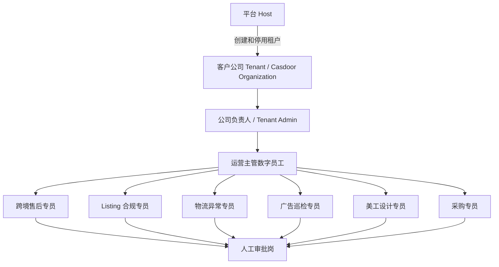
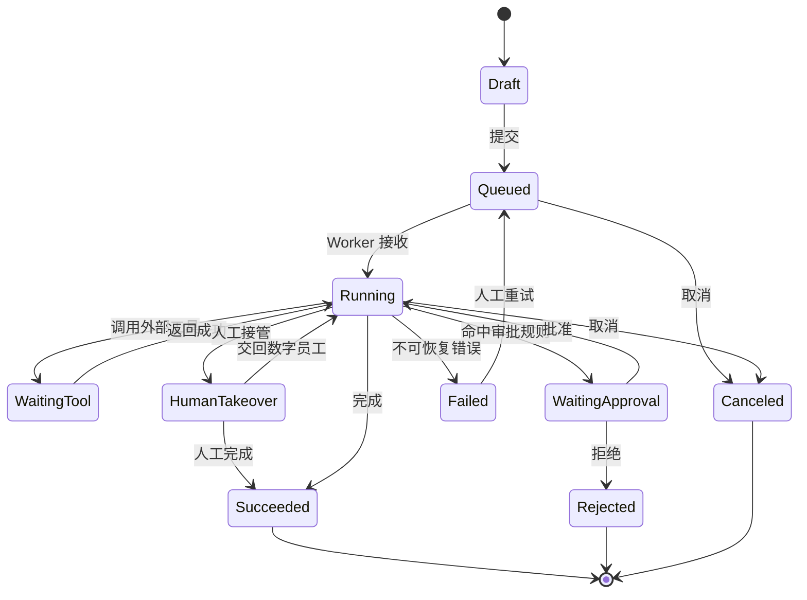
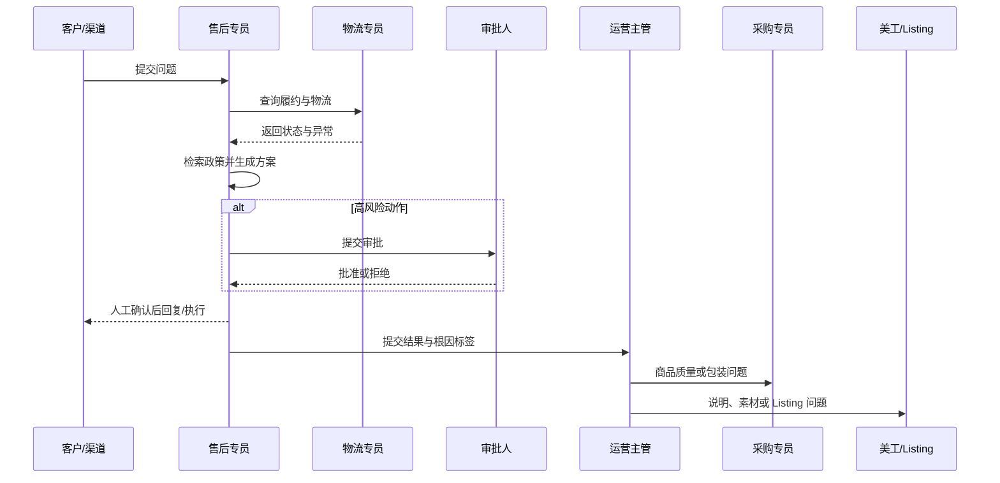
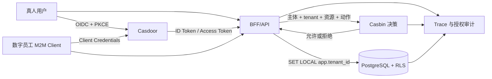
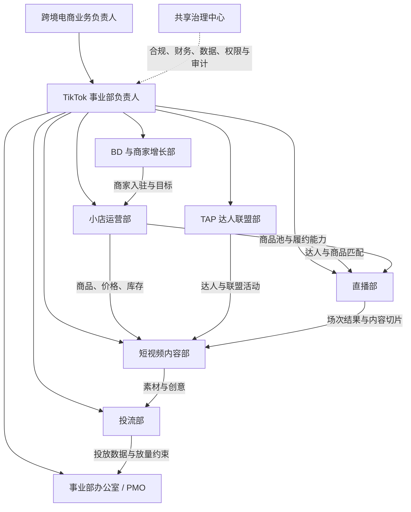
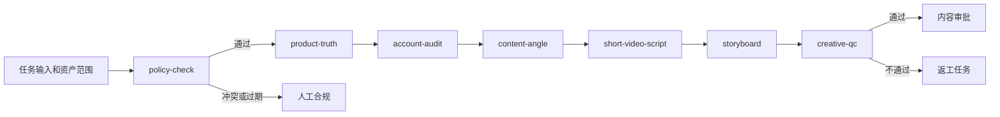
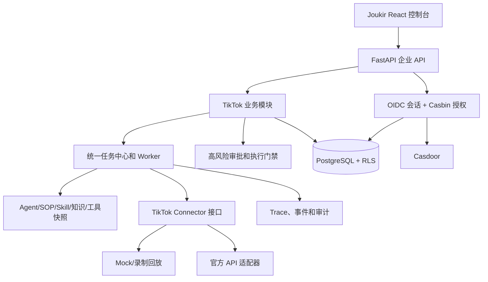

# PRD: 跨境电商数字员工部门平台

> 产品代号：九骥 Joukir（基于 StaffDeck 二次开发）  
> 文档版本：V1.7  
> 文档状态：产品评审稿  
> 日期：2026-09-02  
> 产品负责人：待定  
> 技术负责人：待定  
> 业务负责人：待定  
> 关联方案：[跨境电商数字员工部门综合建设方案（2026）](./crossborder-digital-workforce-integrated-plan-2026.md)  
> 技术底座参考：[局域网多用户共享 Codex 与记忆知识库方案调研（2026）](./lan-multiuser-codex-memory-2026.md)
> V1.1 变更：确定使用 Casdoor 负责身份认证与组织，Casbin 负责授权决策，PostgreSQL Row-Level Security 负责租户数据隔离；增加多语言和机器身份要求。
> V1.2 变更：完成统一任务启动快照与七岗位独立 Casdoor M2M 服务身份；明确 Casdoor 只认证工作负载，StaffDeck/Casbin/RLS 继续执行最终业务授权。
> V1.3 变更：完成七岗位审核后生产只读 SOP、知识库、工具绑定和岗位受限开放广场发布。
> V1.4 变更：高风险审批固定动作内容摘要与业务资源上下文摘要；资源变化自动失效未执行审批，Worker 在连接器调用前二次校验并禁止失效审批重试。
> V1.5 变更：个人记忆支持用户主动提交审核、独立审核人决策、提交快照漂移失效和 append-only 审计；审核结论不改变个人私有范围。
> V1.6 变更：新增 TikTok 事业部组织模型、35 个数字岗位、部门 Skill 能力矩阵、12 条生产 SOP、卖家/达人/TAP/广告资产授权隔离、高风险操作审批和分阶段验收要求；本版本为规划基线，未完成项不得标记为已上线。
> V1.7 变更：冻结 TikTok 事业部推荐实施方案。首期复用七个共享数字员工，仅新增五个 TikTok 专岗，以 12 个实际员工完成试点；采用 Joukir 模块化单体、现有任务/审批/发布快照、项目内审核 Skill、PostgreSQL RLS 和官方授权连接器，不引入第二套工作流引擎、独立向量库或生产期动态 GitHub Skill 安装。

## 1. 产品概述

### 1.1 产品定义

跨境电商数字员工部门平台是一套面向跨境电商公司的企业 AI 工作台。平台以九骥 Joukir 为产品品牌，基于 StaffDeck 的数字员工、SOP、知识检索、工具调用和 Trace 能力进行二次开发，结合局域网多用户身份隔离、独立会话、个人与团队记忆治理，先建设七个职责明确、可协作、可审批、可审计的共享数字岗位：

1. 跨境售后专员
2. Listing 合规专员
3. 物流异常专员
4. 广告巡检专员
5. 美工设计专员
6. 采购专员
7. 运营主管

平台的核心不是提供聊天入口，而是让数字员工按受控 SOP 接收业务任务、查询授权数据、引用有效知识、调用受限工具、提交审批、记录执行证据并完成跨岗位协作。在共享七岗位之上，V1.6 增加 TikTok 事业部，覆盖 BD、短视频、小店运营、投流、TAP 机构、直播和共享治理等部门，形成“真人负责人 + 数字员工 + 业务资产 + 审批人”的完整组织模型。

### 1.2 产品定位

一句话定位：**让跨境电商公司的 SOP 从文档变成可运行、可审批、可复盘的数字员工部门。**

目标客户：拥有多个品牌、店铺或站点，已使用 ERP、WMS、PIM、客服、广告或素材系统，希望通过内网部署降低重复运营成本的跨境电商公司。

### 1.3 产品形态

- 九骥 Joukir 业务工作台：数字员工、SOP、任务、知识、审批、Trace 和运营报告。
- Clay/Codex 专业工作台：面向真人运营、审核和技术人员的隔离式多会话工作区。
- 统一治理服务：Casdoor 管理登录、组织、用户、服务身份和 MFA；Casbin 管理角色、资源、动作和租户域策略；PostgreSQL Row-Level Security（RLS）执行数据层租户隔离。
- 局域网 Web 访问：统一 HTTPS 入口，业务服务和模型服务不直接暴露给浏览器。
- 多语言工作台：登录页、平台导航、通知和系统模板支持语言选择；业务原文、平台规则和证据保持原始语言并明确翻译来源。

## 2. 背景与问题

### 2.1 当前业务问题

| 问题 | 当前表现 | 业务影响 |
|---|---|---|
| SOP 静态化 | 规则保存在文档、表格和员工聊天中 | 流程依赖个人经验，执行不一致 |
| 系统割裂 | 客服、ERP、物流、广告、素材和采购数据分散 | 异常需要多人重复查询与转述 |
| AI 停留在聊天 | AI 能回答，但不能持续执行业务流程 | 难以形成稳定产能和责任边界 |
| 知识版本混乱 | 不同国家、平台和类目的规则混用 | Listing 违规、售后误判和返工 |
| 高风险动作缺少治理 | 退款、调价、发布和下单依赖口头确认 | 资金、库存、账号和合规风险 |
| 过程不可追溯 | 无法完整回答 AI 使用了哪些数据和工具 | 难以审计、复盘和持续改进 |
| 多用户数据边界弱 | 共享账号、工作区或记忆容易串域 | 客户、店铺、供应商和凭据泄露 |

### 2.2 产品机会

跨境电商业务具有高频任务、明确时限、多平台规则、固定岗位分工和大量结构化系统数据，适合采用“数字员工 + SOP + 工具 + 审批 + Trace”的产品模型。平台先承担信息收集、检查、分类、草稿和建议，再逐步开放可控、可幂等、可回滚的低风险执行动作。

## 3. 产品目标与成功指标

### 3.1 产品目标

- 将七个岗位的核心职责固化为可配置的数字员工和 SOP。
- 建立按公司、品牌、店铺、平台、站点、岗位和用户隔离的权限模型。
- 打通客服、ERP、物流、PIM、广告、DAM 和采购系统的受控读取链路。
- 建立高风险动作审批中心，确保模型不能绕过人工决策。
- 建立个人记忆、岗位知识、业务知识和公司知识的审核与生命周期。
- 通过 Trace 和业务指标证明数字员工的质量、效率和成本收益。
- 建立 TikTok 事业部的部门、岗位、Skill、SOP、知识库和平台资产模型，严格隔离 Seller、Creator、Partner/TAP、广告账户与 TikTok 账号权限。

### 3.2 北极星指标

**有效闭环任务数**：在目标时限内，由数字员工完成信息收集、规则判断、结果输出并被人工采纳或按审批执行的任务数。

有效闭环必须同时满足：任务成功、引用可追溯、无越权、无重大错误、结果被采纳或形成有效后续动作。

### 3.3 MVP 成功指标

| 指标 | MVP 门槛 | 统计口径 |
|---|---:|---|
| 售后建议采纳率 | >= 70% | 被人工直接采用或轻微修改的建议/有效建议总数 |
| 售后政策引用正确率 | >= 95% | 引用适用且版本有效的任务/有引用任务 |
| 物流重大异常漏检 | 0 | 标准评测集及试点期间已知重大异常 |
| 普通售后建议完成时间 P95 | <= 120 秒 | 排除外部平台明确故障和人工等待 |
| 未授权跨租户/跨用户/跨店铺读取 | 0 | Casbin、RLS、安全测试与生产审计 |
| 高风险动作绕过审批 | 0 | 工具调用审计 |
| 授权决策审计完整率 | 100% | 包含租户、主体、资源、动作、策略版本和决策原因的请求/需审计请求 |
| P0 语言缺失键 | 0 | 简体中文和英文登录、工作台、通知及错误状态回归测试 |
| Trace 完整率 | 100% | 有输入、知识引用、工具、审批与结果链路的完成任务 |
| 试点用户周活跃率 | >= 70% | 每周完成至少 3 个有效任务的试点用户/试点用户 |

### 3.4 中期业务指标

- 客服平均处理时长降低 30% 以上。
- 物流异常发现时延降低 50% 以上。
- Listing 发布前返工率降低 30% 以上。
- 设计 Brief 一次完整率达到 90% 以上。
- 采购延期和断货风险提前发现率持续提升。
- 广告建议经人工批准后的 7 天和 14 天增益可回溯。

## 4. 非目标

- MVP 不支持模型自动发起退款、补发、采购订单、付款、Listing 发布或广告调价。
- MVP 不覆盖所有电商平台和所有国家规则，只支持试点确认的平台、站点和店铺。
- MVP 不替代 ERP、WMS、PIM、DAM、客服或广告系统的主数据职责。
- MVP 不承诺数字员工生成内容可免除法律、税务、知识产权或平台合规审核。
- MVP 不建设通用 BI 平台，仅展示数字员工运营和关键业务风险指标。
- MVP 不允许多人共享一个个人 Codex 或 ChatGPT 登录。
- MVP 不为每个租户单独部署一套应用和数据库，默认采用共享 Schema 与 PostgreSQL RLS；合同或合规要求物理隔离的客户另行评估。
- P0 多语言不包含所有站点语言，仅交付简体中文和英文；业务证据的自动翻译不替代人工合规审核。

## 5. 用户与角色

### 5.1 真人角色

| 角色 | 核心诉求 | 主要权限 |
|---|---|---|
| 平台管理员 | 管理租户生命周期和平台安全 | 创建、停用租户及平台配置；默认不读取租户业务原文 |
| 公司管理员 | 管理本租户组织、系统和安全边界 | 本租户用户、角色、店铺范围、模型、连接器和审计配置 |
| 运营经理 | 掌握跨岗位风险和经营动作 | 查看汇总、分派任务、审批运营动作、发布 SOP |
| 客服主管 | 提升工单效率并控制补偿风险 | 查看售后任务、接管、审批退款/补发建议 |
| Listing/合规人员 | 降低违规和发布返工 | 管理规则、审核检查结果、批准发布建议 |
| 物流人员 | 及时发现并闭环履约异常 | 查看异常、确认原因、批准物流处置 |
| 广告人员 | 降低浪费并提高广告效率 | 查看建议、审核数据口径、批准广告动作 |
| 设计人员 | 获取清晰 Brief 并管理素材版本 | 查看设计任务、上传版本、提交审核 |
| 采购人员 | 管理补货、交期、成本和供应商风险 | 查看建议、供应商资料和采购任务 |
| 审批人 | 控制资金、账号、库存和合规风险 | 在授权范围内批准、拒绝或要求补充材料 |
| 审计员 | 调查事件并验证流程 | 只读访问审计、Trace 和配置版本，不读取明文密钥 |

### 5.2 数字岗位

每个数字岗位必须具备以下产品对象：

- 岗位档案：名称、编号、职责、服务范围、负责人和状态。
- 能力档案：SOP、知识、工具、模型和输出 Schema。
- 权限档案：品牌、店铺、平台、站点、字段和工具动作。
- 版本档案：配置版本、生效时间、发布人和回滚版本。
- 工作记录：任务、Trace、人工接管、反馈和 KPI。

### 5.3 组织关系

- 平台级 Host 管理租户生命周期和平台配置，不承载租户业务数据操作。
- 一个客户公司对应一个 `tenant` 和一个 Casdoor Organization。
- 部门是租户内的管理和授权范围，不单独创建 Casdoor Organization。
- 品牌、店铺、平台、站点和项目是业务资源范围，可同时分配给真人角色和数字岗位。
- 同名部门、用户、角色、店铺和数字员工可存在于不同租户，所有唯一性和查询均包含 `tenant_id`。
- 运营主管可以在本租户内汇总部门结果，不能跨租户聚合或训练。



### 5.4 TikTok 事业部组织原则

- TikTok 事业部属于租户内业务单元，不创建新的 Casdoor Organization；组织、部门、岗位和资产授权始终包含 `tenant_id`。
- 每名真人用户仅加入一个主岗位组；临时项目、审批权和资产范围通过 Casbin 策略单独授予，避免用多个岗位组叠加出隐式权限。
- BD、短视频、小店运营、投流、TAP 和直播为生产部门；事业部办公室与共享治理中心承担目标管理、财务、数据、合规、权限和审计职责。
- Seller、Creator、Partner/TAP、广告账户和 TikTok 账号是不同授权域，不允许共用访问令牌、浏览器 Cookie、服务身份或默认资产范围。
- 数字员工不得因为同属 TikTok 事业部而自动获得跨部门数据；跨部门任务通过任务中心派单，并固定输入、授权、SOP、知识和工具版本快照。
- 完整组织架构、岗位编制和能力矩阵见第 25 章。

## 6. 版本范围与优先级

### 6.1 P0: MVP

- Casdoor 统一登录、企业组织、用户生命周期、MFA 和机器身份。
- Casbin 租户域 RBAC/ABAC、角色、资源、动作和业务范围授权。
- PostgreSQL 强制 `tenant_id`、组合约束和 RLS 租户隔离。
- 简体中文和英文的登录页、工作台、通知和用户语言选择。
- 数字员工档案、版本、启停和岗位权限。
- 任务中心、SOP 执行、人工接管、Trace。
- 知识库的上传、审核、发布、版本、引用和撤回。
- 连接器管理及只读接口调用。
- 审批中心和高风险动作门禁。
- 跨境售后专员、物流异常专员、运营主管。
- 日报、异常汇总和基础运营看板。
- 多用户 Codex 独立身份、Thread、工作区和个人记忆。

### 6.2 P1: 业务扩展

- Listing 合规专员。
- 美工设计专员。
- 采购专员。
- PIM、DAM、采购和供应商系统连接器。
- 新品上线、质量反馈和补货协同流程。
- 团队知识晋升、冲突和过期管理。
- 低风险内部写操作，例如创建任务、保存草稿、上传新素材版本。

### 6.3 P2: 优化与受控执行

- 广告巡检专员。
- 广告、利润和活动数据连接器。
- 建议效果回溯和实验对比。
- 经评测批准的低风险自动执行。
- 更细粒度的审批策略、动作额度和双人审批。
- 多数字员工自动协作、容量扩展和高级成本控制。

### 6.4 P3: TikTok 事业部扩展

- 建立 BD、短视频、小店运营、投流、TAP 机构、直播、事业部办公室和共享治理中心。
- 保留 35 个 TikTok 数字岗位模板作为目标能力目录；P3-A 试点复用七个共享数字员工，仅新增五个 TikTok 专岗，共启用 12 个实际员工，并为每个实际员工分配独立 Casdoor M2M 服务身份。
- 建立 TikTok Shop Seller、Creator、Partner/TAP、Business Center、广告账户和 TikTok 账号资产台账及授权快照。
- 上线 12 条跨部门生产 SOP、10 类知识库、Skill 注册表、评测集和发布门禁。
- 首期仅开放官方 API 或企业已授权数据源的读取、分析、草稿、内部派单和审批；发布、发送消息、调价、调预算、修改佣金、创建活动等外部写动作默认禁用。
- 经真实连接器契约测试、影子运行、审批演练和业务签字后，按资产、动作、金额、地区和时间窗灰度开放受控写操作。

## 7. 信息架构

### 7.1 一级导航

| 导航 | 目标用户 | 核心内容 |
|---|---|---|
| 工作台 | 全部用户 | 待办、异常、任务进度、待审批和常用数字员工 |
| 数字员工 | 业务人员、管理员 | 员工列表、岗位档案、能力、权限、版本和 KPI |
| 任务中心 | 全部业务用户 | 新建、分派、运行、接管、批注、重试和归档 |
| SOP 中心 | 运营、管理员 | SOP 编辑、版本、测试、发布和回滚 |
| 知识中心 | 业务专家、管理员 | 证据、知识、审核、冲突、引用、过期和删除 |
| 审批中心 | 审批人 | 待审批、已审批、驳回、过期和执行结果 |
| Trace | 业务负责人、审计员 | 意图、检索、工具、审批、人工接管和结果 |
| 运营报告 | 运营与管理层 | 日报、周报、岗位 KPI、异常趋势和成本 |
| 连接器 | 管理员、技术人员 | 系统连接、凭据、范围、动作、限流和健康状态 |
| 系统管理 | 管理员、审计员 | 用户、角色、业务范围、模型、配额、审计和告警 |

### 7.2 工作台布局要求

- 顶部展示当前公司、品牌、店铺和站点范围，切换范围时刷新全部数据。
- 首页第一屏展示“待我处理”“待我审批”“重大异常”“运行中任务”。
- 所有风险卡片必须显示来源时间、适用范围和数据新鲜度。
- 所有数字员工结果提供“查看依据”“人工接管”“反馈错误”“创建后续任务”操作。
- 当数据过期、连接器故障或知识冲突时，界面必须显式告警，不能只显示正常结果。

## 8. 核心对象与状态

### 8.1 任务状态



任务必须记录每次状态变化的操作者、时间、原因和关联 Trace。外部写操作成功但任务状态回写失败时，系统必须先查询幂等执行结果，不得直接重试。

### 8.2 审批状态

- `pending`：等待审批。
- `needs_information`：需要补充材料。
- `approved`：批准，尚未执行。
- `rejected`：拒绝并结束。
- `expired`：超过有效期。
- `canceled`：发起方取消。
- `executing`：连接器正在执行。
- `executed`：外部动作确认成功。
- `execution_failed`：执行失败，需要人工处理。
- `compensated`：已执行补偿或回滚动作。

### 8.3 知识状态

- `draft`：草稿，不参与生产检索。
- `pending_review`：等待授权人员审核。
- `published`：已发布，可在授权范围检索。
- `conflicted`：与其他有效知识冲突，检索时必须提示。
- `superseded`：已被新版替代，保留引用链。
- `expired`：超过有效期，不作为默认答案。
- `withdrawn`：被授权人员撤回。
- `deleted`：进入删除流程并清理派生数据。

## 9. 平台功能需求

### 9.1 FR-001 统一身份与组织

**优先级：P0**

功能要求：

- Casdoor 作为统一身份提供方（Identity Provider，IdP），九骥 Joukir 业务服务作为 OpenID Connect（OIDC）客户端和资源服务。
- Web 登录使用 Authorization Code Flow 和 Proof Key for Code Exchange（PKCE），正式环境支持 MFA、会话撤销和密钥轮换。
- 一个客户公司对应一个 Casdoor Organization 和一个平台 `tenant`。普通业务用户只能属于一个生产租户；跨公司服务人员使用独立账号和显式租户授权，不隐式切换身份。
- 支持公司、部门、用户、角色、品牌、店铺、平台、站点和项目范围；Casdoor 维护身份与组织主数据，平台维护业务范围主数据。
- 支持用户邀请、启用、停用、强制登出、密码策略、会话有效期和登录失败锁定策略。
- 支持平台超级管理员、租户管理员、运营负责人、部门主管、操作员、审批人和审计员分权。
- Casdoor Token 至少包含稳定主体标识、签发方、受众、有效期和组织标识。业务服务根据主体标识查询平台授权上下文，不直接信任前端提交的角色和租户信息。
- 用户提交的 `tenant_id`、`user_id`、`store_id`、`project_id` 仅作为资源定位条件，服务端必须根据已验证 Token 重新解析并校验。
- 每个生产数字员工使用独立 Casdoor M2M Client 或服务账号，禁止多个数字岗位共享一个客户端密钥，禁止与真人账号共用凭据。
- 数字员工实际权限为服务身份、数字岗位、任务范围、连接器范围和审批策略的交集。
- 所有登录、退出、Token 撤销、用户状态、角色和组织变更进入不可修改的授权审计链。

验收标准：

1. 租户 A 的用户、管理员和数字员工均无法读取或修改租户 B 的任务、Thread、知识、审批、Trace 和连接器配置。
2. 停用用户或服务账号不能新建、恢复或继续任何任务，已有高风险任务在下一步骤执行前重新鉴权。
3. 角色、组织或店铺范围变更在 5 分钟内对新请求生效；强制登出和账号停用在 1 分钟内阻止新会话。
4. Token 签发方、受众、签名、有效期或组织标识任一校验失败时返回未认证或拒绝，不回退到匿名权限。
5. 所有允许和拒绝事件均写入审计日志，并包含 `tenant_id`、主体、角色、资源、动作、策略版本和决策原因。
6. 至少完成两个租户、两个部门、两名同名用户和两个服务账号的隔离测试。

### 9.2 FR-005 多语言与区域偏好

**优先级：P0**

功能要求：

- P0 支持简体中文 `zh-CN` 和英文 `en`；P1 增加日文 `ja`、德文 `de`、法文 `fr` 和西班牙文 `es`。
- Casdoor 登录、注册、MFA、邀请和错误提示与九骥 Joukir 工作台使用一致的语言选择。
- 语言解析顺序为：当前用户主动选择 > 用户已保存语言 > 租户默认语言 > 浏览器语言 > 系统默认英文。
- `tenants` 保存默认语言、时区、日期格式和默认币种；`users` 保存个人语言和时区偏好。
- 登录时向身份服务传递语言上下文；登录后语言切换无需重新认证，并在后续会话中保持。
- 系统导航、状态、权限名称、通知和内置 SOP 模板使用翻译键，不在业务代码中硬编码中文文本。
- 客户消息、平台规则、合同、Listing 和证据保留原始语言。机器翻译必须标记源语言、目标语言、翻译时间和模型或服务版本。
- 数字员工的输出语言由任务指定语言、用户语言和租户默认语言共同决定；引用和证据标题不得因界面切换而篡改原文。
- 日期、时间、数字和币种按用户区域偏好显示，但数据库存储统一使用 UTC 时间和明确币种代码。

验收标准：

1. 用户可在登录页和工作台切换简体中文或英文，退出并重新登录后保持选择。
2. 租户管理员可设置默认语言和时区，新用户首次登录使用租户默认值。
3. 中英文状态、菜单、错误提示和邀请通知不存在混用、缺失键或布局溢出。
4. 同一任务切换界面语言后，原始客户消息、规则证据和审计内容保持不变。
5. 接口返回机器可读错误码，前端根据语言包显示文本，不依赖后端拼接固定语言错误消息。

### 9.3 FR-010 数字员工管理

**优先级：P0**

功能要求：

- 创建、复制、编辑、测试、发布、停用和归档数字员工。
- 配置岗位、编号、职责、服务风格、负责人和访问范围。
- 绑定 SOP、知识库、工具、模型、输出 Schema 和审批策略。
- 配置岗位允许读取的数据字段和允许调用的工具动作。
- 绑定独立 M2M 服务身份、Casbin 角色、租户、部门和店铺范围；未绑定有效服务身份不得发布到生产。
- 每次发布生成不可变版本，支持查看差异和一键回滚。
- 展示任务量、成功率、人工接管率、建议采纳率、成本和质量反馈。

验收标准：

1. 未发布版本不得处理生产任务。
2. 运行中任务固定使用启动时的员工、SOP、知识和工具版本。
3. 回滚后新任务使用目标版本，历史 Trace 保留原版本。
4. 数字员工权限不得超过发起用户和业务范围权限的交集。
5. Trace 可区分真人发起者、数字员工服务身份和最终审批人。

### 9.4 FR-020 任务中心

**优先级：P0**

功能要求：

- 支持手工创建、API 创建、定时任务和跨岗位事件创建任务。
- 支持按岗位、状态、品牌、店铺、平台、站点、风险、负责人和时间筛选。
- 任务详情展示输入、当前步骤、引用、工具调用、审批、输出、反馈和后续任务。
- 支持取消、人工接管、交回、补充材料、重试和归档。
- 支持批量创建只读巡检任务，但高风险操作不得批量自动批准。
- 支持任务优先级和截止时间，优先级顺序为客户/平台时限、履约异常、合规风险、经营优化和管理报表。

验收标准：

1. 重复事件使用幂等键合并，不重复创建相同外部动作。
2. 取消任务后未开始的工具调用不再执行。
3. 任务失败显示可理解的失败阶段、错误分类和建议处理方式。
4. 人工接管后的所有操作继续记录在同一 Trace。

实施状态（2026-09-02）：

- 已完成统一岗位队列、报告后续事项幂等入队、岗位权限隔离、证据回链和状态 Trace。
- 已完成岗位数字员工 Worker、独立执行会话、Run 记录、PostgreSQL 租约、过期恢复、指数退避和 generation fencing。
- 已完成人工接管、交回数字员工、取消门禁和旧执行结果忽略；自动分析完成后只进入人工复核，不直接完成高风险业务动作。
- 本地演示部署保持 `sandbox` 执行模式；`live` AgentLoop 路径已接入，但未开启任何外部业务写操作。
- 任务领取事务内为每个 Run 固定数字员工档案与 Persona、全部当前可见且已发布 SOP 内容/版本、知识库版本 ID、工具调用摘要和服务身份摘要，并生成完整 SHA-256 快照摘要。
- `work_task_execution_snapshots` 在 PostgreSQL 中按租户强制 RLS、每个 Run 唯一且只允许追加；数据库触发器拒绝更新和删除。Run、快照、任务、数字员工和服务身份相互绑定。
- SOP 仅可替换仍对该员工可见的当前能力，不可借历史快照恢复已撤销授权；知识检索固定到启动版本 ID；工具配置摘要漂移时失败关闭，不复制或重放旧 Secret。
- 已为运营主管、售后、Listing、物流、广告、美工和采购分别建立独立 Casdoor Client Credentials 应用及 Joukir 服务身份映射。任务执行前验证 JWT 签名、签发方、受众、有效期、员工/岗位/租户绑定；任一门禁失败均不回退到共享身份。
- 长效 Client Secret 仅保存在仓库外受 Windows ACL 限制的部署 Secret Store；业务库、任务、快照、Trace 和日志不保存 Secret 或完整 Token。Trace 仅保存身份、有效期和不可逆指纹。

### 9.5 FR-030 SOP 中心

**优先级：P0**

功能要求：

- 支持可视化或结构化编辑步骤、条件、分支、循环、工具、审批和结束条件。
- 支持自然语言生成 SOP 草稿，但发布前必须人工审核。
- 支持中途暂停、跨流程切换、恢复和人工接管。
- 支持测试环境、样例输入、预期输出和步骤级断言。
- 支持 SOP 版本、差异、发布、回滚、适用范围和生效时间。
- 支持超时、最大重试、最大循环次数和整体截止时间。

验收标准：

1. SOP 未通过测试和审核不得发布。
2. 高风险工具步骤必须绑定审批策略，删除审批节点时阻止发布。
3. 流程恢复后从最近一次确认的状态继续，不重复已确认的外部写动作。
4. 每个步骤都能在 Trace 中定位输入、输出、耗时和版本。

### 9.6 FR-040 知识中心

**优先级：P0**

功能要求：

- 支持文档、网页快照、表格、结构化记录和人工知识条目。
- 每条知识配置平台、国家、品牌、店铺、SKU、岗位、数据分类和有效期。
- 区分原始证据、知识声明和派生索引，修改知识不得覆盖原始证据。
- 支持草稿、审核、发布、冲突、替代、过期、撤回和删除。
- 检索前先执行身份、范围、分类、有效期和删除状态过滤。
- 数字员工引用知识时返回稳定 ID、标题、版本、适用范围和来源。
- 支持“此知识错误”“规则已过期”“适用范围不符”的反馈。

验收标准：

1. 未授权知识不得进入候选集，向量相似度不能绕过权限。
2. 过期知识默认不用于结论，除非任务明确要求历史回溯。
3. 冲突知识必须同时提示冲突状态和来源，不得静默选择。
4. 删除流程覆盖原文、切片、向量、缓存和备份生命周期记录。

### 9.7 FR-050 连接器中心

**优先级：P0**

功能要求：

- 管理 ERP、WMS、TMS、PIM、客服、广告、DAM、采购和供应商系统连接器。
- 每个连接器配置店铺范围、凭据、允许动作、字段、限流、超时、重试和健康检查。
- 凭据只保存在服务端加密存储，接口和日志不返回明文。
- 支持只读模式、沙箱模式和生产模式。
- 写操作必须支持幂等键或执行前后查询，无法保证幂等的动作默认禁止自动重试。
- 展示最近同步时间、游标、错误率、限流和数据新鲜度。

验收标准：

1. Agent Prompt、浏览器和 Trace 中不出现明文平台密钥。
2. 连接器停用后新任务不得调用，运行中高风险动作进入人工确认。
3. 店铺 A 的连接器凭据不能访问店铺 B。
4. 数据陈旧超过阈值时，相关数字员工必须显示警告并禁止高风险建议自动执行。

### 9.8 FR-060 审批中心

**优先级：P0**

功能要求：

- 支持按动作、金额、店铺、风险、岗位和数据分类配置审批规则。
- 提交、查看、批准、拒绝和委托分别执行 Casbin 动作鉴权，并校验审批单 `tenant_id` 与当前数据库租户上下文一致。
- 审批单展示旧值、新值、影响范围、理由、证据、SOP 版本、工具版本和回滚方式。
- 支持批准、拒绝、要求补充、取消、过期和委托。
- P1 支持双人审批和职责分离。
- 审批通过后由连接器执行，不允许前端直接调用生产写接口。
- 审批内容发生实质变化时，原审批失效并生成新审批单。

验收标准：

1. 无审批记录或审批已过期时，高风险工具调用失败关闭。
2. 审批人只能批准其角色、金额和业务范围内的动作。
3. 执行结果、失败和补偿动作回写同一审批链路。
4. 审批人不能修改数字员工原始理由和证据，只能追加意见。

### 9.9 FR-070 Trace 与审计

**优先级：P0**

功能要求：

- Trace 展示任务意图、SOP 步骤、模型调用、知识检索、工具调用、审批、人工接管和最终结果。
- 每个事件包含时间、主体、版本、业务范围、输入摘要、输出摘要、耗时和结果。
- 身份与授权事件包含 Casdoor 主体、Organization、`tenant_id`、真人或 M2M 类型、Casbin 策略版本、资源、动作、允许或拒绝和决策原因。
- 敏感数据按角色脱敏，审计员可查看访问记录但不默认查看明文。
- 支持在当前租户范围内按任务、用户、数字员工、店铺、工具、审批和时间检索，禁止平台级默认跨租户搜索。
- 支持导出经脱敏的事故调查包。
- 审计日志采用追加语义，普通管理员不能修改历史事件。

验收标准：

1. 完成任务的 Trace 完整率达到 100%。
2. 任何生产写动作都能定位发起人、审批人、工具版本和外部结果。
3. 审计写入失败时，高风险写动作停止。
4. 导出行为本身记录在审计日志中。

### 9.10 FR-080 运营报告

**优先级：P0**

功能要求：

- 运营主管按固定时间聚合各岗位的结构化摘要。
- 日报展示重大异常、今日待办、待审批、逾期、数据缺失和关键指标。
- 周报展示趋势、重复根因、建议采纳、人工接管、SOP 改进、知识过期和成本。
- 支持按公司、品牌、店铺、平台、站点、SKU 和岗位筛选。
- 报告中的每个结论可跳转到来源任务、指标和 Trace。
- 支持人工批注、确认、驳回和创建后续任务。

验收标准：

1. 报告不复制无必要的客户明细和供应商敏感字段。
2. 无数据或数据陈旧时显示口径与时间，不生成虚假趋势。
3. 同一异常被多个岗位上报时按业务键归并，保留全部来源。
4. 管理者批注仅形成候选知识，不自动修改已发布 SOP。

### 9.11 FR-090 多用户 Codex 与个人记忆

**优先级：P0**

功能要求：

- 每位真人绑定独立 Codex profile、`CODEX_HOME`、Thread owner 和工作区白名单。
- 支持同一用户多个独立 Thread，支持恢复、分叉、归档和删除。
- MCP capability 绑定用户、Session 和项目，缺失或不匹配时拒绝。
- Turn 完成后异步提取个人候选记忆，不影响主会话。
- 个人记忆支持查看、编辑、删除、导出和提交团队审核。
- 非互信用户使用 OS 用户、容器或 VM 进行文件与进程隔离。

验收标准：

1. 用户 A 即使知道用户 B 的 Thread ID，也不能 list、read、resume、fork、archive 或审批。
2. 用户 A 的 Shell 和工具不能读取用户 B 的工作区、凭据和记忆。
3. 个人记忆默认私有，不自动进入岗位或团队知识。
4. 删除用户后，Thread、个人记忆、向量和缓存按策略进入删除流程。

## 10. 数字岗位需求

### 10.1 DE-001 跨境售后专员

**优先级：P0**

输入：客户消息、渠道、订单号、店铺、语言、历史工单。  
输出：问题分类、订单与物流摘要、适用政策、建议方案、当地语言回复草稿、风险等级和待审批动作。

核心流程：

1. 识别平台、店铺、国家、语言和订单。
2. 查询订单、付款、发货、物流、SKU 和历史售后。
3. 分类为售前、未收到、破损、错发、退货退款、使用问题、投诉或其他。
4. 按适用范围检索政策与 FAQ。
5. 生成处理建议和回复草稿。
6. 命中金额、争议、安全、隐私或舆情规则时进入审批或人工接管。
7. 完成后创建质量、物流或 Listing 后续任务。

异常处理：订单不存在、客户身份不匹配、物流数据陈旧、政策冲突、重复索赔和平台截止时间临近时，必须升级人工处理。

### 10.2 DE-002 物流异常专员

**优先级：P0**

输入：订单履约、仓库出库、承运商轨迹、渠道 SLA、清关和库存事件。  
输出：异常类型、影响订单、原因假设、证据、优先级、建议动作和负责人。

核心能力：

- 识别待发货超时、未上网、轨迹停滞、清关异常、妥投争议和预约异常。
- 按承运商、渠道、仓库、国家、SKU 和批次聚类。
- 计算平台截止时间和客户影响等级。
- 为售后提供沟通建议，为采购提供交期风险，为运营主管提供重大异常。
- 相同订单和状态事件使用业务键去重。

### 10.3 DE-003 运营主管

**优先级：P0**

输入：各岗位结构化结果、审批、经营指标、活动日历和管理者批注。  
输出：日报、周报、重大风险、跨岗位冲突、待审批、逾期任务和 SOP 改进建议。

核心能力：

- 按风险、金额、时限、客户影响和库存影响排序。
- 检测广告增量与断货、设计卖点与合规、补货与资金等冲突。
- 创建、分派、升级和跟踪跨岗位任务。
- 只读取必要摘要，需要明细时按权限跳转来源任务。
- 不能替代有权真人批准资金、发布和账号动作。

### 10.4 DE-004 Listing 合规专员

**优先级：P1**

输入：标题、五点、描述、A+、属性、关键词、图片文字、视频脚本、SKU 事实和规则版本。  
输出：问题位置、风险等级、命中规则、证据、修改建议和发布门禁结果。

核心能力：

- 按平台、站点、类目和生效日期选择规则。
- 检查禁限词、认证、尺寸、标签、知识产权和事实一致性。
- 检查多语言版本是否改变产品事实或风险表述。
- 区分阻断问题、警告问题和优化建议。
- 发布前终审必须使用已批准的素材和 SKU 事实版本。

### 10.5 DE-005 美工设计专员

**优先级：P1**

输入：产品事实、品牌规范、平台素材规则、目标受众、广告数据、历史素材和设计需求。  
输出：Creative Brief、构图建议、素材草稿、合规检查、版本记录和验收结果。

核心能力：

- 生成包含尺寸、语言、卖点、场景、必备素材和截止时间的 Brief。
- 调用受控图像生成或编辑工具创建草稿，记录来源和生成参数。
- 检查尺寸、清晰度、文字安全区、Logo、品牌色、产品事实和版权状态。
- 新版本不得覆盖源文件，必须保留父版本、创建人和审批状态。
- 主图、品牌资产和敏感宣称素材必须人工批准。

### 10.6 DE-006 采购专员

**优先级：P1**

输入：销量、可售库存、在途、广告计划、活动、MOQ、交期、报价、质检和资金约束。  
输出：补货建议、采购风险、供应商比较、交期预警和待审批采购动作。

核心能力：

- 计算并展示补货建议所用口径，不隐藏预测输入。
- 识别采购延期、价格变化、MOQ 变化、质检异常和包装变更。
- 将断货风险发送广告和运营，将质量问题发送售后与 Listing。
- 生成询价和谈判草稿，不发送具有合同效力的承诺。
- 采购下单、改价、付款和新增供应商必须人工审批。

### 10.7 DE-007 广告巡检专员

**优先级：P2**

输入：广告花费、销售、ACOS/ROAS、CTR、CVR、搜索词、预算、价格、库存和活动。  
输出：异常、原因假设、证据、建议动作、风险等级和效果回溯计划。

核心能力：

- 识别异常花费、低转化词、预算耗尽、不可售商品、数据断流和素材疲劳。
- 建议必须同时检查利润、库存、价格和活动约束。
- 素材问题创建美工任务，Listing 问题创建合规任务，断货问题创建采购任务。
- 任何预算、竞价、否词、启停和自动规则变更在 P2 前保持人工审批。
- 建议执行后自动生成 7 天、14 天和 30 天回溯任务。

## 11. 跨岗位流程需求

### 11.1 WF-001 售后与质量闭环



验收标准：

- 同一工单的业务、工具、审批和人工操作保存在同一任务链路。
- 客户回复前显示使用的政策版本和数据时间。
- 质量、包装和物流标签可以自动创建跨岗位任务，但不能自动执行采购或发布动作。

### 11.2 WF-002 新品上线闭环

步骤：

1. 采购专员创建供应商、BOM、成本、交期、包装和认证资料。
2. Listing 合规专员检查事实完整性和平台准入要求。
3. 美工设计专员生成 Brief、素材草稿和版本。
4. Listing 合规专员使用已批准的 SKU 与素材版本终审。
5. 人工运营批准发布。
6. 广告巡检专员建立监控基线。
7. 物流专员监控首批履约，售后专员聚合首批 VOC。
8. 运营主管生成 7 天、14 天和 30 天复盘。

门禁：认证缺失、素材未批准、产品事实冲突、规则过期或采购交期不可用时，流程不得进入发布审批。

### 11.3 WF-003 补货与广告协同

- 采购专员输出可售天数、补货建议和交期风险。
- 物流专员补充在途、入仓和清关风险。
- 广告巡检专员输出流量与预算建议。
- 运营主管检测库存与广告冲突，并生成限制增量、降速或加急采购建议。
- 采购订单和广告变更分别进入授权审批人。

### 11.4 WF-004 日报与周报

日报字段：

- 重大异常
- 今日必须处理
- 待审批
- 逾期任务
- 数据缺失或陈旧
- 各岗位完成量与失败量
- 预计业务影响

周报字段：

- KPI 趋势
- 重复异常和根因
- 建议采纳及效果
- 人工接管与推翻原因
- SOP 失败步骤
- 知识冲突、过期和待审核
- 模型与工具成本
- 下周建议动作及负责人

## 12. 权限要求

### 12.1 身份、授权与数据隔离边界

| 组件 | 核心职责 | 明确不负责 |
|---|---|---|
| Casdoor | 登录、MFA、用户、Organization、会话、M2M Client、OIDC Token | 订单、店铺、SOP 等业务资源的最终授权 |
| Casbin | 在 `tenant_id` 域内计算主体对资源动作的允许或拒绝 | 用户密码、登录页面、数据库行过滤 |
| Joukir BFF/API | 验证 Token、组装授权上下文、执行 Casbin 决策、落实审批与字段脱敏 | 自行保存用户密码或信任前端权限状态 |
| PostgreSQL RLS | 在数据库连接和 SQL 层限制可见 `tenant_id` | 替代 API 动作授权和审批策略 |
| Trace/Audit | 记录身份、策略、数据范围和最终决策 | 参与实时允许决策 |



授权设计遵循以下约束：

- Casdoor 是身份主数据源，Joukir 只保存稳定的 `casdoor_subject_id` 映射和业务属性，不保存密码。
- Casbin 使用带 Domain 的 RBAC/ABAC 模型，Domain 固定为 `tenant_id`。策略至少包含主体、租户、资源、动作和效果。
- BFF/API 是策略执行点。前端菜单、按钮和路由守卫只改善体验，不能作为最终权限控制。
- PostgreSQL RLS 是数据层第二道防线。Casbin 允许不代表可以跨越当前数据库租户上下文。
- 默认拒绝；显式拒绝优先于允许；策略服务、租户上下文或审批状态不可验证时，高风险动作失败关闭。
- 平台超级管理员的租户支持操作走单独的临时授权流程，要求工单原因、有效期、双人批准和完整审计，不给日常应用连接授予 RLS 绕过权限。

### 12.2 授权决策规则

最终权限取以下集合的交集：

```text
Casdoor 已认证主体与有效会话
∩ Casbin 租户域策略
∩ 真人用户或服务账号范围
∩ 数字岗位范围
∩ 当前任务范围
∩ 连接器凭据范围
∩ 数据分类策略
∩ 审批策略
∩ PostgreSQL 当前租户 RLS
```

任何一项为空、过期、冲突或不可验证时拒绝访问。资源 UUID、前端隐藏、向量相似度和客户端传入的 `tenant_id` 不能作为授权依据。

标准授权请求：

```text
subject = user:<casdoor_subject_id> 或 service:<casdoor_client_id>
domain  = tenant:<tenant_id>
object  = <resource_type>:<resource_id>
action  = <verb>
context = department_id, store_id, marketplace, classification,
          task_id, risk_level, approval_status, policy_version
```

对需要逐行读取的数据，API 先完成 Casbin 动作授权，再在数据库事务中设置服务端解析的租户上下文，由 RLS 过滤数据。禁止先查询全租户数据后在应用内过滤。

### 12.3 真人与机器角色

| 角色代码 | 主体类型 | 主要范围 | 关键限制 |
|---|---|---|---|
| `platform_super_admin` | 真人 | 平台配置和租户生命周期 | 默认不能查看租户业务原文；支持访问必须临时授权 |
| `tenant_admin` | 真人 | 当前租户用户、部门、角色和店铺范围 | 不能修改平台级策略或其他租户 |
| `operations_director` | 真人 | 当前租户跨部门汇总、任务和审批 | 仍受店铺、金额、风险和双人审批限制 |
| `department_manager` | 真人 | 指定部门、店铺和岗位 | 不能配置其他部门数字员工 |
| `operator` | 真人 | 分配的任务和业务范围 | 无角色与用户生命周期管理权限 |
| `approver` | 真人 | 指定动作、店铺、金额和风险等级 | 不能审批本人发起且要求职责分离的动作 |
| `auditor` | 真人 | Trace、审批和授权审计只读 | 不读取明文密钥，不执行生产动作 |
| `agent_service` | M2M | 单一数字岗位、租户和受控工具范围 | 无交互登录，无租户管理权限，不得自行扩大范围 |

### 12.4 权限命名空间

| 资源 | P0 动作权限 |
|---|---|
| 数字员工 | `agent.read`, `agent.configure`, `agent.publish`, `agent.run`, `agent.stop` |
| 任务 | `task.read`, `task.create`, `task.assign`, `task.takeover`, `task.cancel`, `task.approve` |
| SOP | `sop.read`, `sop.edit`, `sop.test`, `sop.publish`, `sop.execute`, `sop.rollback` |
| 知识 | `knowledge.read`, `knowledge.edit`, `knowledge.review`, `knowledge.publish`, `knowledge.withdraw` |
| 连接器 | `connector.read`, `connector.configure`, `tool.invoke`, `credential.rotate` |
| 审批 | `approval.read`, `approval.submit`, `approval.approve`, `approval.reject`, `approval.delegate` |
| Trace 与审计 | `trace.read`, `trace.export`, `audit.read`, `authz_audit.read` |
| 报表 | `report.read`, `report.generate`, `report.export` |
| 租户管理 | `tenant.read`, `member.manage`, `role.manage`, `scope.manage`, `locale.manage` |

权限名称必须映射到稳定业务动作，不以页面按钮或接口 URL 作为长期权限名称。角色只聚合权限，业务代码不得用角色名称替代动作鉴权。

### 12.5 数字岗位权限矩阵

| 岗位 | 客户/订单 | Listing/PIM | 物流/WMS | 广告 | DAM | 采购/供应商 | 生产写动作 |
|---|---|---|---|---|---|---|---|
| 售后 | 必要字段只读 | SKU 事实只读 | 轨迹只读 | 无 | 说明素材只读 | 无 | 退款/补发需审批 |
| Listing 合规 | 无客户明细 | 读、建议 | 无 | 转化摘要 | 读 | 认证只读 | 发布需审批 |
| 物流异常 | 履约字段只读 | 包装只读 | 读、内部任务写 | 无 | 无 | 交期摘要 | 拦截/调拨需审批 |
| 广告巡检 | 聚合销售 | 状态只读 | 库存摘要 | 明细只读 | 效果只读 | 补货摘要 | 调价/启停需审批 |
| 美工设计 | 无 | SKU 事实只读 | 无 | 效果摘要 | 版本化读写 | 包装只读 | 发布素材需审批 |
| 采购 | 退货原因聚合 | BOM/认证只读 | 库存与在途 | 需求摘要 | 包装只读 | 读、建议写 | 下单/改价/付款需审批 |
| 运营主管 | 授权摘要 | 汇总 | 汇总 | 汇总 | 状态汇总 | 汇总 | 仍按审批矩阵 |

## 13. 数据模型

### 13.1 核心实体

| 实体 | 关键字段 | 数据所有者与约束 |
|---|---|---|
| `tenants` | id, casdoor_org_name, name, default_locale, timezone, status | 租户治理服务；`casdoor_org_name` 唯一且不可复用 |
| `users` | id, casdoor_subject_id, locale, timezone, status | Casdoor 为身份主数据；平台不保存密码；停用后禁止访问 |
| `tenant_members` | tenant_id, user_id, department_id, status | 租户治理服务；所有查询受当前租户 RLS 限制 |
| `roles` | code, subject_type, status, version | 授权服务；角色只聚合权限，代码全局唯一 |
| `permissions` | resource, action, risk_level, status | 授权服务；采用稳定的资源和动作命名 |
| `role_bindings` | tenant_id, subject_type, subject_id, role_id, scope | 授权服务；支持用户和 M2M 主体，范围变更可审计 |
| `casbin_policies` | tenant_id, subject, object, action, effect, version | Casbin 策略存储；发布后版本不可变，支持回滚 |
| `service_accounts` | tenant_id, casdoor_client_id, digital_employee_id, status | 每个生产数字岗位独立机器身份；密钥不进入业务库 |
| `business_scopes` | company, brand, store, platform, region | 治理服务；服务端解析 |
| `digital_employees` | role, version, owner, status | Joukir；发布版本不可变 |
| `sops` | steps, conditions, tools, approvals, version | SOP 中心；运行任务固定版本 |
| `tasks` | type, scope, owner, status, priority, deadline | 任务中心；所有访问校验 scope |
| `task_events` | task, event_type, actor, payload_ref, time | 追加写；用于 Trace 和恢复 |
| `approvals` | action, old/new value, approver, status | 审批中心；实质变更后失效 |
| `connector_actions` | connector, action, idempotency_key, result | 连接器网关；外部动作对账 |
| `evidence_items` | source, hash, scope, classification | 知识中心；原始证据不可被知识修改覆盖 |
| `knowledge_claims` | claim, evidence, validity, review_state | 知识中心；可冲突、替代和撤回 |
| `memory_items` | owner, project, source_turn, visibility | 个人默认私有，团队需审核 |
| `authorization_decisions` | tenant_id, subject, policy_version, resource, action, decision, reason, time | 追加写；记录 Casbin 和业务门禁的最终结果 |
| `audit_log` | actor, action, resource, decision, time | 追加写；业务管理员不可修改 |

### 13.2 PostgreSQL 租户隔离规范

所有租户业务数据采用共享数据库、共享 Schema、行级租户隔离作为 MVP 模型。平台全局配置与租户业务数据分离，具体要求如下：

- 除语言目录、权限目录、平台版本等明确全局表外，所有业务表必须包含 `tenant_id UUID NOT NULL`，并引用 `tenants(id)`。
- 业务唯一约束和查询索引必须以 `tenant_id` 为首列或包含 `tenant_id`。例如店铺编码唯一约束使用 `(tenant_id, store_code)`，不能使用全局 `store_code` 唯一。
- 跨表关系优先使用 `(tenant_id, id)` 组合外键，阻止子表引用其他租户的父记录。
- 所有租户表必须执行 `ENABLE ROW LEVEL SECURITY` 和 `FORCE ROW LEVEL SECURITY`，并分别定义 `USING` 与 `WITH CHECK` 条件。
- 数据库运行角色不得拥有 `SUPERUSER`、`BYPASSRLS`、表所有者或修改 RLS 策略的权限。迁移角色与应用运行角色必须分离。
- BFF/API 在完成 Token 和 Casbin 校验后，在数据库事务内使用 `SET LOCAL app.tenant_id = '<validated-tenant-id>'` 设置租户上下文。租户值只能来自服务端授权上下文。
- 连接池归还连接前必须结束事务并清理上下文。禁止使用跨请求持久化的普通 `SET app.tenant_id`。
- 后台任务、定时任务和数字员工 Worker 必须从不可篡改的任务信封读取 `tenant_id`，并在每次数据库事务和工具调用前重新绑定租户上下文。
- pgvector 检索、全文检索、导出、缓存键、对象存储路径和队列分区均必须携带租户边界，禁止先跨租户召回再在应用层过滤。
- 平台支持人员不得通过日常应用数据库角色绕过 RLS。租户数据导出或支持访问使用独立审批工具和独立审计账号。

RLS 基线示例：

```sql
ALTER TABLE tasks ENABLE ROW LEVEL SECURITY;
ALTER TABLE tasks FORCE ROW LEVEL SECURITY;

CREATE POLICY tasks_tenant_isolation ON tasks
    FOR ALL
    USING (tenant_id = current_setting('app.tenant_id', true)::uuid)
    WITH CHECK (tenant_id = current_setting('app.tenant_id', true)::uuid);
```

验收标准：

1. 关闭应用层 `tenant_id` 过滤后，RLS 仍阻止读取和写入其他租户数据。
2. 伪造请求参数、对象 UUID、分页游标、搜索条件和导出任务均不能改变数据库租户上下文。
3. 使用运行时数据库账号尝试 `SET row_security = off`、修改策略或访问无租户上下文的表时失败关闭。
4. 连接池连续执行租户 A、租户 B、租户 A 请求，结果不存在上下文残留和串租户数据。
5. 跨租户外键、唯一键、批量写入、UPSERT、后台任务和向量检索均有自动化隔离测试。
6. RLS 策略变更通过版本化迁移、预发布验证和回滚脚本发布。

### 13.3 数据保留

- 任务与 Trace：默认保留 1 年，受合同、平台和公司政策调整。
- 审批和生产写动作：默认保留 3 年或按财务与审计政策执行。
- 原始客户消息：按客服和隐私政策最小化保留。
- 个人记忆：用户可见、可编辑、可删除，离职后按组织政策处理。
- 派生向量与缓存：必须跟随源记录删除和权限变化更新。
- 平台密钥与银行信息：不进入知识索引和模型上下文。

## 14. 非功能需求

### 14.1 性能与可用性

| 能力 | MVP 目标 | 正式目标 |
|---|---:|---:|
| 工作台可用性 | 99.5%/月 | 99.9%/月 |
| Casdoor 登录与 Token 服务可用性 | 99.5%/月 | 99.9%/月 |
| 服务端授权决策 P95 | <= 50 毫秒 | <= 30 毫秒 |
| 登录回调处理 P95，不含用户输入和外部 IdP | <= 2 秒 | <= 1 秒 |
| 首个进度事件 P95 | <= 5 秒 | <= 3 秒 |
| 普通售后建议 P95 | <= 120 秒 | <= 90 秒 |
| 物流异常新鲜度 | <= 30 分钟 | <= 10 分钟 |
| 知识审核后索引新鲜度 | <= 30 分钟 | <= 15 分钟 |
| RPO | 24 小时 | 15 分钟 |
| RTO | 8 小时 | 4 小时 |

### 14.2 容量基线

MVP 按 5-20 个租户、每租户 10-50 名真人用户、3-10 个店铺设计，总规模约 50-500 名真人用户。初期总 AI/SOP 任务量按 800-2,000 个/日设计。按 1,500 任务/日、20 倍峰值、平均占用 30 秒估算，峰值并发约 10。初期部署 8-12 个受控 Worker，并通过租户公平队列吸收突发任务。

身份与授权容量按每名活跃用户 8 小时内登录或续期 4 次、每个业务 API 请求至少 1 次服务端授权检查估算。Casbin 策略优先在应用进程内或低延迟授权组件中执行，策略变更通过版本通知刷新，避免每个请求同步查询 Casdoor 管理 API。

扩容触发条件：

- 队列 P95 等待连续 7 天超过 60 秒。
- Worker 利用率连续 7 天超过 70%。
- 单个连接器配额成为主要瓶颈。
- 单个店铺占用超过全局 30% 且影响其他店铺时，启用每租户公平队列。

### 14.3 安全与隐私

- 全部局域网访问使用 HTTPS。
- BFF、数据库、队列、模型和连接器服务不直接对 LAN 暴露。
- Web 客户端不直接持有 Casdoor Client Secret。刷新 Token 优先由 BFF 使用 `HttpOnly`、`Secure` 和合适 `SameSite` 策略的 Cookie 管理。
- BFF 必须验证 OIDC Token 的签名、签发方、受众、有效期、随机值和授权请求状态，防止 Token 替换、重放和登录 CSRF。
- Joukir 不保存用户密码；Casdoor 管理凭据、MFA 和会话。Casdoor 管理 API 凭据只对身份同步服务可见。
- Casbin 默认拒绝并启用显式拒绝优先；授权缓存必须绑定主体、租户、策略版本、资源和动作。
- PostgreSQL 运行账号无 `BYPASSRLS` 和策略修改权限，数据库连接必须使用 TLS，备份和对象存储加密。
- 凭据服务端加密，支持轮换、停用和最小权限。
- 日志、Trace 和导出按角色脱敏。
- 高风险动作失败关闭。
- 跨租户未授权读取容忍度为 0。
- 所有模型输入进行敏感数据分类和最小化。

### 14.4 可靠性

- 只对安全、幂等、处于整体截止时间内的操作自动重试。
- 有副作用工具超时后先查询执行状态，不直接重复执行。
- 队列设置优先级、每租户并发上限、最大任务年龄和死信队列。
- 外部数据陈旧时显示时间戳并禁止高风险自动执行。
- 审批或审计不可用时，高风险动作停止，分析和草稿按策略降级。
- Casdoor 暂时不可用时，仍在有效期内且已完成本地签名验证的会话可继续只读和草稿操作；新登录、续期、用户管理和高风险动作暂停。
- Casbin 策略刷新失败时保留最近一次已验证策略版本；超过策略新鲜度阈值后只读操作可按租户策略降级，高风险和生产写动作失败关闭。
- PostgreSQL 事务缺少有效租户上下文时必须拒绝访问，不允许回退到全局查询。

### 14.5 可观测性

- 指标：吞吐、延迟、错误、队列年龄、Worker、Token、成本、连接器限流和数据新鲜度。
- 身份指标：登录成功率、MFA 失败率、Token 校验失败、会话撤销延迟、Casdoor 依赖可用性和异常登录来源。
- 授权指标：Casbin 决策延迟、允许/拒绝数量、策略版本分布、无租户上下文拒绝、RLS 拒绝和跨租户测试结果。
- 日志：结构化日志包含 `request_id`、`task_id`、`trace_id`、`tenant_id`、`casdoor_subject_id`、`service_account_id`、资源、动作和策略版本，不记录明文密钥或完整 Token。
- Trace：覆盖模型、知识、工具、审批和人工操作。
- 告警：以用户影响、任务逾期、安全事件和业务异常为主，不只监控 CPU 和内存。

## 15. 埋点与分析

### 15.1 产品埋点

| 事件 | 关键属性 |
|---|---|
| `employee_opened` | employee_role, version, user_role, scope |
| `task_created` | source, task_type, role, priority, scope |
| `task_completed` | duration, outcome, human_takeover, cost |
| `suggestion_adopted` | role, edit_distance_band, business_result |
| `suggestion_rejected` | rejection_reason, role, knowledge_ids |
| `approval_decided` | action_type, risk, amount_band, result |
| `knowledge_cited` | claim_id, version, validity, rank |
| `knowledge_feedback` | error_type, task_id, claim_id |
| `tool_called` | connector, action, result, latency, idempotent |
| `report_action_created` | report_type, source_role, risk |

### 15.2 反馈原因枚举

- 结论错误
- 数据过期
- 规则不适用
- 缺少关键信息
- 语言或语气不合适
- 建议不可执行
- 工具调用错误
- 重复任务
- 权限或范围错误
- 其他

反馈必须关联任务、数字员工版本、SOP 版本、知识版本和工具版本，便于定位问题来源。

## 16. 异常与边界场景

1. 一个订单属于多个店铺映射时，暂停执行并要求人工确认业务范围。
2. 知识规则存在冲突时，显示冲突来源并升级审核，禁止给出确定性结论。
3. 外部 API 返回成功但网络超时，使用幂等键或状态查询确认，不直接重试。
4. 用户在任务执行中失去权限，未开始的步骤停止，已完成动作保留审计并通知管理员。
5. 数字员工版本在任务中途发布，当前任务继续固定旧版本，新任务使用新版本。
6. 同一异常被多个岗位发现，按业务键合并为主事件，保留各岗位观察结果。
7. 客户消息包含 Prompt Injection，内容仅作为不可信业务输入，不得改变系统指令或工具权限。
8. 用户要求删除记忆，系统同步清理 Canonical 记录、索引、缓存和后续检索结果。
9. 报告缺少完整数据时，显示缺口和时间范围，不用模型填补不存在的数据。
10. 设计素材来源或版权状态不明确时，标记不可发布并进入人工审核。
11. Token 中的组织标识与请求资源租户不一致时，在业务查询前拒绝并记录高风险授权事件。
12. 数字员工服务账号被停用时，运行中任务在下一步骤前停止，保留已完成动作和 Trace，不切换到其他服务账号继续执行。
13. Casdoor 不可用时，不允许以缓存密码、本地管理员后门或共享账号绕过登录；有效会话仅按降级策略继续。
14. Casbin 策略版本落后或加载失败时，生产写动作失败关闭；只读请求明确记录使用的最近有效策略版本。
15. 用户选择的语言缺少翻译键时回退到英文并上报缺失键，不显示键名，不自动翻译审计和证据原文。
16. 数据库连接池复用连接时检测租户上下文残留，发现残留立即丢弃连接并触发安全告警。

## 17. 发布计划

### 17.1 Milestone 0: 产品和安全基线，1-2 周

- 确认试点店铺、平台、系统接口、数据口径和业务量。
- 完成组织、业务范围、风险分级和审批矩阵。
- 部署 Casdoor 测试环境，创建平台应用、两个测试 Organization、真人用户和数字员工 M2M Client。
- 固化 Casbin Domain RBAC/ABAC 模型、权限命名空间、默认拒绝和策略版本发布方式。
- 完成 PostgreSQL 租户表清单、运行角色、迁移角色、RLS 策略和连接池租户上下文方案。
- 确定简体中文、英文语言包、租户默认语言、用户偏好和回退规则。
- 建立售后、物流和权限评测集。
- 完成两租户、两用户、两服务账号、两工作区和两记忆域的越权验证。

退出条件：OIDC 登录、Casbin 策略、PostgreSQL RLS、Thread、文件、知识和连接器越权测试全部通过，平台凭据不进入浏览器或 Prompt。

### 17.2 Milestone 1: P0 MVP，4-6 周

- 上线 Casdoor 统一登录、MFA、组织、用户生命周期和数字员工 M2M 身份。
- 上线 Casbin 租户域授权、PostgreSQL RLS、简体中文和英文语言选择。
- 上线数字员工、任务、SOP、知识、连接器、审批、Trace 和基础报告。
- 上线跨境售后、物流异常和运营主管。
- 接入一个客服系统、一个 ERP/订单源和一个物流数据源。
- 影子运行，不直接回复客户或执行高风险动作。

退出条件：达到 MVP 成功指标，重大错误和跨租户越权为 0。

### 17.3 Milestone 2: P1 扩展，4-8 周

- 上线 Listing 合规、美工设计和采购专员。
- 接入 PIM、DAM、库存和采购只读数据。
- 上线新品、质量和补货协同流程。
- 开放创建任务、保存草稿和上传新版本等低风险内部写操作。

### 17.4 Milestone 3: P2 优化，3-6 周

- 上线广告巡检、利润约束和建议效果回溯。
- 引入灰度店铺、动作限额、双人审批和低风险自动执行。
- 建立成本看板、岗位质量榜和版本回归机制。

### 17.5 Milestone 4: TikTok 事业部试点，8-12 周

- 第 1 阶段（1-2 周）：完成版本控制基线、组织单元、六个 TikTok 真人主岗位、四类新增数据结构和 PostgreSQL 迁移。
- 第 2 阶段（2-3 周）：发布 12 个原子 Skill 和五个 TikTok 专岗，复用七个共享数字员工，完成任务快照、权限和开放广场联调。
- 第 3 阶段（2-3 周）：上线资产与授权中心、Mock/回放连接器、12 条 SOP 的首批只读路径和统一运营页。
- 第 4 阶段（2-4 周）：接入已获批的 TikTok 官方读取权限，完成影子运行、双租户安全、故障、成本和业务评测；P3-A 不开放外部写操作。

退出条件：第 25.12 节的 P3 UAT 全部通过，跨租户、跨授权域和跨资产越权为 0，严重平台违规和未审批外部写操作为 0。

## 18. 上线门槛与回滚

### 18.1 上线门槛

- 售后建议采纳率 >= 70%。
- 政策引用正确率 >= 95%。
- 标准评测集重大漏检为 0。
- 未授权读取和审批绕过为 0。
- 高风险动作均具备审批、幂等和审计证据。
- 备份恢复和连接器故障降级完成演练。
- 业务负责人、产品负责人、安全负责人共同签字。

### 18.2 回滚触发

- 发生跨用户、跨店铺或跨供应商数据泄露。
- 发生未经审批的资金、发布、库存或广告写操作。
- 连续出现重大政策误用或客户伤害事件。
- 连接器重复执行产生外部副作用。
- Trace 或审计无法还原关键动作。

回滚方式：关闭相关数字员工或连接器写权限，切换为只读检索与草稿模式，保留历史任务和审计，人工核对已执行动作。

## 19. UAT 验收清单

### 19.1 P0 功能验收

- [x] 平台管理员创建租户后自动或受控创建对应 Casdoor Organization 和平台 `tenant` 记录。（本地生产同构验收通过；正式 Casdoor 管理 API 授权为发布门槛。）
- [x] 租户管理员可邀请、启停和强制登出本租户用户，无法查看其他租户用户。（租户生命周期、会话撤销和 Casdoor 对账回归通过。）
- [ ] 正式环境 MFA、OIDC Authorization Code Flow、PKCE、Token 签名与受众校验通过。（除正式环境 MFA/TLS/密钥轮换外，本地 OIDC、PKCE、签名、签发方、受众、state 和重放测试均通过。）
- [x] 管理员可创建角色、店铺范围和数字员工，并通过 Casbin 策略版本发布。（草稿、校验、发布、不可变版本和回滚通过。）
- [x] 每个生产数字员工使用独立 M2M Client；停用服务账号后任务在下一步骤前停止。（七岗位独立身份和执行前/步骤前门禁通过。）
- [x] 简体中文和英文可在登录页及工作台切换，用户偏好和租户默认语言生效。（前端 264 项回归及 i18n 全量扫描通过。）
- [x] Casbin 对用户、服务账号、租户、部门、店铺、资源和动作的允许与拒绝测试全部通过。（默认拒绝、显式拒绝优先和上下文维度回归通过。）
- [x] PostgreSQL RLS、组合外键、UPSERT、批量任务、向量检索、导出和连接池复用隔离测试全部通过。（受限运行账号 PostgreSQL 验收 7/7。）
- [x] 应用运行数据库账号无法关闭 RLS、修改策略或读取无租户上下文的数据。（`staffdeck_runtime` 权限审计和无上下文查询通过。）
- [x] 数字员工发布、版本、回滚和停用可用。（不可变发布快照、漂移拒绝、差异和回滚回归通过。）
- [x] 售后工单可完成查询、分类、引用、草稿、审批和 Trace。（结构化案件全链路通过。）
- [x] 物流巡检可识别、聚类、去重和升级异常。（异常指纹、聚类、幂等升级和解决链路通过。）
- [x] 运营主管可生成带来源的日报并创建后续任务。（不可变报告快照和幂等跟进任务通过。）
- [x] 审批内容变化后原审批自动失效。（P0-14：动作/资源双摘要、资源修订、同步失效、执行前门禁与审计事件已通过聚焦回归并应用 PostgreSQL 迁移。）
- [x] 连接器明文密钥不出现在前端、日志和 Trace。（字段拒绝、脱敏、公开 API 和 M2M 指纹回归通过。）
- [x] 用户、店铺、知识、Thread 和工作区越权测试全部失败关闭。（会话隐私、资源详情、记忆、业务资源和工作区隔离回归通过。）
- [x] Token 租户与资源租户不一致、伪造 `tenant_id` 和对象 UUID 时在业务查询前拒绝。（OIDC 组织映射与业务对象 BOLA 回归通过。）
- [x] 授权审计包含租户、主体、资源、动作、策略版本、允许或拒绝和决策原因。（持久化决策审计回归通过。）
- [x] 个人记忆可查看、删除和提交审核，默认不共享。（P0-19：幂等快照提交、职责分离、内容漂移失效、RLS 和 append-only 审核事件已通过回归并应用 PostgreSQL 迁移。）
- [x] 模型、知识、连接器和审批故障时按设计降级。（依赖健康、陈旧状态、人工接管、重试和未知结果失败关闭通过；正式故障演练仍是发布门槛。）

### 19.2 P1 功能验收

- [x] Listing 可按平台、站点、类目和规则版本检查。（规则版本、证据、事实/IP/翻译发现和发布门禁通过。）
- [x] 美工 Brief、素材版本、来源和审批链路完整。（不可变父子版本、来源、生成参数、质检和人工审核通过。）
- [x] 采购建议展示输入、口径、交期和风险，不直接下单。（MOQ 公式、输入快照和无采购单副作用通过。）
- [x] 新品上线门禁可阻止认证缺失、事实冲突和素材未批准的任务。（完整版本绑定和阻断回归通过。）
- [x] 售后质量问题可闭环到采购、美工和 Listing。（破损/错发结案三岗位幂等派单通过。）

### 19.3 P2 功能验收

- [x] 广告建议同时检查利润、价格、库存和活动约束。（指标与约束快照、盈亏平衡 ACoS、库存阻断和跨岗位任务通过。）
- [x] 建议执行后自动生成效果回溯任务。（成功回执后幂等创建 7/14/30 天任务，运行态 UAT 已验证。）
- [x] 低风险自动执行受灰度、限额、审批和停用开关控制。（独立审批、灰度桶、单次/单日限额、风险上限和熔断账本通过。）
- [x] 任一外部写动作可通过幂等键和 Trace 对账。（通用对账 API、回执身份、冲突失败关闭和可验证逆操作通过；各真实连接器签署仍是发布门槛。）

### 19.4 P3 TikTok 事业部验收

- [ ] TikTok 事业部及 BD、短视频、小店运营、投流、TAP、直播、事业部办公室和共享治理中心可按租户创建、停用和审计。
- [ ] 每名用户仅有一个主岗位组，临时项目与审批权限不通过叠加主岗位组获得。
- [ ] Seller、Creator、Partner/TAP、广告账户和 TikTok 账号授权凭据完全隔离，错误令牌类型和错误资产绑定均失败关闭。
- [ ] 35 个岗位模板可创建；每个实际启用的生产数字员工固定岗位、Skill、SOP、知识、工具、模型和 M2M 身份版本快照。
- [ ] 12 条 TikTok 生产 SOP 均通过正常、缺数据、规则冲突、权限撤销、重复回调、API 超时和人工接管测试。
- [ ] 内容生产任务保存产品事实、素材权利、声明依据、脚本、分镜、生成参数、字幕、审核和发布回执全链路证据。
- [ ] TAP 任务可追踪卖家、达人授权、匹配依据、活动、样品、交付、佣金和结算；未授权消息发送、活动发布和佣金变更全部被拒绝。
- [ ] 直播任务具备开播前检查、商品顺序、价格与库存快照、实时异常升级、违规处置和复盘证据。
- [ ] 广告巡检能区分数据事实、诊断推断和操作建议；调预算、启停广告和改出价必须单独审批。
- [ ] 任何 GitHub Skill 或外部 CLI 在进入生产前均完成许可证、依赖、数据去向、密钥、成本、Prompt Injection 和输出质量审核。
- [ ] TikTok 官方规则知识记录来源 URL、市场、适用主体、版本、生效时间、抓取时间和审核人；过期或地区不明时禁止确定性执行。
- [ ] TikTok 事业部 KPI、日报、周报和 Trace 可按部门、岗位、店铺、账号、活动和直播场次下钻，且不泄露无权查看的原始数据。

## 20. 依赖项

- 九骥 Joukir 可部署版本及其数字员工、SOP、知识、工具和 Trace 能力。
- Clay/Codex 多用户工作台及 per-user `CODEX_HOME` 隔离能力。
- Casdoor 自托管身份服务、OIDC、MFA、Organization、M2M Client 和管理 API。
- Casbin 服务端授权库或授权组件、持久化 Adapter、策略版本和刷新机制。
- PostgreSQL、pgvector、RLS、独立迁移与运行账号、任务队列、对象存储和监控系统。
- 前端国际化框架和版本化语言包；Casdoor 与 Joukir 共用语言代码和回退约定。
- 客服、ERP、WMS/TMS、PIM、广告、DAM 和采购系统的 API 或可授权数据出口。
- OpenAI 兼容模型接口及组织确认的账号和数据处理方式。
- 各平台规则、公司政策、SKU 事实、供应商和素材数据的业务负责人。
- TikTok Shop Developer、Partner Center、Seller Center、Business Center、Ads Manager 及试点市场所需的正式应用、审核权限和 API 配额。
- TikTok Seller、Creator 与 Partner/TAP 分离授权，以及广告账户和 TikTok 账号资产级角色配置；不得以个人 Cookie 或非授权抓取替代。
- StaffDeck AGPL-3.0、Casdoor Apache-2.0、Casbin Apache-2.0 及其他开源组件的许可证和商业使用评估。

## 21. 风险

| 风险 | 等级 | 产品控制 |
|---|---:|---|
| 错误或过期规则导致业务误判 | 高 | 来源、版本、有效期、冲突提示和人工终审 |
| 模型越权调用工具 | 极高 | 服务端 scope、岗位交集、审批、幂等和审计 |
| 多店铺或多用户数据串域 | 极高 | 先授权后检索、独立工作区、跨租户测试 |
| Casdoor 单点故障阻断登录或账号管理 | 高 | 高可用部署、健康检查、密钥备份、有效会话降级和恢复演练 |
| Casdoor 组织与平台租户映射漂移 | 极高 | 唯一映射、幂等同步、周期对账和异常冻结 |
| Casbin 策略错误或缓存过期造成越权 | 极高 | 默认拒绝、策略版本、双人发布、回归测试和决策审计 |
| PostgreSQL RLS 缺失、旁路或连接池上下文残留 | 极高 | FORCE RLS、运行角色无绕过权、迁移门禁和连接池串租户测试 |
| 数字员工共用服务身份导致责任不清 | 高 | 一岗位一 M2M Client、短期凭据、独立停用和 Trace 主体记录 |
| 多语言翻译错误改变业务含义 | 高 | 系统文案与业务原文分离、翻译版本、回退规则和母语审核 |
| 自动退款、调价、发布或下单造成损失 | 极高 | MVP 只建议，高风险动作始终审批 |
| AI 生成素材侵权或虚构卖点 | 高 | 授权素材库、生成记录、品牌与合规双审 |
| 供应商与合同信息泄露 | 极高 | 字段级权限、脱敏、导出审批和受控原文库 |
| 双工作台增加学习和运维成本 | 中高 | 统一 SSO、任务入口、知识、连接器和审计 |
| 外部平台 API 限流或变化 | 高 | 连接器版本、限流、健康检查、降级和契约测试 |
| Seller、Creator、Partner/TAP 令牌混用 | 极高 | 授权域类型校验、独立密钥、独立 M2M、资产绑定和调用前二次校验 |
| TikTok 规则因市场或时间变化导致误判 | 高 | 官方来源、市场标签、生效期、新鲜度、规则冲突升级和人工终审 |
| 达人或视频数据来自未授权抓取 | 极高 | 仅用官方 API、企业授权数据和合规供应商；保存数据来源与授权证据 |
| AI 视频包含虚假商品效果、未授权人物或音乐 | 极高 | 产品事实账本、素材权利账本、合成内容标记、品牌/法务/平台三重审核 |
| TAP 活动、佣金或样品操作造成资金损失 | 极高 | 草稿优先、金额限额、职责分离、双人审批、幂等和对账 |
| 直播期间自动化误操作放大事故 | 极高 | 实时数字员工默认只读告警，暂停、下架、改价和发送由真人控制台确认 |
| 用户不信任数字员工结果 | 中高 | 展示依据、数据时间、人工接管和反馈闭环 |

## 22. 已决策与待决策事项

### 22.1 已决策架构

| 决策 | 结论 | 选择理由 | 复审触发条件 |
|---|---|---|---|
| 身份认证与组织 | Casdoor 自托管 | Apache-2.0；支持 OIDC、Organization、MFA、M2M 和多语言；适合内网及私有部署 | 目标客户要求当前方案无法满足的企业身份协议、委托管理或合规认证 |
| 业务授权 | Casbin Domain RBAC/ABAC | Apache-2.0；支持租户域、角色、属性、显式拒绝和多语言 SDK | 权限关系演化为大规模用户、资源和共享关系图时评估 OpenFGA 等 ReBAC 引擎 |
| 租户数据隔离 | PostgreSQL 共享 Schema + 强制 RLS | 初期运维成本低，支持数据库层第二道隔离，适合 MVP 规模 | 合同要求物理隔离或数据驻留；单租户持续占用超过全局资源 30%；RLS 运维复杂度不可控 |
| P0 多语言 | 简体中文和英文 | 覆盖国内运营团队和海外协作基础场景 | 试点确定日文、德文、法文或西班牙文为上线门槛 |

上述决策由产品负责人、技术负责人和安全负责人共同维护。Casdoor、Casbin 或租户模型变更必须提交架构决策记录、迁移方案、双读或影子验证结果和回滚条件。

### 22.2 待决策事项

以下事项在 Milestone 0 结束前确定：

1. 首个试点平台、站点、品牌和店铺。
2. 首个客服、ERP 和物流系统及其 API 权限。
3. 退款、补发、广告、采购和发布的审批矩阵与金额阈值。
4. 个人记忆、客户消息、Trace 和审计的保留周期。
5. 正式环境采用每人独立 Codex 席位还是组织 API Customer Application。
6. Windows 宿主采用 WSL2 多 Linux 用户、一用户一容器还是 VM 隔离。
7. 模型供应商、数据驻留、敏感数据处理和容灾要求。
8. StaffDeck 修改和网络服务场景下的 AGPL-3.0 合规方案或商业授权。
9. Casdoor 的生产高可用拓扑、备份恢复、密钥轮换和外部企业身份源清单。
10. Casbin 使用进程内 Enforcer 还是独立授权服务，以及策略发布和刷新延迟目标。
11. 哪些大客户需要独立 Schema、独立数据库或独立部署单元。
12. P1 语言优先级、翻译责任人、业务术语表和通知模板审核流程。
13. TikTok 首个试点市场、店铺、广告账户、TikTok 账号、TAP Partner 和达人样本范围。
14. TikTok Shop Affiliate API、Partner API、消息 API、广告 API 的实际审批状态、配额、数据保留和地区限制。
15. 哪些 TikTok 外部写动作进入灰度，分别由谁审批、是否双人审批、额度和回滚方式是什么。
16. 外部视频生成或情报服务的供应商、许可证、数据处理协议、单次成本和可替代方案。

## 23. 需求追踪矩阵

| 业务目标 | 产品模块 | 主要需求 | 验证方式 |
|---|---|---|---|
| 售后提效 | 售后专员、任务、知识、Trace | FR-020, FR-040, FR-070, DE-001 | 历史工单评测与影子运行 |
| 履约风险前置 | 物流专员、连接器、报告 | FR-050, FR-080, DE-002 | 异常回放和故障注入 |
| 发布合规 | Listing、知识、审批 | FR-040, FR-060, DE-004 | 合规/违规混合集 |
| 素材协同 | 美工、DAM、审批 | FR-050, FR-060, DE-005 | 素材版本与门禁测试 |
| 采购协同 | 采购、库存、审批 | FR-050, FR-060, DE-006 | 断货、延期和报价场景 |
| 广告优化 | 广告、报告、回溯 | FR-080, DE-007 | 7/14/30 天效果对比 |
| 跨岗位管理 | 运营主管、任务、报告 | FR-020, FR-080, DE-003 | 冲突场景与日报验收 |
| 多租户登录与授权 | Casdoor、Casbin、PostgreSQL RLS | FR-001, FR-005, FR-070 | OIDC、MFA、策略、RLS、M2M 和串租户测试 |
| 多用户安全 | 身份、Codex、知识、审计 | FR-001, FR-040, FR-070, FR-090 | BOLA、文件和记忆越权测试 |
| 多语言协作 | 登录、工作台、通知、数字员工输出 | FR-005, FR-080 | 中英文切换、回退、布局和原文完整性测试 |
| TikTok 商家增长 | BD、CRM、任务和小店运营 | TT-FR-001, TT-FR-010 | 商机到入驻全链路回放与资产隔离测试 |
| TikTok 内容产能 | 短视频、素材、脚本、分镜和审核 | TT-FR-020, TT-FR-021 | 产品事实、版权、脚本、分镜、字幕和发布门禁测试 |
| TikTok 小店经营 | 小店运营、订单、库存和售后 | TT-FR-030 | 订单、履约、售后和活动场景回放 |
| TikTok 投流优化 | 广告巡检、归因和审批 | TT-FR-040 | 账户巡检、创意疲劳和预算建议评测 |
| TikTok 达人联盟 | TAP、达人、活动、样品和结算 | TT-FR-050, TT-FR-051 | 三类授权隔离、匹配、履约和对账测试 |
| TikTok 直播经营 | 直播计划、场控、商品和复盘 | TT-FR-060 | 开播前、直播中和复盘故障演练 |

## 24. 七岗位生产能力包实施基线（V1.3）

### 24.1 已落地能力包

能力包标识为 `staffdeck.crossborder.production-readonly`，版本为 `1.0.0`。它已经完成工程审核并绑定到 `tenant_demo` 的七个生产岗位，可用于本地生产同构环境的只读巡检、影子运行和人工复核；当前审核范围不包含任何外部业务系统写操作。

| 岗位 | 已发布 SOP/技能 | 已发布知识库 | 已批准工具 | 当前边界 |
|---|---|---|---|---|
| 运营主管 | 跨境运营主管日报周报复盘 | 口径、数据质量、运营节奏、汇总和跟进合同 | 岗位上下文只读查询 | 汇总与生成跟进建议，不代替审批 |
| 售后专员 | 跨境售后案件研判 | 案件输入、退货 RCA、Listing/包装联动、处置边界 | 售后范围上下文只读查询 | 不承诺退款，不执行退款 |
| Listing 合规专员 | Listing 发布前合规审查 | 市场/类目适用性、证据矩阵、内容一致性和发布边界 | Listing 范围上下文只读查询 | 不发布或修改 Listing |
| 物流异常专员 | 履约与物流异常研判 | 事件时间线、异常分类、SLA、库存联动和升级路径 | 物流范围上下文只读查询 | 不改路、不切换承运商 |
| 广告巡检专员 | 广告账户只读巡检 | 指标口径、可比性、毛利/库存上下文、阈值治理 | 广告范围上下文只读查询 | 不调价、不否词、不暂停或改预算 |
| 美工设计 | 商品视觉素材合规审查 | 素材输入、真实性、平台要求、移动端、版本测试和权利证明 | 素材范围上下文只读查询 | 不发布 Listing 或广告素材 |
| 采购专员 | 供应商与采购补货评估 | 供应商证据、商业条款、到岸成本、交期库存和质量合规 | 供应商范围上下文只读查询 | 不下单、不付款、不承诺采购量 |

### 24.2 审核与运行控制

- 七个岗位以“跨境电商 / 生产只读 / 岗位授权 / 已审核”身份发布到租户开放广场；运营主管和平台管理员可见全部岗位，其他生产用户只能发现并使用与本人 Casdoor 业务角色一致的岗位。该限制同时作用于企业端、聊天端、公开 API 和定时任务入口。
- 每个岗位固定绑定一个私有 SOP、一个已发布知识库版本和一个 GET-only 工具；任务启动时生成不可变版本快照和摘要校验值。
- 工具调用必须同时通过租户、数字员工、岗位、SOP allowlist、技能分支、工具绑定和资源范围校验；生产只读工具与 mock 工具使用不同的内部凭证作用域。
- 工具输出采用字段白名单，不返回 `metadata_json`、`payload_json` 或凭据字段；缺少可信上下文时失败关闭。
- 知识条目记录来源、审核状态、版本、审核日期和新鲜度策略；平台政策在实际发布前仍需核验最新官方来源。
- 检索内容按不可信输入处理，不得通过知识文本改变权限、读取凭据或绕过审批。
- 通用比例、SLA、ACoS、毛利、补货和赔付阈值只能作为方法示例；生产判断必须使用租户批准配置或同口径历史基线。
- 退款、Listing 发布、物流改路、广告变更、素材发布和采购下单均只能形成审批建议。新增写工具必须单独完成业务负责人、安全负责人和审批矩阵审核。

### 24.3 验收门槛

- 七个岗位分别只能看见且只能快照自己的一个 SOP、一个知识库版本和一个工具；运营主管按授权汇总其他岗位结果。
- 七个独立 Casdoor M2M 服务身份保持有效并可单独停用；停用后下一工具步骤必须失败关闭。
- 同一版本重复部署必须幂等；相同版本内容漂移必须拒绝覆盖并要求升版。
- 跨租户、跨岗位、外部同路径伪造、缺少上下文、无令牌和错误令牌测试必须返回拒绝结果。
- 真实 HTTP 调用、任务快照摘要复算、凭据泄露扫描、后端回归、前端构建和健康检查全部通过后，才可进入只读影子运行。
- 因当前源码副本没有 Git 元数据，不能形成基于不可变 commit/tree 的正式独立发布证明；正式上线前必须在受版本控制仓库重放测试并由独立审核人签署。

## 25. TikTok 事业部组织与生产能力规划（V1.6）

### 25.1 建设目标与业务边界

TikTok 事业部面向 TikTok Shop、短视频内容、广告投流、达人联盟和直播经营，建设可按租户复制的组织模板。该模板既能支持品牌自营团队，也能支持为多个商家提供服务的 TAP/代运营团队。

建设原则：

1. **官方授权优先**：业务数据只来自 TikTok 官方 API、企业已授权系统或完成合规审查的数据供应商，不以个人 Cookie、绕过登录或未授权抓取作为生产方案。
2. **授权域分离**：Seller、Creator、Partner/TAP、广告账户和 TikTok 账号分别建档、授权、轮换和审计。TikTok Shop Developer 文档中的卖家、达人和合作伙伴令牌不能互相替代。
3. **岗位最小权限**：每名真人只有一个主岗位组；每个生产数字员工使用独立 M2M 身份，只获得完成当前 SOP 所需的读写动作和业务资产。
4. **事实与建议分离**：报告必须区分可验证事实、模型推断、业务假设和操作建议；缺数据不得补零，不得虚构达人、价格、销量、效果或平台政策。
5. **内容真实性**：脚本和视频先建立产品事实与声明依据；未授权素材、人物、声音、音乐、商标和不可证明的效果不得进入发布队列。
6. **外部写操作受控**：发消息、发布内容、修改商品、创建联盟活动、修改佣金、发样、改价、调预算、启停广告和直播处置均为受控动作，默认只生成草稿或建议。
7. **人机职责清晰**：数字员工负责收集、核验、分类、起草、检测和复盘；真人负责人承担商务承诺、合规判断、资金决策、账号安全和最终发布责任。

### 25.2 组织架构



| 组织单元 | 建议真人岗位 | 核心责任 | 关键交付物 |
|---|---|---|---|
| 事业部办公室 / PMO | 事业部负责人、运营经理、项目经理、数据分析师 | 目标拆解、资源协调、经营节奏、跨部门冲突和日报周报 | OKR、经营看板、任务组合、风险清单、复盘 |
| BD 与商家增长部 | BD 负责人、行业 BD、商家成功、解决方案顾问、入驻专员 | 找商家、判断适配度、方案报价、入驻交接、续约与健康管理 | 商机档案、尽调、方案书、交接包、客户健康报告 |
| 短视频内容部 | 内容负责人、编导、脚本、摄影、剪辑、设计、本地化、账号运营、内容审核 | 账号定位、选题、脚本、分镜、制作、字幕、本地化和内容质检 | 内容日历、脚本、分镜、成片、字幕、素材权利与审核记录 |
| 小店运营部 | 店长、商品运营、活动运营、订单履约、客服售后、库存协调 | 店铺健康、商品、价格、活动、订单、履约、售后和库存协同 | 店铺日报、商品任务、异常单、活动计划、补货与售后任务 |
| 投流部 | 投流负责人、Media Buyer、创意策略、归因分析、预算控制 | 广告账户巡检、素材诊断、预算节奏、归因健康和操作建议 | 巡检报告、创意矩阵、预算建议、实验计划、效果回溯 |
| TAP 达人联盟部 | TAP 负责人、商家拓展、达人拓展、Creator Manager、活动运营、样品运营、结算专员 | 商家与达人授权、匹配、联盟活动、样品、交付、绩效和佣金结算 | 达人池、匹配单、活动草稿、样品单、交付台账、佣金对账 |
| 直播部 | 直播负责人、直播策划、主播、副播、场控、中控、选品、技术保障、直播客服、切片运营 | 直播选品、排品、脚本、彩排、开播、实时响应和场后复盘 | 场次计划、Run of Show、商品顺序、异常记录、复盘和切片 |
| 共享治理中心 | 平台管理员、数据治理、财务、法务合规、账号安全、审计员 | 权限、规则、数据口径、合同、资金、平台政策、事故和审计 | 授权台账、规则版本、财务对账、审计报告、事故处置单 |

### 25.3 数字员工编制

数字员工是岗位执行单元，不替代真人劳动关系或法定责任。以下 35 个岗位模板可以按租户、市场和业务规模启用；未启用岗位不创建服务身份，也不占用生产权限。

| 编号 | 部门 | 数字员工 | 主要产出 | 禁止事项 |
|---|---|---|---|---|
| TT-DE-001 | PMO | TikTok 运营主管 | 汇总目标、风险、日报周报和跨部门待办 | 不替代审批人，不修改源数据 |
| TT-DE-002 | PMO | 经营分析与任务编排专员 | 指标口径、异常归因、任务拆解和责任路由 | 不把相关性写成因果，不伪造缺失指标 |
| TT-DE-003 | BD | 商机线索评分专员 | 线索去重、适配度评分、证据和跟进优先级 | 不自动联系、不承诺业绩或报价 |
| TT-DE-004 | BD | 商家解决方案专员 | 现状诊断、服务范围、里程碑和方案草稿 | 不签约、不承诺平台资源 |
| TT-DE-005 | BD | 商家入驻尽调专员 | 主体、类目、账号、商品、履约和合规清单 | 不代替 KYC/法务终审 |
| TT-DE-006 | BD | 大客户健康专员 | 目标进度、服务风险、续约信号和行动清单 | 不自动发客户消息或变更合同 |
| TT-DE-007 | 短视频 | 趋势与账号审计专员 | 已验证账号样本、内容支柱、表现分布和机会假设 | 不把缺失数据当零，不伪造趋势 |
| TT-DE-008 | 短视频 | 产品事实与声明专员 | 产品事实账本、可用卖点、禁用声明和证据缺口 | 不创造功效、认证、价格或保证 |
| TT-DE-009 | 短视频 | Hook 与脚本专员 | 2-4 个创意角度、Hook、脚本、CTA 和拍摄说明 | 不抄袭原视频，不使用无依据声明 |
| TT-DE-010 | 短视频 | 分镜导演专员 | 稳定镜号、景别、镜头运动、表演、声音和剪辑意图 | 不在未查看素材时声称素材内容 |
| TT-DE-011 | 短视频 | 视频制作助理 | 素材清单、生成任务、渲染状态、版本和交付包 | 未批准不得消耗付费额度或发布 |
| TT-DE-012 | 短视频 | 本地化与字幕专员 | 目标市场语言、字幕、安全区、术语和文化风险 | 不改变产品事实和法律含义 |
| TT-DE-013 | 短视频 | 创意合规与质检专员 | 声明、版权、品牌、画面、字幕、节奏和发布门禁结果 | 不自行放行高风险内容 |
| TT-DE-014 | 小店 | 店铺健康巡检专员 | 店铺、商品、订单、履约、售后和违规风险摘要 | 不修改店铺设置 |
| TT-DE-015 | 小店 | 商品与 Listing 专员 | 商品资料完整性、内容合规、版本差异和修改草稿 | 不直接发布或下架商品 |
| TT-DE-016 | 小店 | 订单履约异常专员 | 超时、取消、缺货、物流和异常升级任务 | 不改地址、承运商或订单状态 |
| TT-DE-017 | 小店 | 客服售后专员 | 工单分类、政策引用、回复草稿和补偿建议 | 不自动退款、补发或承诺赔付 |
| TT-DE-018 | 小店 | 库存与活动专员 | 可售库存、活动冲突、价格风险和补货建议 | 不改价、不锁库存、不报名活动 |
| TT-DE-019 | 投流 | 广告账户巡检专员 | 账户、Campaign、Ad Group、Ad 和素材异常清单 | 不启停、不修改预算和出价 |
| TT-DE-020 | 投流 | 创意疲劳诊断专员 | CTR、频次、CPM、CVR 联合诊断和素材迭代建议 | 不以单一指标判定疲劳 |
| TT-DE-021 | 投流 | 归因与埋点健康专员 | 事件、归因窗口、漏数、延迟和口径差异 | 不修改 Pixel、事件或归因配置 |
| TT-DE-022 | 投流 | 预算节奏建议专员 | 花费节奏、库存/毛利约束、调配建议和实验设计 | 不调预算、不保证 ROAS |
| TT-DE-023 | TAP | TAP 商家准入专员 | 商家资质、商品、履约、目标和合作风险 | 不代表 TAP 签约或授权 |
| TT-DE-024 | TAP | 达人授权与入驻专员 | 达人授权状态、范围、过期时间、资料缺口和撤销记录 | 不代替达人同意，不保存明文令牌 |
| TT-DE-025 | TAP | 达人发现与画像专员 | 可追溯达人样本、内容主题、互动分布和风险标签 | 不抓取未授权私有数据 |
| TT-DE-026 | TAP | 商达匹配专员 | 商品与达人匹配分、依据、冲突和候选排序 | 不因敏感属性歧视，不自动邀约 |
| TT-DE-027 | TAP | 联盟活动策划专员 | 活动目标、商品、达人范围、内容要求和佣金草稿 | 不发布活动、不改佣金 |
| TT-DE-028 | TAP | 样品与交付跟踪专员 | 申请、审批、发货、签收、内容交付和逾期升级 | 不自动发样或修改订单 |
| TT-DE-029 | TAP | 联盟绩效与佣金对账专员 | 内容、点击、订单、退款、佣金和异常对账 | 不付款、不调整账单 |
| TT-DE-030 | 直播 | 直播策划专员 | 场次目标、主题、人员、时间线和检查清单 | 不创建或启动直播 |
| TT-DE-031 | 直播 | 选品排品与 Offer 专员 | 商品顺序、库存、价格、卖点、优惠和替补商品 | 不改价、不虚构优惠和库存 |
| TT-DE-032 | 直播 | 直播脚本与流程专员 | Run of Show、主播话术、演示、转场和应急话术 | 不使用禁用声明或未批准脚本 |
| TT-DE-033 | 直播 | 实时场控预警专员 | 只读监测、库存/价格/违规/技术异常和升级建议 | 不自动禁言、下架、改价或停播 |
| TT-DE-034 | 直播 | 直播复盘与切片专员 | 漏斗、关键时刻、问题、切片候选和后续任务 | 不发布切片，不遗漏素材权利审核 |
| TT-DE-035 | 治理 | 政策、权限与审计专员 | 官方政策变化、授权漂移、异常调用和整改任务 | 不自行扩大权限或覆盖审计记录 |

### 25.4 Skill 注册与审核机制

每个 Skill 必须作为可版本化产品对象登记，至少包含：

- `skill_id`、名称、负责人、适用部门、适用市场、语言、版本、状态和变更记录。
- 输入 Schema、输出 Schema、执行步骤、必需知识库、工具 allowlist、数据新鲜度和超时策略。
- 事实、推断、假设、建议的字段定义，以及来源 URL、授权主体、抓取时间和样本限制。
- 风险等级、禁止动作、人工审批点、成本上限、幂等策略、回滚方式和 Trace 事件。
- 正常、缺字段、过期规则、冲突规则、Prompt Injection、越权、API 限流、超时和重复回调评测集。
- 许可证、第三方依赖、数据出境、密钥使用、付费调用和供应商退出方案。

Skill 本身不授予任何业务权限。运行时有效权限为：

`真人或 M2M 主体权限 ∩ 岗位权限 ∩ SOP 工具白名单 ∩ Skill 工具白名单 ∩ 任务资产范围 ∩ 当前有效审批`

生产状态固定为：`draft -> security_review -> business_review -> evaluated -> approved -> published -> deprecated -> revoked`。任一内容、依赖、模型、外部 API 或数据口径变化必须升版并重新评测，不得覆盖已发布版本。

### 25.5 部门 Skill 能力矩阵

| 部门 | 优先 Skill | 来源与复用方式 | 生产化要求 |
|---|---|---|---|
| PMO | 经营指标设计、数据质量、日报周报、任务编排、复盘 | 复用 `marketing-os` 的经营框架和已安装数据分析类 Skill 的指标/质量方法 | 固定口径、数据时间窗和来源；推断不得冒充事实 |
| BD | 市场研究、客户画像、线索评分、竞品定位、方案与交接包 | 复用 `marketing-os`、`research-thinking-insights`；`partnerboost-api` 仅在接口和数据权利审核通过后连接 | CRM 数据范围隔离；报价、承诺和外联必须人工确认 |
| 短视频 | 账号审计、产品事实、创意角度、脚本、分镜、素材导入、生成、字幕、渲染、质检 | 复用已安装 `tiktok-account-audit`、`product-ad-video-script`、`storyboard-shot-breakdown`、`asset-import`、`ai-motion-director`、`create-motion-graphics`、`remotion-*`、`long-video-to-shorts`、`reference-video-replica-qc`、`music-intelligence` | 保存来源与样本限制；生成前报价；产品声明和素材权利双审；发布单独审批 |
| 小店运营 | 店铺健康、商品内容、订单履约、售后、库存和活动约束 | 复用现有 Listing、物流、售后、采购能力；Nexscope `eCommerce-Skills` 仅作为方法模板候选 | TikTok 平台事实只用官方规则；实时数据必须来自已授权接口 |
| 投流 | 账户巡检、创意诊断、归因健康、预算节奏、实验与回溯 | 复用 `marketing-os` 的 paid-ads、hooks、analytics 方法及 `tiktok-account-audit` 的证据分层 | 同时观察 CTR、频次、CPM、CVR、CPA/ROAS、毛利和库存；操作权与分析权分离 |
| TAP | 商家/达人入驻、授权、画像、匹配、活动、样品、交付、佣金对账 | 复用 `tiktok-account-audit` 和经审核的 `partnerboost-api` 方法；连接 TikTok Affiliate/Partner API | Seller、Creator、Partner 三类授权隔离；邀约、发样、发布活动和改佣金均审批 |
| 直播 | 场次策划、选品排品、脚本、场控告警、切片和复盘 | 复用 `talking-head-guide`、`product-ad-video-script`、`storyboard-shot-breakdown`、`long-video-to-shorts`、`music-intelligence`、`remotion-*` | 直播中默认只读；价格、库存和声明以开播快照为准；异常由真人场控处置 |
| 共享治理 | 政策变更、权限审计、数据质量、财务对账、事故复盘 | 复用现有 Casdoor/Casbin/RLS、Trace、审批和个人记忆治理能力 | 官方来源优先、职责分离、append-only 审计、默认拒绝和定期权限复核 |

### 25.6 生产 SOP 目录

| SOP 编号 | 名称 | 触发条件 | 核心阶段 | 输出与审批 | 目标 SLA |
|---|---|---|---|---|---|
| TT-SOP-001 | 商机到商家入驻 | 新线索或商家申请 | 去重 -> 适配评分 -> 主体/类目/商品/履约尽调 -> 方案草稿 -> 商务确认 -> 资产与团队交接 | 尽调报告、方案、交接包；报价与签约人工审批 | 2 个工作日出初评 |
| TT-SOP-002 | 短视频内容工厂 | 内容 Brief、商品上新或素材迭代 | 产品事实 -> 账号/竞品样本 -> 2-4 个角度 -> 脚本 -> 分镜 -> 素材/生成 -> 字幕本地化 -> QC -> 发布审批 | 成片包、权利账本、审核单；付费生成和发布分别审批 | 标准视频 1-2 个工作日 |
| TT-SOP-003 | 小店日常运营巡检 | 定时任务或平台告警 | 店铺健康 -> 商品 -> 订单/履约 -> 售后 -> 库存/活动 -> 异常去重 -> 派单 | 巡检报告和待办；任何店铺写操作审批 | 每日开工前完成 |
| TT-SOP-004 | 广告账户只读巡检 | 日巡检或指标异常 | 数据完整性 -> 账户结构 -> 花费/转化 -> 创意疲劳 -> 归因 -> 毛利/库存约束 -> 建议 | 事实、诊断、建议、证据；无外部写动作 | 日巡检 P95 30 分钟 |
| TT-SOP-005 | 广告操作变更 | 人工采纳巡检建议 | 固定指标快照 -> 形成变更集 -> 影响/回滚模拟 -> 审批 -> 执行前二次校验 -> 幂等执行 -> 7/14/30 天回溯 | 变更单和回执；按金额/动作单审或双审 | 审批后 30 分钟内执行或失效 |
| TT-SOP-006 | TAP 商家与达人授权入驻 | 新商家、达人或 Partner 资产 | 主体确认 -> 对应 OAuth -> scope/资产校验 -> 最小权限 -> 授权快照 -> 到期提醒 -> 撤销演练 | 授权档案；授权主体亲自同意 | 授权完成即时校验 |
| TT-SOP-007 | 商达匹配与联盟活动 | 商家提交商品和目标 | 商品约束 -> 达人池过滤 -> 画像审计 -> 可解释评分 -> 冲突检查 -> 候选复核 -> 活动草稿 -> 审批 | 候选清单、评分依据、活动草稿；邀约、发布和佣金审批 | 1 个工作日出候选 |
| TT-SOP-008 | 样品与内容交付 | 达人接受合作或申请样品 | 样品资格 -> 成本/库存 -> 审批 -> 发货 -> 签收 -> 截止时间 -> 内容审核 -> 发布回执 -> 异常升级 | 样品台账、交付物和逾期任务；发样及例外补偿审批 | 状态变更 15 分钟内同步 |
| TT-SOP-009 | 直播开播前检查 | 已排期直播 T-72h/T-24h/T-1h | 目标/商品 -> 价格库存 -> 权益 -> 脚本声明 -> 人员设备 -> 账号权限 -> 彩排 -> Go/No-Go | Run of Show 和开播许可；负责人最终 Go | T-1h 完成最终检查 |
| TT-SOP-010 | 直播实时异常处置 | 直播开始或实时告警 | 只读监测 -> 事件分级 -> 证据截取 -> 场控提醒 -> 真人处置 -> 回执 -> 复盘任务 | 事件时间线；停播、下架、改价、禁言由真人确认 | P0 告警 30 秒内 |
| TT-SOP-011 | 直播复盘与内容切片 | 直播结束 | 数据完整性 -> 漏斗 -> 商品段落 -> 高光/事故时刻 -> 原因假设 -> 切片候选 -> 新任务 -> 效果回溯 | 场次复盘、切片 Brief、跨部门待办 | 直播后 12 小时内 |
| TT-SOP-012 | 事业部日报周报与经营复盘 | 每日/每周定时 | 各部门结果 -> 数据缺口 -> 风险去重 -> 目标差异 -> 负责人确认 -> 后续任务 -> 关闭验证 | 带来源报告和待办队列；不自动关闭业务事项 | 日报 10:00 前，周报周一前 |

### 25.7 关键 SOP 执行规则

#### A. 短视频内容工厂

1. 创建任务时固定市场、语言、账号、店铺、商品、目标、受众、素材目录和发布时间窗。
2. 产品事实专员建立 `Product Truth Ledger`：尺寸、材质、功能、使用限制、认证、价格、优惠和可证明卖点；缺失字段进入阻塞清单。
3. 账号审计专员仅使用已验证账号与可追溯样本，报告样本数、时间范围和数据缺口；观察、推断与假设分栏。
4. 脚本专员先给出 2-4 个创意角度，再输出 Hook、问题、演示、证据和 CTA；禁止把竞品文案或视频逐句复刻。
5. 分镜专员按镜号固定构图、焦段、运动、人物动作、产品动作、声音、时长和剪辑目的；输入素材必须先查看再描述。
6. 付费生成或外部渲染前显示模型、时长、清晰度、预计成本和数据去向，取得单次或预算额度审批。
7. QC 同时检查产品真实性、声明证据、商标/音乐/肖像权、字幕安全区、移动端可读性、节奏、语言和平台规则。
8. 发布审批固定脚本、分镜、成片哈希、字幕、封面、账号、发布时间和权限摘要；任何内容变化使审批失效。

#### B. TAP 商达匹配与活动

1. 确认操作者当前使用 Seller、Creator 或 Partner/TAP 授权中的哪一种，令牌类型、授权主体、scope 和资产必须一致。
2. 商品先通过库存、履约、毛利、佣金上限、样品成本、禁限售和内容声明审查。
3. 达人画像记录来源、采样时间、内容主题、地区、语言、互动分布、历史合作和风险信号；缺失值显示未知。
4. 匹配分至少解释内容适配、受众适配、地域语言、商业履约、品牌安全和预算适配，不允许用敏感属性进行歧视性筛选。
5. 数字员工只生成候选、邀约草稿和活动草稿；真人 Creator Manager 选择联系人、频率和发送窗口。
6. 活动发布固定商品、达人范围、佣金、时间、交付要求、素材许可和退出条款；修改其中任一项必须重新审批。
7. 样品、交付、订单、退款和佣金按业务键对账，异常进入任务队列，不允许模型直接调账或付款。

#### C. 直播全流程

1. T-72h 固定场次目标、受众、主题、商品池、主播、账号和预算；T-24h 固定脚本、优惠、库存和应急方案；T-1h 做最终 Go/No-Go。
2. 每个商品段保存事实卡、价格/优惠来源、可售库存、禁用声明、演示步骤、常见问答和替补商品。
3. 直播中数字员工默认只读，按 P0/P1/P2 事件分级提醒中控；自动回复也必须来自批准模板且受频率和敏感词限制。
4. 停播、下架商品、修改价格、禁言、退款或向观众发送私信均由真人在平台控制台确认，并回写操作结果。
5. 场后复盘区分数据事实与原因假设，按商品段、主播段和流量段分析；高光切片重新经过版权、声明和发布审核。

#### D. 投流巡检与变更

1. 先验证时区、币种、归因窗口、事件延迟、数据完整性和指标定义，再进行表现分析。
2. 创意疲劳必须联合频次、CTR、CPM、CVR、CPA/ROAS 和时间趋势判断，不能用单一阈值下结论。
3. 建议同时检查毛利、库存、价格活动、店铺履约和素材合规；不满足约束时只能建议暂停评估。
4. 输出严格分为数据观察、诊断推断、建议动作、预期影响、风险、回滚和验证窗口。
5. 每个广告变更形成独立参数差异和审批摘要，执行前重取资产状态；资产、预算或版本变化使旧审批失效。

### 25.8 知识库规划

| 知识库 | 内容 | 负责人 | 新鲜度与门禁 |
|---|---|---|---|
| TT-KB-001 官方政策与 API | TikTok Shop、Affiliate、Partner、Seller Center、Business Center、Ads、直播和内容政策 | 合规负责人 | 官方来源优先；记录市场、主体、版本、生效时间；高风险规则至少每周核验 |
| TT-KB-002 产品事实与声明 | SKU 主数据、材质、规格、认证、测试、禁用声明和证据 | 商品/合规负责人 | PIM 变更触发新版本；无证据声明禁止发布 |
| TT-KB-003 品牌与素材权利 | 品牌语调、视觉规范、Logo、字体、人物、音乐、素材授权和到期日 | 品牌/法务 | 授权到期自动阻断新发布 |
| TT-KB-004 内容方法与本地化 | 内容支柱、Hook 类型、脚本模板、分镜、字幕规范、市场语言和文化禁忌 | 内容负责人 | 只保存方法和已批准案例，不把偶然爆款当通用规律 |
| TT-KB-005 小店运营 | 商品、订单、履约、售后、库存、活动和异常处理 | 店长 | 与当前市场和店铺类型绑定；政策变化触发复审 |
| TT-KB-006 广告与归因口径 | 指标公式、时区币种、归因窗口、账户结构、实验和预算约束 | 投流负责人 | 指标定义和平台版本变更即升版 |
| TT-KB-007 TAP 与达人联盟 | 入驻、授权、匹配、活动、样品、交付、佣金和退出规则 | TAP 负责人 | 按 Seller/Creator/Partner 主体分区，不混用权限说明 |
| TT-KB-008 直播运营 | 选品、排品、脚本、场控、设备、事故、客服和复盘 | 直播负责人 | 每场事故和复盘只经审核后晋升为团队知识 |
| TT-KB-009 BD 与客户成功 | 客户画像、行业、服务目录、报价边界、交接和续约规则 | BD 负责人 | 合同原文单独受限；模型仅访问必要摘要 |
| TT-KB-010 财务、数据与安全 | 毛利、预算、佣金、结算、数据字典、权限和事故响应 | 财务/数据/安全 | 字段级权限；导出和原文查看单独审批 |

所有知识条目必须包含 `tenant_id`、市场、语言、适用主体、来源、版本、审核人、审核状态、有效期和替代版本。检索时先做授权过滤再向量检索；过期、冲突或市场不明的规则只可作为线索，不可作为自动执行依据。

### 25.9 工具、连接器与授权域

| 授权域/工具 | 主要使用部门 | 首期能力 | 写操作边界 |
|---|---|---|---|
| TikTok Shop Seller API | 小店、BD、直播、TAP | 商品、订单、履约、财务和联盟相关的已获批只读数据 | 商品、订单、物流、活动等写操作按动作审批 |
| TikTok Shop Creator API | TAP、短视频、直播 | 达人授权资料、允许范围内的内容/联盟数据 | 不代表达人同意；消息和合作动作审批 |
| TikTok Shop Partner/TAP API | TAP、PMO | Partner Campaign、商家/达人匹配和活动数据 | 创建、发布活动、修改佣金和范围需双人审批 |
| Affiliate Messaging API | TAP | 经平台批准后读取会话和生成回复草稿 | 发送、建会话和批量触达默认禁用，开放后限频审批 |
| TikTok Business Center | 投流、内容、治理 | 成员、资产和角色对账 | 管理员分配资产；数字员工不直接提升权限 |
| TikTok Ads/广告账户 | 投流、PMO | Analyst 级只读数据、报表和诊断 | Operator/Admin 动作使用独立连接器和审批 |
| TikTok 账号资产 | 内容、直播、投流 | 账号状态、内容和授权范围对账 | “仅用于广告”与“主页发布及广告”权限分开审批 |
| CRM/合同系统 | BD、PMO | 线索、商机、客户健康和合同摘要 | 外联、报价、合同修改和导出审批 |
| PIM/ERP/OMS/WMS | 小店、直播、内容、TAP | 商品事实、价格、库存、订单和履约 | 主数据、价格、库存和订单状态写入审批 |
| DAM/视频生产链 | 内容、直播 | 素材读取、版本、渲染、字幕和 QC | 付费生成先报价；资产发布和覆盖禁止直接执行 |
| 财务/BI | PMO、TAP、投流、治理 | 毛利、预算、佣金和结算只读汇总 | 付款、调账、预算变更和明细导出审批 |

认证与密钥要求：

- Seller、Creator、Partner/TAP 分别使用对应 OAuth 流程、回调地址、scope 和令牌库，数据表必须保存 `authorization_type` 并在每次调用前校验。
- 每个生产数字员工实例使用独立 Casdoor M2M Client；平台连接器密钥只存于服务端密钥库，不进入浏览器、Prompt、日志、Trace 或导出文件。
- Casdoor 负责认证主体，Casbin 决定主体可对哪些租户、部门、店铺、商家、达人、Partner、广告账户、TikTok 账号和直播场次执行哪些动作，PostgreSQL RLS 执行租户层隔离。
- TikTok Business Center 的 Admin/Standard、Finance 和资产级角色映射为外部事实，Joukir 内部仍需再次授权；外部平台允许不代表内部策略自动允许。
- 用户撤销授权、scope 缩减、资产解绑、岗位调整或 M2M 停用后，缓存和运行任务在下一步骤前失效，不切换其他令牌继续。

### 25.10 高风险操作审批矩阵

| 动作 | 默认风险 | 提交人 | 最低审批 | 额外控制 |
|---|---:|---|---|---|
| 发布短视频、切片或直播预告 | 高 | 内容/直播负责人 | 品牌或内容负责人 + 合规 | 固定文件哈希、字幕、账号、时间和素材权利 |
| 修改商品内容、上下架、价格或活动 | 极高 | 小店负责人 | 店长 + 合规/财务按动作 | 商品版本、库存、毛利、市场和回滚快照 |
| 创建或发布 TAP/联盟活动 | 极高 | TAP 负责人 | TAP 负责人 + 商家授权人 | 商品、达人范围、佣金、期限和 Partner 授权快照 |
| 修改佣金、发放样品或例外补偿 | 极高 | TAP/小店 | 商家授权人 + 财务；超阈值双审 | 金额/数量上限、库存锁定、幂等和对账 |
| 发送达人消息或批量邀约 | 高 | Creator Manager | TAP 负责人；批量任务加合规审批 | 模板、频率、名单、退订、时区和发送窗口 |
| 调整广告预算、出价、定向或启停 | 极高 | 投流负责人 | 预算负责人；超阈值加财务 | 参数 diff、当日累计额度、灰度、回滚和效果任务 |
| 启动直播、停播、下架直播商品或改价 | 极高 | 直播负责人/中控 | 实时真人确认；预案外动作升级 | 当前场次、商品、价格、库存和事件证据 |
| 导出达人、客户、订单或财务明细 | 极高 | 授权业务负责人 | 数据 Owner + 安全/财务 | 字段脱敏、用途、保留期、水印和下载审计 |
| 创建/扩权/轮换外部授权 | 极高 | 平台管理员 | 资产 Owner + 安全管理员 | 职责分离、短期令牌、scope 差异和撤销演练 |

审批对象必须保存动作参数摘要、业务资源上下文摘要、策略版本、提交人、审批人、有效期和幂等键。资源、内容、价格、预算、库存、授权或版本任一变化即使审批失效；Worker 调用连接器前必须重取资产状态并二次校验。

### 25.11 功能需求、数据模型与指标

#### 25.11.1 TikTok 专项功能需求

| 编号 | 需求 | 验收重点 |
|---|---|---|
| TT-FR-001 | 支持租户内 TikTok 事业部、部门、主岗位组、岗位模板、真人负责人和数字员工实例 | 一人一个主岗位组；部门停用后新任务不可启动 |
| TT-FR-010 | 支持商机、客户、方案、尽调、入驻、交接和客户健康任务 | CRM 与店铺资产分域；商务承诺必须人工确认 |
| TT-FR-020 | 支持内容 Brief、产品事实、创意角度、脚本、分镜、素材、生成、字幕、QC 和发布交接 | 全链路版本、权利和审批证据完整 |
| TT-FR-021 | 支持账号与内容审计的证据账本、样本限制、事实/推断/假设分离 | 缺失不补零；每条结论可定位来源或说明限制 |
| TT-FR-030 | 支持店铺健康、商品、订单、履约、售后、库存和活动异常进入统一任务中心 | 跨店铺范围拒绝；重复告警幂等合并 |
| TT-FR-040 | 支持广告账户巡检、创意疲劳、归因健康、预算建议、审批变更和效果回溯 | 分析身份与执行身份隔离；变更前二次校验 |
| TT-FR-050 | 支持 Seller、Creator、Partner/TAP 三类授权、达人池、画像、匹配、活动和撤销 | 错误授权类型或 scope 失败关闭 |
| TT-FR-051 | 支持样品、交付、内容、订单、退款、佣金和结算对账 | 每个状态有来源、业务键和时间线；禁止直接调账 |
| TT-FR-060 | 支持直播计划、商品顺序、脚本、开播检查、实时只读告警、复盘和切片 | 实时写动作须真人确认；场次输入和事件不可变 |
| TT-FR-070 | 支持 TikTok 官方规则的市场、主体、版本、有效期、新鲜度和冲突治理 | 过期或市场不明规则不触发确定性操作 |
| TT-FR-080 | 支持按部门、岗位、店铺、账号、Campaign、达人、活动和直播场次查看 KPI 和 Trace | 数据范围下钻一致，导出受控 |

#### 25.11.2 新增核心实体

| 实体 | 关键字段 |
|---|---|
| `business_unit` / `department` / `position_template` | tenant、名称、负责人、状态、主岗位组、版本 |
| `digital_employee_instance` / `skill_binding` | tenant、岗位、M2M 主体、Skill/SOP/知识/工具/模型版本、状态 |
| `tiktok_asset` | tenant、asset_type、市场、seller/creator/partner/ad/tiktok_account 标识、Owner、状态 |
| `external_authorization` | tenant、authorization_type、主体、scope、资产范围、到期、撤销、密钥引用 |
| `merchant_opportunity` / `merchant_onboarding` | tenant、CRM 键、商家、行业、评分、尽调、阶段、Owner |
| `content_project` / `claim_ledger` / `media_asset_version` | tenant、商品、账号、事实、声明证据、素材权利、脚本、分镜、哈希、审核 |
| `creator_profile_snapshot` / `creator_match` | tenant、授权来源、样本窗、画像、匹配分、依据、限制、版本 |
| `partner_campaign` / `sample_fulfillment` / `affiliate_reconciliation` | tenant、Partner、商家、达人、商品、佣金、样品、交付、订单、退款、对账状态 |
| `ad_inspection` / `ad_change_set` | tenant、广告账户、指标口径、观察、推断、建议、参数差异、审批和效果窗口 |
| `live_session` / `live_event` / `live_segment` | tenant、账号、场次、商品顺序、脚本、价格库存快照、事件、处置和复盘 |
| `policy_snapshot` / `asset_permission_snapshot` | tenant、来源、市场、主体、版本、有效期、策略/外部权限摘要和哈希 |

所有表包含 `tenant_id` 并启用 RLS；外部业务键使用 `(tenant_id, source_system, external_id)` 组合唯一约束。访问令牌不保存在业务表，只保存密钥库引用与不可逆指纹。授权、任务、审批、内容和外部执行均保留不可变快照，禁止通过后续对象变化改写历史证据。

#### 25.11.3 部门 KPI

| 部门 | 过程指标 | 结果与护栏指标 |
|---|---|---|
| BD | 初评时长、尽调完整率、交接一次完整率 | 合格商机转化、入驻周期；违规承诺为 0 |
| 短视频 | 脚本/分镜一次通过率、制作周期、素材复用率 | 有效发布率、完播/互动/转化趋势；无证据声明和版权事故为 0 |
| 小店 | 巡检覆盖、异常响应、任务闭环时长 | 取消、迟发、退款和店铺健康趋势；未经审批改价/发布为 0 |
| 投流 | 数据完整率、建议采纳率、实验覆盖 | CPA/ROAS/增量回溯和预算偏差；未经审批变更为 0 |
| TAP | 授权完整率、匹配解释完整率、样品/交付准时率 | 有效达人率、活动订单/GMV、佣金准确率；未授权触达为 0 |
| 直播 | 开播检查通过率、告警时延、复盘时效 | 商品点击、转化、GMV/分钟趋势；严重违规和自动误操作为 0 |
| 治理 | 规则新鲜度、权限复核、对账及时率 | 越权、密钥泄露、审批绕过和不可追溯动作均为 0 |

### 25.12 P3 UAT 细则

除第 19.4 节的功能清单外，P3 上线必须完成以下测试矩阵：

1. **双租户隔离**：两个租户使用同名部门、同名岗位、同名店铺和同名达人时，列表、搜索、向量检索、导出、Trace 和审批均不得串域。
2. **五授权域隔离**：分别用 Seller、Creator、Partner/TAP、广告账户和 TikTok 账号授权执行正确与错误调用，错误类型、scope、市场、资产或过期令牌全部失败关闭。
3. **岗位隔离**：BD、内容、小店、投流、TAP、直播互相伪造对象 ID、任务链接、API 参数和 M2M Token 时均被拒绝；运营主管只看到授权汇总。
4. **SOP 版本固定**：任务中途发布新 Skill、SOP、知识或工具版本，当前任务继续使用旧快照；摘要不一致时停止执行。
5. **规则冲突**：官方政策、租户政策和历史案例冲突时展示来源并升级合规，不输出确定性执行结论。
6. **内容红队**：测试虚假功效、虚构认证、未授权音乐/人物、竞品商标、提示注入、隐藏文本和错误字幕，全部被门禁拦截或升级。
7. **外部写动作**：发布、消息、商品、活动、佣金、样品、广告和直播动作在无审批、审批过期、内容变化、资产变化和重复请求时均不得产生副作用。
8. **实时与故障**：模拟 API 限流、回调乱序、网络超时、成功未知、令牌撤销、直播事件风暴和连接器熔断，验证幂等、降级、人工接管与对账。
9. **成本控制**：所有付费数据、视频生成和渲染调用在预算外被阻断；任务展示估算、实际成本和供应商回执。
10. **业务评测**：每个数字岗位至少 30 个脱敏历史样本、10 个边界样本和 10 个对抗样本；重大越权、虚假声明、未审批写入和严重漏检必须为 0。

### 25.13 GitHub 与外部方案采用策略

| 项目/方案 | 可复用价值 | 采用结论 |
|---|---|---|
| `HiAPIAI/awesome-ai-video-workflows` | 产品素材审计、Hero 视觉、脚本、分镜、UGC、平台变体和媒体 QC 的工作流路由；项目原创内容为 MIT，链接项目各自保留许可证 | 可作为 TT-SOP-002 的方法和模板来源；引用上游代码前逐项核对许可证、版本和数据边界 |
| `nexscope-ai/eCommerce-Skills` | 多平台电商研究、Listing、定价、供应链、视频营销等 Skill 方法库，MIT | 可筛选后改造为知识型 Skill；不能把方法文本当实时 TikTok 数据或官方政策 |
| `Clipcat-ai/clipcat-skill` | TikTok 电商数据查询、视频分析、复刻和生成的 CLI/Skill 接口 | 仅列候选外部服务；依赖 API Key 和付费额度，仓库页面未展示可供本项目直接复用 CLI 二进制的明确开源许可证，必须先完成合同、许可证、数据、成本和安全审核 |
| TikTok Shop/Partner/Business Center 官方文档 | Seller、Creator、Partner/TAP 授权、Affiliate API、资产和角色的权威依据 | 生产连接器与权限模型的主依据；按市场和版本持续核验，不以第三方博客替代 |
| 已安装 TikTok/营销/视频 Skills | 账号审计、经营分析、脚本、分镜、字幕、渲染、切片和质检方法 | 先封装输入输出、禁止动作和评测集，再逐个审核发布；安装存在不等于生产批准 |

外部项目纳入生产前必须提交《第三方 Skill/连接器评审单》，包含仓库与 commit、许可证、维护状态、依赖清单、网络目的地、数据处理、密钥、付费方式、输出真实性、退出方案和安全测试。无许可证、来源不明、要求提交 Cookie、执行远程安装脚本或上传私有素材的项目默认禁止生产使用，除非安全和法务完成专项批准。

## 26. 推荐实施方案与开发冻结基线（V1.7）

### 26.1 决策摘要

本章是 P3-A 开发的约束基线。第 25 章描述 TikTok 事业部的目标能力目录，本章决定首期实际建设范围；两者冲突时，P3-A 以本章为准。

| 决策项 | 选定方案 | 原因 | 复审触发条件 |
|---|---|---|---|
| 应用架构 | 在现有 Joukir FastAPI + SQLModel + React/TypeScript 应用中增加 TikTok 模块 | 现有任务、审批、Agent Release、M2M、知识、Skill 和 Trace 已满足主流程，拆服务不会增加首期业务价值 | 单模块需要独立扩缩容或部署，或单团队无法安全维护 |
| 工作流 | 复用统一任务中心、SOP 和 WorkTask Worker | 已具备租约、重试、执行快照、证据、事件和人工接管 | 需要长达数周的跨系统补偿，且现有任务状态机无法表达 |
| 身份与授权 | Casdoor OIDC/M2M + Casbin + PostgreSQL RLS | 与现有七岗位一致，支持用户、服务身份、角色、资产和租户多层校验 | 客户要求企业级关系授权图或物理独立数据库 |
| TikTok 资产 | 扩展现有 `business_resources`，不新增重复资产主表 | 店铺和广告账户已在该模型中，统一审批和范围校验更简单 | 类型专属查询和生命周期无法由现有模型及索引满足 |
| 外部授权 | 新增独立 `external_authorizations`，业务表只保存密钥引用 | Seller、Creator、Partner/TAP 必须区分授权主体、scope、资产和到期状态 | 接入统一企业密钥平台后改为其元数据投影 |
| Skill 来源 | 将审核后的能力复制或改写为项目内 Skill，发布为不可变快照 | 项目版本可审计，可固定来源、许可证、输入输出和禁止动作 | 平台具备签名 Skill Registry、供应链验证和可信运行沙箱 |
| GitHub 使用 | 只做审查后的方法和代码来源，不允许生产期在线安装 | 避免许可证、远程脚本、依赖漂移、密钥和数据出境风险 | 建立第三方制品签名、SBOM、恶意代码扫描和审批流水线 |
| 视频生成 | P3-A 只写 Script、分镜和 QC，生成器作为可选工具适配器 | 避免把业务主流程绑定到付费闭源服务 | 供应商合同、数据处理、成本、许可和回退方案全部通过 |
| 外部写动作 | P3-A 全部禁用，只读、草稿、内部派单和审批演练 | 先证明数据、权限和建议质量，再承担账号和资金风险 | 真实读取影子运行达标，逐动作完成审批、幂等、回滚和对账 |

明确不采用：

- 不为每个部门创建微服务，不引入 Kubernetes、Kafka、Temporal 或第二套工作流引擎。
- 不建立第二套 Skill 数据库、向量数据库、审批中心或用户目录。
- 不把 35 个目标岗位一次性全部实例化，不为未启用岗位创建 M2M Client。
- 不让生产 Worker 直接读取 `C:\Users\...\.codex\skills` 等个人目录。
- 不自动执行 GitHub 仓库中的安装脚本，不把 Clipcat 等外部 CLI 设为首期硬依赖。

### 26.2 已验证事实、假设与限制

#### 已验证事实

- 当前代码底座为 Python 3.11+、FastAPI、SQLModel、React 和 TypeScript。
- 现有模型包含 `BusinessResource`、`BusinessResourceScope`、`HighRiskActionRequest`、`BusinessActionExecution`、`WorkTask`、`WorkTaskExecutionSnapshot`、`SkillVersion`、`GeneralSkill`、`AgentRelease`、`AgentServiceIdentity`、`KnowledgeBaseVersion` 和 Trace 相关对象。
- 当前 `business_resources.resource_type` 只接受 `store`、`carrier`、`ad_account` 和 `supplier`，TikTok 达人、Partner、内容账号和直播间需要数据库迁移。
- 当前真人业务角色由代码和 OIDC Group 映射共同限定，同一身份映射到多个业务角色时登录失败关闭。
- 当前数据库层同时保留 SQLite 兼容路径和 PostgreSQL RLS 路径；P3-A 的安全验收只认可 PostgreSQL 运行账号和 `FORCE ROW LEVEL SECURITY` 结果。
- 当前源码目录没有 `.git` 元数据。正式开发证明必须先恢复到受版本控制仓库，不能只依赖文件时间戳。

#### P3-A 规划假设

- 首个试点为 1 个租户、1-3 个 TikTok Shop、1-10 个广告账户、1-5 个内容或直播账号、20-50 名真人用户。
- 日均不超过 2,000 个统一任务、5,000 条达人或内容快照、300 个视频任务和 20 场直播；这些数值是容量假设，不是客户承诺。
- 首期接口权限可能尚未全部获批，因此每个 Connector 必须同时支持 Mock、录制回放和 Live 三种模式。
- 默认语言为简体中文和英文，业务原文保持原语言；其他市场语言由本地化岗位处理，不作为 P3-A 界面语言承诺。
- P3-A 只处理读、分析、草稿、内部任务和审批模拟，不向 TikTok 执行发布、消息、商品、佣金、广告或直播写操作。

### 26.3 方案比较

| 方案 | 交付速度 | 安全与可审计 | 运维成本 | 扩展性 | 结论 |
|---|---:|---:|---:|---:|---|
| A. 模块化单体 + 项目内 Skill + 现有任务引擎 | 高 | 高 | 低 | 足够覆盖试点 | 选定 |
| B. 35 岗位全量上线 + 动态加载个人/GitHub Skill | 中低 | 低 | 高 | 表面高，实际难治理 | 拒绝 |
| C. 微服务 + 独立工作流引擎 + 外部 Skill 市场 | 低 | 中，取决于新增平台治理 | 极高 | 高 | 延后评估 |

选项 A 可逆。若任务吞吐持续超过单进程 Worker 能力、TikTok Connector 需要独立发布和故障隔离，或团队边界要求独立所有权，再从模块中拆出 Connector Worker；数据契约和事件格式保持不变。

### 26.4 P3-A 实际员工范围

首期启用 12 个数字员工，其中七个复用现有生产能力包，五个为 TikTok 专岗。数字员工实例和 35 个目标岗位模板不是同一概念：模板描述未来能力，实例才拥有 M2M 身份、发布快照和任务执行权。

| 实际员工 | 来源 | TikTok 任务范围 | 首期控制模式 |
|---|---|---|---|
| DE-003 运营主管 | 复用 | TikTok 日报周报、风险汇总、跨部门派单 | 自动汇总，禁止外部写入 |
| DE-001 跨境售后专员 | 复用 | TikTok Shop 客服、退货退款和售后草稿 | 只读和草稿 |
| DE-004 Listing 合规专员 | 复用 | TikTok 商品与内容声明检查 | 只读和发布门禁 |
| DE-002 物流异常专员 | 复用 | TikTok 订单履约、样品物流和异常升级 | 只读和内部派单 |
| DE-007 广告巡检专员 | 复用 | TikTok 广告账户和素材表现巡检 | Analyst 只读 |
| DE-005 美工设计专员 | 复用 | 视频素材、封面、字幕、品牌和版权 QC | 草稿和审核 |
| DE-006 采购专员 | 复用 | 直播/联盟商品库存、样品成本和补货约束 | 只读和建议 |
| TT-DE-005 商家入驻尽调专员 | 新增 | BD 线索、主体、类目、商品、履约和交接包 | 只读和方案草稿 |
| TT-DE-009 Hook 与脚本专员 | 新增 | 账号样本、产品事实、角度、脚本和分镜编排 | 内容草稿 |
| TT-DE-024 达人授权与入驻专员 | 新增 | Creator 授权、scope、资料、到期和撤销 | 只读和授权核验 |
| TT-DE-026 商达匹配专员 | 新增 | 商品约束、达人画像、可解释评分和活动草稿 | 只读和草稿 |
| TT-DE-030 直播策划专员 | 新增 | 场次计划、选品排品、脚本、检查和复盘 | 只读和草稿 |

P3-B 才评估 TT-DE-011 视频制作助理、TT-DE-028 样品与交付跟踪、TT-DE-033 实时场控预警和其他目标岗位。实时直播自动化不进入 P3-A。

### 26.5 P3-A Skill Pack 1.0

#### 26.5.1 原子 Skill 清单

Skill 遵循“一项能力一个 Skill”。SOP 负责顺序、分支、重试和人工门禁，数字员工负责选择并组合输入输出，不允许 Skill 之间通过隐式全局文件传递状态。

| Skill ID | 能力 | 审核来源 | 标准输出 | 工具模式 | 人工门禁 |
|---|---|---|---|---|---|
| `joukir-tiktok-account-audit` | 验证账号、采样内容、记录证据和数据缺口 | 改写已安装 `tiktok-account-audit` | `AccountAuditResultV1` | 官方/授权读取 | 对外结论发布前审核 |
| `joukir-product-truth` | 建立 SKU 事实、可用声明、禁用声明和证据缺口 | 复用现有 Listing/产品治理 | `ProductTruthLedgerV1` | PIM/知识只读 | 缺证据声明阻断 |
| `joukir-content-angle` | 基于目标、受众和事实产生 2-4 个创意角度 | 改写 `marketing-os` 社交与 Hook 方法 | `ContentAngleSetV1` | 无外部写入 | 选择角度 |
| `joukir-short-video-script` | 输出 Hook、问题、演示、证据、CTA 和镜头提示 | 改写 `product-ad-video-script` | `ShortVideoScriptV1` | 无外部写入 | 声明和脚本审核 |
| `joukir-storyboard` | 输出稳定镜号、景别、运动、声音和剪辑目的 | 改写 `storyboard-shot-breakdown` | `StoryboardV1` | 素材只读 | 分镜确认 |
| `joukir-creative-qc` | 检查声明、版权、品牌、字幕、安全区和移动端可读性 | 组合现有美工、参考视频 QC 方法 | `CreativeQcResultV1` | DAM/素材只读 | 高风险项人工终审 |
| `joukir-shop-health` | 检查店铺、商品、订单、履约、售后和库存异常 | 复用现有跨境七岗位能力 | `ShopHealthResultV1` | Seller/ERP 只读 | 异常派单确认 |
| `joukir-ad-inspection` | 检查数据口径、账户、创意疲劳、归因和预算节奏 | 改写 `marketing-os` paid-ads 方法 | `AdInspectionResultV1` | Ads Analyst 只读 | 所有操作建议单独审批 |
| `joukir-creator-profile` | 建立有来源、样本窗和限制的达人画像 | 改写 `tiktok-account-audit` | `CreatorProfileSnapshotV1` | Creator/Partner 只读 | 画像用于匹配前复核 |
| `joukir-creator-match` | 计算内容、受众、市场、履约、品牌和预算匹配 | 项目新建 | `CreatorMatchResultV1` | 读取商品和画像 | 候选名单人工确认 |
| `joukir-live-plan` | 生成场次计划、商品顺序、话术、检查和应急预案 | 改写脚本、分镜和直播方法 | `LivePlanV1` | 店铺/素材只读 | T-24h 和 T-1h 审核 |
| `joukir-policy-check` | 根据市场、主体、生效时间和规则版本做门禁 | 复用知识检索和 Listing 合规 | `PolicyCheckResultV1` | 官方知识只读 | 冲突、过期或未知时升级 |

所有 Skill 包放入受版本控制的 `skills/joukir-*` 目录，包含 `SKILL.md`、`manifest.json`、`schemas/`、`references/`、`evals/` 和 `LICENSES.md`。安装到 Joukir 后发布为 `GeneralSkill`/`SkillVersion` 不可变快照；Agent Release 固定其版本和摘要。

#### 26.5.2 Skill 组合



- 顺序 Skill 使用前一步的版本化 JSON 输出，不传递自由文本隐式状态。
- 账号数据不可用时，内容流程可跳过账号审计并明确标记 `degraded=true`，不能伪造趋势结论。
- 付费视频生成属于 QC 前的可选工具步骤，不属于 P3-A 必需 Skill；缺少供应商时仍可交付脚本和分镜。
- 任何外部写入、付费调用、范围扩大或超过五分钟的批量任务必须在阶段间设置 Human-in-the-loop 门禁。

### 26.6 目标架构与代码复用



| 能力 | 复用位置 | P3-A 改动 |
|---|---|---|
| 用户登录与 M2M | `app/api/oidc.py`、`app/work_tasks/m2m.py` | 增加六个 TikTok 真人角色和五个新数字员工身份映射 |
| 业务授权 | `app/security/business_roles.py`、Casbin 策略发布 | 增加 TikTok 角色、资产类型和动作；保持多岗位映射失败关闭 |
| 业务资产 | `BusinessResource`、`BusinessResourceScope` | 扩展资源类型和元数据 Schema，不新建重复资产主表 |
| 数字员工发布 | `AgentProfile`、`AgentRelease`、`AgentServiceIdentity` | 新增五个 Agent 模板、M2M 和发布快照 |
| Skill 与知识 | `GeneralSkill`、`SkillVersion`、`KnowledgeBaseVersion` | 导入 12 个项目 Skill，记录来源、许可证和评测摘要 |
| 任务和证据 | `WorkTask`、`WorkTaskRun`、`WorkTaskExecutionSnapshot`、Evidence/Event | 增加 TikTok task_type、输入输出 Schema 和执行器路由 |
| 审批与外部执行 | `HighRiskActionRequest`、`BusinessActionExecution` | P3-A 仅演练，不注册 Live 写连接器 |
| 运营报告 | `OperationsReport` 及统一任务后续事项 | 增加 TikTok 部门和资产维度 |
| 前端 | `frontend-enterprise` 现有路由、权限清单和页面模式 | 增加一个 TikTok 事业部聚合页，不拆成六套后台 |

### 26.7 最小数据模型与迁移

P3-A 不立即实现第 25.11.2 节全部业务实体。先使用已有 WorkTask、Evidence、Report 和 BusinessResource 承载可变流程数据，只有身份、组织、授权和同步游标建立结构化表。

#### 26.7.1 新表

| 表 | 关键字段 | 约束 |
|---|---|---|
| `organization_units` | id、tenant_id、parent_id、unit_type、code、name、status、revision、metadata_json | `(tenant_id, code)` 唯一；父子必须同租户；类型为 business_unit/department |
| `organization_memberships` | id、tenant_id、unit_id、user_id、business_role、membership_type、source、status、synced_at | 同一用户最多一个 active primary；Casdoor 为身份来源，Joukir 保存可审计投影 |
| `external_authorizations` | id、tenant_id、provider、authorization_type、subject_id、resource_id、scopes_json、credential_ref、fingerprint、status、expires_at、revision | 明文令牌禁止入库；Seller/Creator/Partner 类型和资产匹配 |
| `connector_sync_states` | id、tenant_id、connector_type、resource_id、cursor_ref、watermark_at、status、last_error_code、revision | `(tenant_id, connector_type, resource_id)` 唯一；游标更新幂等 |

#### 26.7.2 现有表变更

- `business_resources.resource_type` 增加 `creator_account`、`partner_account`、`social_account` 和 `live_room`；TikTok Shop 继续使用 `store`，广告账户继续使用 `ad_account`。
- `business_resources.metadata_json` 为 TikTok 类型增加已校验 Schema：`platform`、`market`、`external_owner_type`、`external_id`、`business_center_id` 和显示字段；敏感字段拒绝写入。
- `work_tasks` 不增加 TikTok 专用列，使用现有 `source_type`、`source_id`、`owner_business_role`、`scope_json`、`input_json` 和 Evidence Schema；查询字段证明成为热点后再升为列。
- `general_skills.metadata_json` 增加 `source_uri`、`source_revision`、`license`、`review_status`、`evaluation_digest` 和 `content_digest`。
- PostgreSQL 所有新表启用 RLS、`FORCE ROW LEVEL SECURITY`、组合唯一约束和同租户外键。SQLite 只用于开发冒烟，不作为隔离验收证据。

#### 26.7.3 迁移文件

首个开发切片创建：

- `backend/migrations/20260903_tiktok_business_unit_v1.sql`
- `backend/migrations/20260903_tiktok_business_unit_v1.down.sql`
- `backend/migrations/20260903_tiktok_authorizations_v1.sql`
- `backend/migrations/20260903_tiktok_authorizations_v1.down.sql`

迁移顺序为新表和新类型、RLS、索引、只读验证、种子导入。应用先兼容旧 Schema，再应用迁移；回滚应用不删除已提交数据。Down migration 仅在确认没有 TikTok 数据后运行，否则停止并要求人工导出或迁移。

### 26.8 API 冻结范围

| 方法和路径 | 用途 | 权限 |
|---|---|---|
| `GET /api/enterprise/tiktok/overview` | 返回组织、员工、资产、授权、任务和风险摘要 | TikTok 部门可见，字段按范围裁剪 |
| `POST /api/enterprise/tiktok/bootstrap` | 幂等创建组织模板、五个 Agent 草稿、12 个 Skill 草稿及其知识/工具绑定 | 租户管理员 |
| `POST /api/enterprise/tiktok/bootstrap-assets` | 单独幂等初始化 12 Skill、知识库、只读工具、五个 TikTok Agent 和 M2M 引用 | 租户管理员 |
| `POST /api/enterprise/tiktok/memberships/reconcile` | 将存量 Casdoor 岗位用户对账到唯一主部门 | 租户管理员 |
| `GET/POST/PATCH /api/enterprise/organization-units` | 管理事业部和部门 | 管理员；结构变更审计 |
| `GET /api/enterprise/organization-memberships` | 查看 Casdoor 映射后的组织投影和漂移 | 管理员或主管 |
| `POST /api/enterprise/organization-memberships/reconcile` | 对账，不直接扩大用户权限 | 管理员；差异需确认 |
| `GET /api/enterprise/tiktok/authorizations` | 查看脱敏授权类型、scope、资产、状态和到期 | 管理员或资产 Owner |
| `POST /api/enterprise/tiktok/authorizations/{type}/start` | 生成带 state/PKCE 的授权入口 | 资产 Owner；type 白名单 |
| `POST /api/enterprise/tiktok/authorizations/exchange` | 使用请求体中的 verifier 校验 state/PKCE，一次性保存密钥引用 | 当前登录用户；不得把 verifier 放进 URL |
| `GET /api/enterprise/tiktok/authorizations/callback` | 兼容 API 回调，校验 state、PKCE 和回调，保存密钥引用 | 当前登录用户；必须校验一次性 state |
| `POST /api/enterprise/tiktok/authorizations/{id}/verify` | 使用最小读取调用验证授权 | 管理员或资产 Owner |
| `POST /api/enterprise/tiktok/authorizations/{id}/revoke` | 撤销并停止相关新任务 | 资产 Owner + 管理员 |
| `POST /api/enterprise/tiktok/tasks` | 按已发布 Agent/SOP 创建 TikTok 任务 | 对应岗位 create 权限 |
| `GET /api/enterprise/tiktok/tasks/{id}/result` | 返回版本化结构结果、证据和限制 | 任务和资产范围校验 |

统一错误结构：`code`、`message`、`correlation_id` 和可选 `details`。首期错误码至少包括 `tiktok_authorization_type_mismatch`、`tiktok_scope_missing`、`tiktok_asset_denied`、`tiktok_authorization_expired`、`tiktok_policy_stale`、`tiktok_skill_unapproved`、`tiktok_snapshot_mismatch`、`tiktok_connector_unavailable` 和 `tiktok_live_write_disabled`。

列表接口使用稳定排序和游标分页。时间使用 UTC `timestamptz` 存储，界面按用户时区显示；金额使用 PostgreSQL `numeric` 和明确币种，不使用浮点数。

### 26.9 真人角色与 Casdoor Group

P3-A 增加六个真人业务角色，运营主管和管理员沿用现有角色。Casdoor Group 只决定主岗位，店铺、广告账户、达人、Partner、内容账号和直播间范围由 Casbin/BusinessResourceScope 决定。

| business_role | 中文岗位 | 建议 Casdoor Group | 默认能力 |
|---|---|---|---|
| `tiktok_bd_specialist` | TikTok BD 专员 | `joukir/tiktok-bd` | 商机、尽调和交接草稿 |
| `tiktok_content_specialist` | TikTok 短视频专员 | `joukir/tiktok-content` | 内容任务、素材和草稿 |
| `tiktok_shop_operator` | TikTok 小店运营 | `joukir/tiktok-shop` | 店铺只读、任务和建议 |
| `tiktok_media_buyer` | TikTok 投流专员 | `joukir/tiktok-media` | 广告 Analyst 读取和建议 |
| `tiktok_tap_manager` | TikTok TAP 专员 | `joukir/tiktok-tap` | 达人、Partner、活动草稿 |
| `tiktok_live_operator` | TikTok 直播专员 | `joukir/tiktok-live` | 场次计划、脚本和复盘 |

迁移期间不立即重命名现有 `九头蛇/staffdeck-*` Group，避免已登录用户失去岗位。配置同时接受旧 Group 别名和新 `joukir/*` Group，但两分别映射到同一个 `business_role`；审计记录命中的原 Group。旧别名在全部用户迁移并完成两次登录回归后再移除。

### 26.10 Connector 契约

所有 TikTok 适配器实现同一服务端接口，不让 Skill 直接拼接 HTTP 请求：

```text
verify_authorization(context) -> AuthorizationCheck
list_resources(context, cursor) -> Page[Resource]
fetch_snapshot(context, resource_id, query) -> ConnectorSnapshot
health(context) -> ConnectorHealth
```

P3-A 不定义 Live 写方法。后续写方法只能通过 `BusinessActionExecution` 注册，必须接收 `approval_id`、`idempotency_key`、`expected_resource_revision` 和 `deadline_at`。

每次远程调用记录 connector、授权类型、资产、scope 摘要、请求摘要、响应摘要、外部 request ID、耗时、重试次数和 correlation ID。禁止记录 access token、refresh token、Cookie、客户私信原文或未脱敏个人信息。

重试规则：

- 仅对超时、连接重置、429 和明确 5xx 做有界指数退避加抖动。
- 4xx、scope 不足、授权类型错误、业务校验和 Prompt Injection 不重试。
- 一个请求只有一层负责重试，端到端截止时间优先于单次重试次数。
- 读取返回陈旧缓存时标记 `stale=true` 和数据时间；没有可信缓存时进入人工处理。

### 26.11 质量目标与容量基线

| 关键旅程 | 目标 | 范围和说明 |
|---|---|---|
| 登录并加载 TikTok 事业部 | 可用性 99.5%，P95 <= 3 秒 | 排除计划维护；依赖 Casdoor、API 和数据库 |
| 创建任务并返回 task_id | P95 <= 1 秒 | 不包含异步业务执行 |
| 只读巡检任务开始执行 | 队列等待 P95 <= 120 秒 | 正常容量且外部 API 未故障 |
| 单个只读 SOP 完成 | P95 <= 5 分钟 | 不包含人工审批和视频渲染 |
| 授权与资产越权 | 0 | 双租户、跨角色、跨资产和错误授权类型测试 |
| 未审批外部写入 | 0 | P3-A 没有注册 Live 写 Connector |
| Trace 完整率 | 100% | 主体、租户、任务、版本、知识、工具、外部请求和结果 |
| 数据恢复 | RPO <= 15 分钟，RTO <= 4 小时 | PostgreSQL、密钥引用和对象存储分别演练 |

容量一阶估算：2,000 个任务/日约为 0.023 个任务/秒；按 10 倍突发约为 0.23 个任务/秒。长任务进入持久队列，不以同步 HTTP 持有连接。首期限制全局 20 个并发 Run、单租户 6 个并发 Run、单授权域 3 个并发远程调用；超过限制时排队并展示预计等待。该配置必须用代表性回放压测修正，不作为永久容量承诺。

关键监控：队列年龄、运行并发、每租户积压、Connector P50/P95/P99、429/5xx、授权到期、scope 拒绝、RLS 拒绝、Skill 版本漂移、审批失效、Token 泄露扫描、任务成本和每个有效闭环任务成本。

### 26.12 开发顺序与退出条件

#### Slice 0: 开发基线

- 恢复 `.git` 历史或从可信远端重新克隆，记录基线 commit。
- 运行现有后端、前端、i18n、配置和 PostgreSQL RLS 回归，保存基线结果。
- 为 P3-A 建立 feature flag：`TIKTOK_BUSINESS_UNIT_ENABLED=false`。

退出条件：无未解释的基线失败，能够从 commit 重建当前本地版本。

#### Slice 1: 组织与角色

- 新增组织表、模型、服务、API、Casdoor 六岗位映射和对账。
- 增加前端 TikTok 事业部聚合页的组织与人员只读视图。
- 完成一人一个主岗位、旧 Group 别名、双租户和岗位冲突测试。

退出条件：Joe 等现有用户登录不回归，新岗位用户只看到授权模块。

#### Slice 2: 资产与授权

- 扩展 BusinessResource 类型，新增 ExternalAuthorization 和 SyncState。
- 完成 Mock OAuth state/PKCE、密钥引用、scope 校验、撤销和到期处理。
- 前端显示脱敏授权状态和资产范围，不显示明文凭据。

退出条件：五授权域正反向测试通过，错误令牌不产生业务查询。

#### Slice 3: Skill Pack 与数字员工

- 建立 12 个项目内 Skill、JSON Schema、评测集、来源和许可证文件。
- 幂等创建五个新 Agent 草稿，绑定 Skill、SOP、知识、工具和独立 M2M。
- 发布后验证 Agent Release 和 WorkTaskExecutionSnapshot 摘要。

退出条件：相同版本重复导入幂等，内容漂移拒绝覆盖，未审核 Skill 不能发布。

#### Slice 4: SOP 和任务执行

- 优先打通 TT-SOP-002 内容工厂、TT-SOP-003 店铺巡检、TT-SOP-004 广告巡检、TT-SOP-007 商达匹配、TT-SOP-009 直播开播检查。
- 其余 SOP 先进入任务模板，依赖上述结果后再补齐执行器。
- 所有输出写入版本化 Evidence，并能创建现有七岗位的后续任务。

退出条件：五条主 SOP 完成历史回放、降级、人工接管和 Trace 验收。

#### Slice 5: 统一页面与报告

- TikTok 事业部页面增加员工、资产授权、任务、SOP/Skill、风险和 KPI 六个 Tab。
- 复用现有业务资源、统一任务、运营报告和详情页面，不复制重复管理界面。
- 完成中文、英文、空状态、错误状态、窄屏和角色可见性测试。

退出条件：业务负责人可以从一个入口完成日常巡检、派单、审核和下钻。

#### Slice 6: 官方读取与影子运行

- 仅对已获批授权域启用 Live Read Connector，未获批域继续 Mock/回放。
- 运行两周影子模式，对比真人结果，记录建议采纳、严重漏检、成本和故障。
- 完成双租户红队、授权撤销、限流、超时、成功未知、备份恢复和回滚演练。

退出条件：第 19.4 和 25.12 节验收通过，业务、安全、数据和产品负责人签字。

### 26.13 代码工作包

| 工作包 | 主要文件或目录 | 必需测试 |
|---|---|---|
| WP-01 数据模型 | `backend/app/db/models.py`、`backend/migrations/20260903_tiktok_*.sql` | PostgreSQL 迁移、Down 保护、RLS、组合约束、SQLite 冒烟 |
| WP-02 组织与角色 | `backend/app/security/business_roles.py`、`backend/app/api/identity_roles.py`、新增 `backend/app/tiktok/organization.py` | 单主岗位、Group 别名、冲突失败关闭、双租户 |
| WP-03 TikTok API | 新增 `backend/app/tiktok/`、`backend/app/api/tiktok.py`、`backend/app/main.py` | Schema、权限、分页、幂等、错误结构 |
| WP-04 Connector | 新增 `backend/app/tiktok/connectors/` | Mock/回放、授权类型、scope、超时、429、撤销、密钥泄露 |
| WP-05 Skill Pack | `skills/joukir-tiktok-*`、导入脚本、评测夹具 | Schema、来源、许可证、Prompt Injection、版本漂移 |
| WP-06 Agent/SOP 种子 | 新增幂等 bootstrap 服务和数据清单 | 重复执行、内容漂移、M2M 缺失、发布快照 |
| WP-07 前端 | `frontend-enterprise/src/enums/routes.ts`、`auth.ts`、`App.tsx`、`AppSidebar.tsx`、新增 `TikTokBusinessUnitPage.tsx` | 路由权限、六 Tab、错误/空状态、i18n、构建 |
| WP-08 端到端 | `backend/tests/test_tiktok_*.py`、前端同名测试、验证脚本 | 双租户、五授权域、五主 SOP、Trace、备份和回滚 |

新代码沿用现有模块结构：`schema.py` 定义 API 模型，`service.py` 管理事务和状态，`connectors/` 隔离远程依赖，API 层只做认证、参数转换和错误映射。禁止在 React 页面、Skill Markdown 或 API 路由中直接访问 TikTok HTTP 接口。

### 26.14 开发就绪和完成定义

#### Definition of Ready

- [ ] 源码位于可追溯 Git 仓库，基线 commit 已记录。
- [ ] 首个试点市场、店铺、广告账户和账号 Owner 已确认。
- [ ] 六个 Casdoor Group 名称和旧 Group 迁移策略已确认。
- [ ] P3-A 的 Mock 数据可以脱敏用于测试，业务负责人确认字段口径。
- [x] 12 个 Skill 的来源和许可证清单完成，Clipcat 不作为硬依赖；清单位于 `skills/joukir-tiktok-pack/inventory.json`，可由 `backend/scripts/verify_tiktok_skill_inventory.py` 重复验收。
- [ ] PostgreSQL 测试库、受限运行角色、迁移角色和 RLS 测试可用。
- [ ] TikTok 官方 API 未获批部分已标明 Mock/回放，不伪装为真实接入。

#### Definition of Done

- [ ] 后端 Pytest、Ruff、前端 Vitest、TypeScript Build、i18n 和配置检查通过。
- [ ] 新表在 PostgreSQL 启用 FORCE RLS，应用运行角色不能绕过。
- [ ] 每个实际数字员工固定独立 M2M、Agent Release 和完整执行快照。
- [ ] 未审核 Skill、过期政策、错误授权类型、跨资产和跨租户请求全部失败关闭。
- [ ] P3-A 不存在可从 API、Worker、Skill 或 UI 触发的 TikTok Live 写路径。
- [ ] 日志、Trace、错误和导出不包含 Token、Cookie、密钥、完整个人信息或私信原文。
- [ ] 五条主 SOP 通过正常、缺数据、冲突、超时、重复和人工接管场景。
- [ ] 变更说明、迁移说明、运行手册、授权撤销手册和回滚证据同步更新。

### 26.15 后续扩展触发器

- 两周影子运行建议采纳率达到 70%，重大漏检、越权和虚假声明为 0 后，评估 P3-B 岗位。
- 日任务超过 5,000、队列年龄 P95 连续七天超过 120 秒或单 Connector 占 Worker 时间超过 50% 时，评估拆分 Connector Worker。
- 达人画像查询成为稳定高频需求后，再把 WorkTask Evidence 中稳定字段迁移到 `creator_profile_snapshots`，并做双读对账。
- 直播每月超过 100 场且告警时延目标无法满足轮询时，再建设事件流和 TT-DE-033 实时场控预警。
- 任何 Live 写操作单独立项，不因 P3-A 完成而自动获得授权。

### 26.16 当前开发状态（2026-09-05）

本轮已完成 Slice 1-2 的可运行纵向切片，代码与验收边界如下：

- 已完成 `organization_units`、`organization_memberships`、`external_authorizations` 和 `connector_sync_states` SQLModel 模型及 PostgreSQL 迁移/Down 文件；新表启用 FORCE RLS，凭据仅保留引用和指纹字段。
- 已完成六个 TikTok Casdoor Group 到业务岗位的映射：BD、短视频、小店运营、投流、TAP 机构和直播；已有 Casbin 策略只开放 TikTok 事业部只读总览，未开放外部写入。
- 已完成管理员幂等初始化 TikTok 事业部和六个部门的服务/API；普通岗位初始化返回 403，重复初始化不会产生重复组织单元。
- 已完成按租户、岗位和业务资源 Scope 过滤 TikTok 店铺/广告/达人/直播资源，以及按岗位过滤 TikTok 任务统计；接口只返回脱敏授权元数据。
- 已完成 Casdoor OIDC 登录成功后的 TikTok 岗位成员自动对账；同一用户只保留一个 `primary` 组织成员关系，并提供管理员批量对账接口处理存量用户。
- 已完成 Mock OAuth/PKCE：强制 S256、短期 state、一次性授权码、回调交换后销毁 state；数据库只保存凭据引用和指纹，不保存 access token、refresh token 或 client secret。
- 已完成 seller、creator、partner、ads、social 五类 TikTok Mock Read Connector，严格校验资源平台、岗位 Scope、授权 Scope 和租户；只返回白名单业务字段，并记录 `connector_sync_states` 游标。
- 已完成 12 个 `skills/joukir-*` 项目 Skill 包，包含 SKILL.md、manifest、输入/输出 Schema、参考资料、评测夹具和许可证声明；管理员种子接口幂等创建 12 个 Skill、知识库版本、5 个只读工具、5 个数字员工草稿及 5 个 Casdoor M2M 服务身份，并按岗位最小职责集合绑定到 5 个 TikTok P3-A 数字员工。BD、短视频、达人授权、商达匹配和直播策划分别获得 3/6/3/3/4 个 SOP Skill、对应只读工具和同一份审核知识库；既有种子产生的多余绑定会自动降为 inactive，并写入审计原因。
- 已完成 12 个 Skill 的来源/许可证机器清单与门禁：`skills/joukir-tiktok-pack/inventory.json` 固定每个 Skill 的内部来源、许可证、第三方内容声明、依赖和 `approved_seed` 状态；`skills/joukir-tiktok-pack/LICENSES.md` 提供人工审阅摘要；`backend/scripts/verify_tiktok_skill_inventory.py` 校验 registry、12 个 Skill 的必需文件、manifest 安全字段、第三方依赖声明和 Clipcat 非硬依赖。该门禁只证明 Skill 包资产可审计，不替代业务负责人生产发布审批。
- 已完成前端 `/enterprise/tiktok` 入口、组织与生产资产初始化按钮、岗位 Casdoor 组、资源范围、授权状态和任务计数空/错状态；中文/英文目录和 TypeScript/Vite 构建已校验。
- 已完成 TikTok 事业部六个 Tab：概览、员工、资产与授权、任务中心、SOP/Skill、风险与 KPI；各 Tab 沿用同一租户范围和只读数据边界。
- 已完成生产就绪检查聚合接口和页面门禁卡：按当前租户分别检查 Casdoor Management Client、真实 TikTok 官方授权、五个 AgentRelease、14 天影子运行和外部写入关闭状态；Mock 授权不会计入官方授权，未满足项明确显示阻塞原因。
- 已完成 AgentRelease 预检与发布闭环：新增五岗位统一预检接口，逐项返回岗位、当前发布状态、快照摘要和阻塞原因；批量发布必须输入业务负责人审批编号，预检通过后在单一事务中发布五个 AgentRelease，并写入统一发布原因和事件审计；重复发布同一快照保持幂等，不会无意义生成新版本。
- 已完成五条 Mock SOP 回放验收夹具：`TT-SOP-002` 内容工厂、`TT-SOP-003` 小店巡检、`TT-SOP-004` 广告只读巡检、`TT-SOP-007` 商达匹配、`TT-SOP-009` 直播开播检查均覆盖“任务创建 -> 知识命中 -> 只读工具 -> Trace -> Evidence -> 后续待办契约”链路；其中小店巡检和广告巡检分别按 P3-A 由复用的运营主管、广告巡检员工承接，不虚构 TikTok 专岗实例。回放结果固定、脱敏、`mock_replay` 标记，`external_writes=false`，不写入 TikTok 外部系统，支持页面按钮和 `tests/integration/run_tiktok_mock_sop_replay.py` 重复验收。
- 已完成 Mock 回放到统一任务中心的显式落库入口：管理员可在页面选择“写入任务中心（Mock）”，按五条 SOP 的固定幂等键创建 `WorkTask`、`WorkTaskEvent` 和脱敏 `WorkTaskEvidence`，状态保持 `pending`，可在任务中心继续执行/接管；默认契约回放仍为无副作用，落库动作不自动 Claim、不执行 Worker、不发布 AgentRelease。
- 已完成 Mock 任务的 Sandbox Worker 执行入口：管理员可在 AgentRelease 发布后手动运行来源过滤的 Sandbox Worker，仅 Claim `tiktok_mock_sop_replay` 任务；执行结果返回真实 `WorkTaskRun`、`WorkTaskExecutionSnapshot`、服务身份校验结果和 Trace 摘要。若 AgentRelease、服务身份或快照门禁不完整，任务按现有 Worker 逻辑失败关闭，不降级绕过门禁。
- 已完成五条 Mock SOP 异常矩阵：每条 SOP 覆盖知识缺失、授权冲突、Connector 超时、重复回放、Scope 撤销和人工接管 6 类异常，共 30 个确定性验收单元；每个单元固定失败处置、错误码和后续人工待办契约，异常路径禁止 TikTok 外部写入，并提供管理员只读验收接口 `GET /api/enterprise/tiktok/mock-sop-replays/exception-matrix` 及页面按钮。
- 2026-09-05 运行态验收：PostgreSQL `tenant_demo` 已幂等写入 5 条 `tiktok_mock_sop_replay` 任务；使用明确标记的本地 Sandbox 演示审批编号 `DEMO-TT-RELEASE-20260905` 发布 5 个 AgentRelease v1 后，五条任务均进入 `review`，5 个最新 Run、5 个最新 Snapshot 和 5 个最新 Trace 均已成功生成。历史重试记录保留在审计链中，共 11 个 Run/Snapshot/Trace 记录；异常矩阵 HTTP 接口返回 `30/30 passed`。
- 已增加管理员显式 M2M 验证接口 `POST /api/enterprise/tiktok/m2m/verify` 和页面入口；逐个换取并校验 Casdoor 令牌的 issuer、audience、exp、iat 和 JWKS 签名，仅返回脱敏状态、主体和过期时间，不返回 Token 或 Secret。本地五个 Casdoor Sandbox 应用令牌有效期已修正为 24 小时，接口实测 `5/5 verified`；`backend/scripts/verify_agent_m2m.py` 已从旧的 7 身份口径升级为默认校验 12 个身份，并支持 `--expected-count` 兼容旧环境；全量运行态验收实测 `12/12 verified`、12 个独立客户端、跨租户 RLS 和受保护配置列均通过。新增后端 M2M 验证测试与相关回归共 18 项通过，前端 TikTok 页面测试和生产构建通过。
- 本轮验证：后端 TikTok/跨境能力/授权聚焦回归 23 项通过，新增岗位最小绑定、旧绑定收敛、生产发布预检和两周影子运行控制回归通过；相关新模块 compileall 通过；前端 Vitest 265 项通过、生产构建通过、i18n 覆盖 3,972 项、配置检查通过；全量后端既有 Windows/历史环境失败不计入本切片回归。
- 2026-09-05 SQLite→PostgreSQL 全量迁移与恢复演练已完成，未触碰运行中的 `staffdeck_app`：源 SQLite 71 张表、1,186 行；在线备份通过 `PRAGMA integrity_check=ok` 且逐表计数一致；隔离迁移库 `staffdeck_migration_drill_20260905` 使用 `staffdeck_migrator` owner 完成数据迁移和 9 个正式 PostgreSQL 迁移文件，源/目标逐表无差异；使用 PostgreSQL 管理备份角色生成 custom dump，并恢复到独立库 `staffdeck_migration_restore_20260905`，恢复库逐表无差异、迁移标记保留、120 张 public 表启用并强制 RLS，生产门禁脚本返回 `ok=true`。运行角色无租户上下文不可见数据，设置 `tenant_demo` 后仅可见本租户；备份文件禁止覆盖，恢复后的 RLS/最小权限需重新绑定后才视为可用。新增只读可重复验收脚本 `backend/scripts/verify_sqlite_postgres_migration.py`，实测 `ok=true`，同时校验源库、备份、迁移库、恢复库完整性、逐表行数、迁移标记和 RLS，不输出连接凭据。

本轮已补齐可执行的生产门禁代码：官方 TikTok OAuth 授权码交换、refresh token 加密文件存储、签名只读 Connector、Casdoor Management API 用户拉取/岗位对账 worker、SQLite 在线备份后再迁移的保护、PostgreSQL RLS/运行角色验收脚本、五个 TikTok AgentRelease 的业务负责人审批编号发布命令，以及固定 14 天、只读、可心跳审计的影子运行记录。本地 PostgreSQL runtime 实库已应用 TikTok 事业部、授权和影子运行迁移，并通过表清单、FORCE RLS、角色和 `BYPASSRLS` 验收；SQLite 全量迁移/备份恢复已在隔离库完成并留有恢复证据。Casdoor Management Client 已在本地 Casdoor 创建独立组织级 `client_credentials` 应用并启用，后端重启后已完成 Token 换取、组织用户只读对账和五岗位 M2M 验证；身份角色页面增加了当前租户限定的“立即对账”入口。当前 TikTok App Key/Secret、回调地址和 Token Store 已配置，但授权链接必须使用 Partner Center App & Service 详情页中的独立 `service_id`，代码已禁止 App Key 回退为 Service ID；在补齐真实 Service ID 前不得生成或宣称官方 Seller 授权成功。当前已完成的是本地 Sandbox 与数据库恢复演练，不等同于生产放行：`DEMO-TT-RELEASE-20260905` 不得作为生产审批凭证，两周影子窗口必须实际经过 14 个自然日。当前种子资产保持 `approved_seed`/草稿语义；任何 TikTok Live 写操作仍未实现。

## 27. 参考资料

- [跨境电商数字员工部门综合建设方案（2026）](./crossborder-digital-workforce-integrated-plan-2026.md)
- [局域网多用户共享 Codex 与记忆知识库方案调研（2026）](./lan-multiuser-codex-memory-2026.md)
- [StaffDeck 官方仓库](https://github.com/OpenBMB/StaffDeck)
- [StaffDeck 中文说明](https://github.com/OpenBMB/StaffDeck/blob/main/README.zh.md)
- [Casdoor 官方仓库](https://github.com/casdoor/casdoor)
- [Casdoor Organization 文档](https://casdoor.org/docs/organization/overview/)
- [Casdoor Permission 文档](https://casdoor.org/docs/permission/permission-configuration/)
- [Casbin 官方仓库](https://github.com/apache/casbin)
- [Casbin RBAC with Domains 文档](https://casbin.org/docs/rbac-with-domains)
- [PostgreSQL Row Security Policies](https://www.postgresql.org/docs/current/ddl-rowsecurity.html)
- [Amazon Selling Partner API Models](https://github.com/amzn/selling-partner-api-models)
- [Amazon Selling Partner API Samples](https://github.com/amzn/selling-partner-api-samples)
- [Amazon Ads Advanced Tools Docs](https://github.com/amzn/ads-advanced-tools-docs)
- [TikTok Shop Developer Guide](https://partner.tiktokshop.com/docv2/page/tts-developer-guide)
- [TikTok Shop Creator Authorization Guide](https://partner.tiktokshop.com/docv2/page/creator-authorization-guide)
- [TikTok Shop Partner Authorization Guide](https://partner.tiktokshop.com/docv2/page/partner-authorization-guide)
- [TikTok Shop Affiliate Integration](https://partner.tiktokshop.com/docv2/page/affiliate-integration)
- [TikTok Shop Affiliate Partner (TAP) Overview](https://partner.tiktokshop.com/docv2/page/us-tiktok-shop-affiliate-partner-tap)
- [TikTok Business Center Roles and Permissions](https://ads.tiktok.com/resources/help/article/about-business-center-roles-and-permissions)
- [TikTok Business Center Asset-level Permissions](https://ads.tiktok.com/resources/help/article/about-assets-and-asset-level-permissions)
- [HiAPIAI Awesome AI Video Workflows](https://github.com/HiAPIAI/awesome-ai-video-workflows)
- [Nexscope eCommerce Skills](https://github.com/nexscope-ai/eCommerce-Skills)
- [Clipcat TikTok E-commerce Skill](https://github.com/Clipcat-ai/clipcat-skill)
- [OpenMetadata](https://github.com/open-metadata/OpenMetadata)
- [Langfuse](https://github.com/langfuse/langfuse)
- [OpenAI Codex 官方仓库](https://github.com/openai/codex)
- [Clay 官方仓库](https://github.com/chadbyte/clay)
- [Mem0 官方仓库](https://github.com/mem0ai/mem0)
