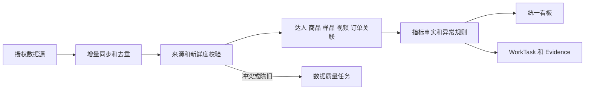
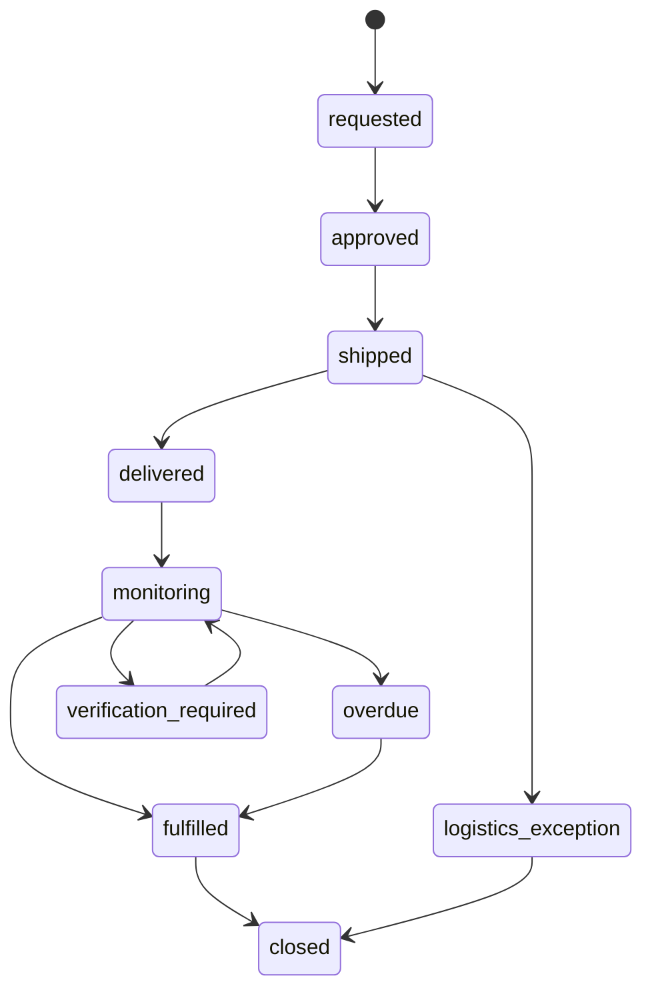
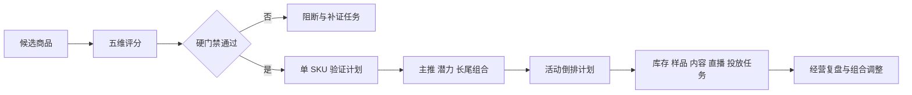
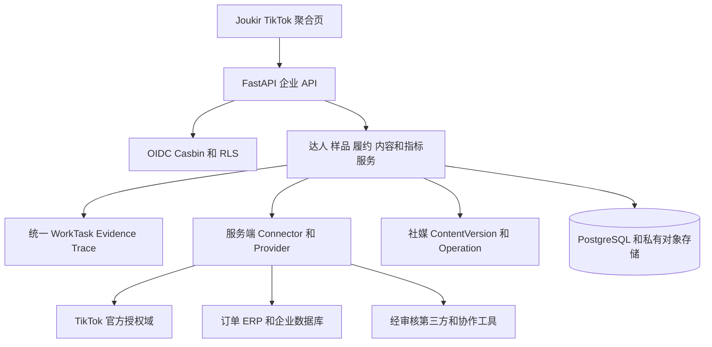

# TikTok 事业部数字化运营模块产品需求文档

> 产品：九骥 Joukir<br>
> 文档版本：V1.8<br>
> 文档状态：产品评审稿<br>
> 日期：2026-09-10<br>
> 适用范围：TikTok 事业部 P3-A 冻结基线和 P3-B 建设范围<br>
> 首期市场：美国<br>
> 产品负责人：待定<br>
> 技术负责人：待定<br>
> 业务负责人：待定<br>
> 上位 PRD：[跨境电商数字员工部门平台](./crossborder-digital-workforce-prd-2026.md)

## 1 产品结论

V1.8 将 TikTok 事业部从组织和能力规划推进到可实施的业务模块设计。P3-A 已完成的组织、岗位、授权、只读 Connector、五条主 SOP 回放、任务 Evidence、Trace 和人工对照影子评估继续作为安全底座，不因本次需求重新扩张。

P3-B 的首要任务是减少 BD 在联盟后台、订单界面和现有管理数据库之间反复跳转查数。第一批能力依次覆盖统一数据看板、样品物流与履约追踪、达人归属和公海池、标准提醒以及产品 Brief 和脚本素材库。内容智能相关的 U4-U8 分别建立为五个 P3-B Epic，并依赖同一套事实、权限、审批和审计能力。

知识库补充能力进入 P3-B4 经营闭环扩展：以五维选品和硬门禁建立 SKU 组合，用活动计划连接库存、样品、内容、投放和直播，再用 GMV Max 诊断、素材版本血缘和经营信任放行包完成复盘。P3-B4 不改变 P3-B1 至 P3-B3 的交付顺序，也不新增自动采购、投放、发布或直播权限。

维护中的达人沟通继续由专属对接人负责。系统可以整理上下文、提供产品知识和生成回复草稿，但不得自动发送日常维护消息。首次批量建联继续使用现有达密能力，本期不开发替代工具。TikTok 店铺后台是标准提醒的首选渠道；WhatsApp 只面向已确认的长期合作达人，P3-B 不建设跨渠道统一聊天记录。

## 2 文档依据和证据边界

### 2.1 输入依据

| 依据 | 证据日期 | 本文用途 | 可信边界 |
|---|---|---|---|
| 跨境电商数字员工部门平台 PRD V1.7 | 2026-09-02 | P3-A 架构、权限、岗位、SOP 和上线门禁 | 作为当前产品基线 |
| TikTok Strategist v1.0.1 安装审计与 PRD 升级建议 | 2026-09-10 | U1-U10、内容实验和媒体 Provider 建议 | 方法建议，不代表平台事实 |
| BD 业务数字化优化需求讨论会议纪要 | 2026-09-10 | 当前工作流程、痛点、优先级和业务边界 | 会议纪要含 AI 总结，关键规则须由业务负责人确认 |
| workforce/tiktok-department 当前代码与提交记录 | 2026-09-10 核验 | 已实现能力和影子运行门禁 | 只表示当前分支状态，不等同于生产上线 |
| 社媒运营 SaaS V2.0 PRD | 2026-09-05 | 内容版本、内容日历、发布 Operation 和达人模型 | 复用契约，避免重复建设 |
| TikTok 美区运营蒸馏知识库与 187 项去重来源索引 | 2026-09-10 | 选品、达人、内容、投放、直播、履约和知识治理补充 | 蒸馏结论用于需求发现；原始资料和当前官方规则用于放行复核 |
| Codex + TikTok《GMV Max 报表诊断与素材测试》SOP | 2026-08-31 核验 | 指标分层、ROI 重算、素材单变量实验和人工投放审批 | Product GMV Max 范围；不覆盖 LIVE GMV Max，示例数据不是平台阈值 |
| Codex + TikTok《原创 UGC 脚本与拍摄》SOP | 2026-08-31 核验 | 商品事实、逐镜证明、原片血缘、权利和披露门禁 | 仅作为制作与质检 SOP；站点规则须在发布时复核 |
| 《TK US 达人运营工作流程》及达人合作历史 SOP | 2025-07 至 2026-03 | 达人发现、筛选、邀约、合作与维护状态补充 | 名额、佣金、时限、话术和业绩数字均为历史案例，不得直接成为系统默认 |

### 2.2 事实分类

本文使用以下四类信息，并在实现和界面中保持区分：

- 已验证事实：能由授权数据源、当前代码、正式配置或人工复核记录证明。
- 业务规则：由业务负责人确认后生效，可配置且保留版本。
- 规划假设：用于排期和设计，必须在 PoC 或影子运行中验证。
- 建议：系统基于事实和规则给出的操作选项，不得冒充已发生的结果。

当前业务以美国市场为主，会议记录显示视频挂车是主要出单渠道，直播订单约占整体 TikTok 订单的 15%-20%。该比例仅是 2026-09-10 的内部业务描述，不作为长期目标或跨品类通用事实。

### 2.3 知识证据治理

- 每条进入规则、Brief、脚本、诊断或审批的知识保存 `KnowledgeEvidenceRef`，至少包含来源 ID、文件哈希、来源日期、抽取版本、市场、语言、品类、适用对象、事实类型、复核人、复核时间和失效时间。
- 证据优先级为：当前官方规则或后台字段说明、已批准内部业务规则、授权平台事实、经合同审核的第三方观察、内部训练案例。低优先级材料不得覆盖高优先级事实。
- 原始资料中的达人名额、佣金比例、履约天数、商品矩阵数量、物流门槛、内容数量、ROI 线和销售案例默认标记为 `training_example` 或 `hypothesis`；只有经业务 Owner 批准并形成版本化规则后才能参与判断。
- 知识检索必须返回事实、案例和假设的类型标签及证据引用。系统不得从无引用的蒸馏文本直接执行邀约、发样、投放、发布、直播或预算动作。
- 来源撤回、官方规则变化、商品事实变化或复核过期时，依赖对象进入 `review_required`；历史结论保留当时证据，不用新知识改写。

## 3 版本变更

| 项目 | V1.7 | V1.8 |
|---|---|---|
| P3-A | 组织、岗位、资产授权、只读 Connector、五条主 SOP 和影子运行规划 | 保持冻结，补充已实现的人工对照证据门禁 |
| 内容请求 | 保存任务输入和内容版本 | 增加原始需求、结构化 Brief 和供应商 Prompt 三层留痕 |
| AI 媒体 | 可选付费工具步骤 | 增加数据出境、供应商准入、费用和删除回执门禁 |
| 第三方 Skill | 经审核后项目内发布 | 明确不得抢占所有媒体请求，不得静默切换付费 Provider |
| BD 数据 | 分散在任务 Evidence 和外部后台 | 新增统一数据看板、数据新鲜度和异常任务 |
| 样品履约 | TT-SOP-008 规划 | 增加物流事件、签收计时、视频识别、PID 校验和 GMV 归集 |
| 达人管理 | 达人画像与商达匹配 | 增加认领、公海回流、专属 Owner、维护交接和分佣草案 |
| 内容智能 | 账号审计、脚本、分镜和 QC | U4-U8 分别建立为 P3-B Epic |
| 达人沟通 | P3-A 外部写入禁用 | P3-B 仅开放三节点标准提醒的草稿和受控发送，不自动维护达人关系 |
| 选品与经营 | 依赖分散表格和经验 | 增加五维选品、硬门禁、单 SKU 验证和组合复盘 |
| 投放诊断 | 只读展示 CPA 与 ROI | 增加 GMV Max 分层对账、汇总 ROI 重算和单变量素材实验 |
| 活动与直播 | 未形成跨岗位对象 | 增加倒排活动计划、库存联动、直播检查单和场后复盘；不开放实时自动场控 |
| 内容可信性 | 以素材审核为主 | 增加商品事实、原片证明、资产血缘、权利披露和履约售后联合放行包 |

## 4 产品目标和非目标

### 4.1 产品目标

1. 用一个工作台呈现样品、物流、履约视频、挂车 PID、播放互动和联盟 GMV，减少重复查数和跨后台跳转。
2. 把签收后的七天履约检查、异常识别和人工跟进变为可追踪任务。
3. 建立达人从公共池、认领、合作、履约到长期维护的归属和交接记录，减少归属及佣金争议。
4. 将趋势、内容实验、制作、发布交接和效果复盘连接为可计算闭环。
5. 在付费媒体生成中保留用户意图、成本、素材权利、数据处理和供应商退出证据。
6. 保持租户、店铺、达人、Partner、广告账户和内容账号的最小权限及完整审计。
7. 把选品、活动、库存、内容、投放和直播复盘连接成可追溯的经营计划，不让局部指标替代经营判断。
8. 用统一信任门禁保证商品事实、内容证明、权利披露、发布版本、履约和售后承诺一致。

### 4.2 非目标

- 不用 AI 自动维护达人关系，不自动发送带有商务承诺、情绪安抚、争议处理或个性化谈判内容。
- 不重建达密已经覆盖的首次批量建联和定邀能力。
- 不把相似达人推荐作为首批必需能力；现阶段继续使用联盟后台的地区、品类和 GMV 筛选及导出。
- 不在 P3-B 汇总 TikTok 店铺后台与 WhatsApp 的完整聊天记录。
- 不通过个人 Cookie、绕过登录、规避平台风控或未经授权抓取获得生产数据。
- 不把静态住宅节点、设备指纹或规避封号方案设计为本产品能力。
- 不自动调价、调预算、启停广告、修改佣金、发样、付款、发布内容或处理直播。
- 不依据通用 ROI、GPM、热视频数量、达人订单数或评分阈值自动淘汰 SKU、停投素材或更改商品矩阵。
- 不把 FastMoss 或任何第三方数据当作 TikTok 官方事实；供应商数据必须显示来源和新鲜度。
- 不在美国市场试点完成前承诺欧洲能力；巴西不在 V1.8 范围。
- 不重建社媒 V2.0 已规划的内容日历、发布 Worker 和统一收件箱。

## 5 用户和责任边界

| 角色 | 核心任务 | 可以执行 | 不可以执行 |
|---|---|---|---|
| TikTok BD 专员 | 开发达人、寄样、履约跟进 | 认领达人、查看授权数据、创建跟进任务、编辑消息草稿 | 自动群发、查看未授权联系方式、修改分佣结果 |
| 长期维护专员 | 维护已稳定合作达人 | 接收维护交接、查看必要历史摘要、记录关系状态 | 获取其他 BD 的非必要私聊原文 |
| TAP 专员 | 达人池、合作和样品管理 | 复核达人资料、处理样品异常、确认履约 | 代表达人授权、未经审批发样或改佣金 |
| 小店运营 | 订单、履约和投流协同 | 核对订单、GMV、链接和投流信号 | 由看板直接更改店铺或广告配置 |
| 内容运营 | 产品 Brief、脚本和内容实验 | 维护素材库、创建实验、提交内容交接 | 使用无证据声明或无权素材 |
| 投流专员 | 视频表现和广告建议 | 查看 CPA、ROI 等授权指标、记录投流决策 | 让系统自动追加投流 |
| 商品运营 | 选品、商品组合和经营验证 | 维护候选评分、硬门禁、单品验证与组合复盘 | 让模型绕过合规、毛利或供应链门禁 |
| 直播运营 | 场次计划、排品、检查和复盘 | 使用已批准商品与话术创建场次包、记录场中事实 | 由系统自动开播、改价、发券或实时控场 |
| 运营主管 | 目标、异常和跨组协作 | 查看授权范围汇总、分派任务、批准内部规则 | 绕过资产和字段权限查看明细 |
| 财务或结算审核人 | 分佣和成本复核 | 审核分配规则、冻结结算快照 | 由系统直接付款或调账 |
| 数据管理员 | 数据源、口径和质量 | 配置字段映射、处理冲突和回补 | 扩大业务人员权限或修改历史事实 |
| 审计员 | 调查权限和流程 | 只读查看 Trace、审批和版本证据 | 查看明文密钥或无必要个人信息 |

每个达人同一时刻最多有一个主要 BD Owner。长期维护人是独立字段，不通过第二个主要 Owner 表达。开发、履约和维护可以由不同人员承担，但每次交接必须产生时间、原因和生效范围明确的事件。

### 5.1 当前交付协作

会议约定由胡鹏牵头数据分析、后台取数和表格归集类需求，曹鹏负责客服模块，洪工负责指纹浏览器和插件类能力。V1.8 将该分工记录为当前协作依据，不把它视为长期系统权限或正式项目任命。P3-B0 评审时仍需确认产品、业务、数据、安全和接口 Owner。

浏览器或插件仅可用于企业明确授权且通过安全评审的场景。生产方案不得因为该分工而使用个人 Cookie、规避登录或未授权抓取。

## 6 阶段范围和优先级

### 6.1 P3-A 冻结基线

P3-A 继续沿用 V1.7 的 12 个实际数字员工、12 个项目内 Skill、五条主 SOP、统一任务中心、审批、Evidence、Trace、Casdoor M2M、Casbin 和 PostgreSQL RLS。P3-A 不新增 TikTok Live 写连接器。

当前实现已将影子运行从单纯计时升级为人工对照证据门禁。生产就绪至少要求 30 条人工评估、覆盖 TT-SOP-002、003、004、007 和 009，采纳或修改后采纳率不低于 70%，且严重漏检、越权、虚假声明和未审批外部写入均为 0。该门禁继续生效。

### 6.2 U1-U3 横向要求

U1-U3 在 V1.8 中成为横向产品要求。由于 P3-A 不执行付费生成，未接入生成 Provider 时不阻塞现有只读能力；任何租户准备启用付费媒体生成前必须全部满足。

| 编号 | 要求 | 产品落点 | 放行条件 |
|---|---|---|---|
| U1 | 原始需求、结构化 Brief、供应商 Prompt 三层留痕 | `GenerationRequestRevision` 和差异摘要 | 三层内容、版本、哈希、作者和变更原因完整 |
| U2 | AI 媒体数据出境与供应商门禁 | Provider 准入、文件网关和数据处理快照 | 处理地区、保留、删除、训练用途、权利和 DPA 版本通过审核 |
| U3 | 第三方 Skill 触发和付费调用规则 | 路由策略、报价审批和故障降级 | 无隐式触发、无静默付费切换、失败仍可交付人工任务包 |

### 6.3 P3-B Epic 总览

| Epic | 来源 | 优先级 | 目标 | 依赖 |
|---|---|---:|---|---|
| P3B-E01 BD 统一数据看板 | 会议 | P0 | 合并物流、履约、视频、PID 和 GMV | 授权数据源、字段口径 |
| P3B-E02 样品物流与内容履约 | 会议 | P0 | 签收计时、七天检查、视频发现和异常派单 | E01、TT-SOP-008 |
| P3B-E03 达人归属公海池与分佣草案 | 会议 | P0 | 认领、回流、交接和分配证据 | 达人主档、组织角色 |
| P3B-E04 趋势信号快照 | U4 | P1 | 形成有来源和失效时间的趋势证据 | 授权账号或供应商 |
| P3B-E05 内容实验与日历交接 | U5 | P1 | 连接策略、生产、排期和复盘 | E04、社媒 V2.0 |
| P3B-E06 媒体生成 Provider | U6 | P2 | 用统一契约接入可替换生成供应商 | U1-U3、供应商审核 |
| P3B-E07 内容指标字典 | U7 | P1 | 统一指标定义、来源、窗口和版本 | E01、平台数据 |
| P3B-E08 Provider 可移植性与退出 | U8 | P2 | 可导出、可删除、可切换且不重复扣费 | E06、对象存储 |
| P3B-E09 标准提醒和受控发送 | 会议 | P1 | 三个固定节点的草稿、审批、发送和回执 | E02、通道能力证据 |
| P3B-E10 产品 Brief 和脚本素材库 | 会议 | P1 | 让 BD 快速调取已批准的产品介绍和脚本 | 产品事实、素材权利 |
| P3B-E11 选品与 SKU 组合验证 | 知识库 | P1 | 五维评估、硬门禁、单品验证和组合调整 | 商品事实、财务、库存、合规 |
| P3B-E12 GMV Max 诊断与素材生命周期 | 知识库 | P1 | 分层对账、正确聚合、漏斗诊断和单变量实验 | E01、E05、E07、广告授权 |
| P3B-E13 活动日历与库存协同 | 知识库 | P1 | 从活动日期倒排备货、样品、内容、直播和投放 | E02、E05、E11、ERP |
| P3B-E14 直播运营与场后复盘 | 知识库 | P2 | 场前检查、人工场控记录和可追溯复盘 | E07、E11、E13、Live 数据能力 |
| P3B-E15 经营信任放行包 | 知识库 | P1 | 串联商品、内容、合规、履约和售后证据 | E02、E05、E10、E11 |

P0、P1 和 P2 表示 P3-B 内部优先级，不对应平台总体 P0-P2 版本。

## 7 信息架构

TikTok 事业部继续使用一个聚合入口，不拆分为独立后台。现有六个 Tab 扩展为以下工作区：

| 工作区 | 主要内容 | 默认角色 |
|---|---|---|
| 今日工作台 | 待签收、即将到期、已逾期、PID 异常、爆量候选和数据故障 | BD、主管 |
| 达人池 | 公共池、我的达人、长期维护、认领历史和归属冲突 | BD、TAP、主管 |
| 样品与履约 | 申请、审批、发货、签收、履约计时、内容和异常 | BD、TAP、小店 |
| 商品与活动 | 候选评估、SKU 组合、单品验证、活动倒排、库存和风险 | 商品、小店、内容、主管 |
| 视频与销售 | 视频链接、播放、点赞、挂车 PID、订单、GMV 和趋势 | BD、小店、投流 |
| 内容实验室 | 趋势快照、UGC Brief、脚本、逐镜证明、资产血缘、实验和内容交接 | 内容、商品、投流 |
| 投放诊断 | GMV Max 活动、商品和素材层对账、假设、测试单和审批结果 | 投流、商品、财务 |
| 直播作战室 | 场次计划、排品、检查单、人工事件记录和场后复盘 | 直播、小店、内容 |
| 消息任务 | 三节点提醒草稿、审批、发送状态和人工接管 | BD、TAP |
| 数据与连接器 | 来源、授权、同步游标、新鲜度、字段冲突和回补 | 管理员、数据负责人 |
| SOP 和数字员工 | P3-A/P3-B 能力、版本、评测和发布状态 | 主管、管理员 |
| 风险与指标 | 权限、数据质量、影子评估、成本和业务指标 | 主管、审计员 |

所有列表必须继承租户、店铺、市场、业务角色和 BusinessResourceScope。主管的汇总视图不自动授予受限明细访问。

## 8 核心业务流程

### 8.1 每日数据归集流程



1. Connector 按授权域和资产范围增量读取联盟、订单、物流、视频和广告数据。
2. 每条记录保存来源业务键、观测时间、同步批次和原始回执引用；重复回调或重复导入保持幂等。
3. 系统通过达人 ID 或 UID、商品 PID、样品单和视频链接建立可解释关联。不能可靠关联时进入待核对队列，不做猜测性合并。
4. 指标服务生成时间窗明确的事实，异常规则创建统一任务和 Evidence。
5. 看板显示数据新鲜度、未知值和数据源故障，不把缺失值显示为 0。

### 8.2 样品到内容履约流程



- 样品申请获批后建立样品记录并准备第一条标准提醒。
- 物流优先使用 TikTok 达人联盟授权数据。基础状态异常或信息不足时，从授权订单数据补充全量轨迹。
- 首次确认签收时记录不可变 `delivered_at`，并计算 `content_due_at`。默认期限为七个自然日，租户可按活动或达人合同调整。
- 系统每日检查已签收未履约记录，读取授权范围内的达人内容和挂车信息。
- 找到内容后保存视频链接、发布时间、PID、播放、点赞和来源。PID 不是当前活动或官方主推链接时创建人工跟进任务。
- 当数据源陈旧或访问失败时状态为 `verification_required`，不得直接判定达人逾期。
- 履约确认后将记录从物流工作视图转入视频与销售视图，但保留同一条时间线。

### 8.3 达人认领和公海回流流程

1. 新达人进入公共池，保留来源、市场、品类、最近 GMV、数据时间窗和可联系依据。
2. BD 认领时系统用乐观锁确认达人仍可认领，并创建唯一主要 Owner 关系。
3. Owner 在租户配置的跟进期限内记录有效动作。只打开页面或查看资料不算有效跟进。
4. 到期前系统提醒 Owner；到期后由规则生成回流建议。自动回流是否启用由租户配置，首期默认需要主管确认。
5. 达人完成首个有效合作后可转入长期维护，并明确新的维护人、交接摘要和生效时间。
6. 开发、履约、维护贡献只产生分佣草案。比例规则、适用期间、订单范围和例外由业务及财务审核后冻结，系统不执行付款。

### 8.4 标准提醒流程

系统支持三个默认触发点：

1. 样品申请通过后，提醒达人关注物流轨迹。
2. 样品签收后，确认收货并提供已批准的产品素材入口。
3. 签收七天仍未履约时，创建催办草稿和人工跟进任务。

消息优先通过 TikTok 店铺后台支持的正式通道发送。系统必须先证明当前账号、地区和消息类型具备相应能力。若只支持人工发送，系统提供可复制草稿并记录人工完成，不伪造平台回执。WhatsApp 在 P3-B 仅保留人工任务或经官方 Business API 验证后的独立受控 Operation，不以个人账号自动化代替正式能力。

### 8.5 趋势到内容复盘流程


TikTok 模块负责趋势证据、产品事实、实验、Brief、脚本、分镜和 QC。社媒模块负责 ContentVersion、PlatformVariant、排期、发布 Operation、平台回执和抑制规则。两边通过稳定 ID 和版本哈希交接，不复制发布状态机。

### 8.6 选品到活动倒排流程



五维评分覆盖需求、内容可表达性、差异化、单位经济性和供应链。评分用于解释和排序，商品事实、法规/认证、权利、可售库存、最低贡献边际与履约能力是独立硬门禁。主推、潜力、长尾的数量和比例是租户经营假设，不设全局默认。活动计划以目标日期为锚点，为备货、样品、达人、UGC、直播和投放生成带依赖关系的任务；库存或合规失效时阻断受影响任务，不自动替换商品。

### 8.7 GMV Max 诊断与素材测试流程

1. 固定店铺、站点、时区、币种、统计窗口、导出时间、数据更新时间和归因版本，分别导入活动、商品和素材层原始报表。
2. 各层独立去重和对账；同一收入不得跨层相加。汇总 ROI 以同口径总收入除以总花费重算，不平均行级 ROI；零花费返回不可计算。
3. 先读取经营层收入、花费、订单、退款、库存和价格，再读取素材层曝光、点击、观看、转化与分发。Product GMV Max 的自然和联盟订单属性必须可见，不能把该 ROI 表述为净利润或纯广告增量回报。
4. 系统把异常拆为已观察事实、可能原因和待补证据；没有可读视频、变更日志或一致口径时不得猜测创意原因。
5. 素材测试必须保留对照版、变体版、唯一改动、观察窗口、主指标、护栏、成本上限、样本不足处理和负责人。预算、上线、停投与复用均停留在待审批动作。

### 8.8 内容与经营信任链

每个可发布或可投放版本必须能沿以下链路回溯：`商品事实与限制 -> 已批准 UGC Brief -> 脚本与逐镜证明点 -> 原始连续演示与场记 -> 授权素材变体 -> 平台变体 -> 发布/投放回执 -> 履约与售后反馈`。UGC 表示用户视角表达，不代表真实购买者证言；未真实体验不得生成虚构经历。写实 AI 或重大 AI 改动画面不能作为真实商品效果证明，并在发布时按当前站点规则完成标签与商业披露复核。

## 9 Epic 详细需求

### 9.1 P3B E01 BD 统一数据看板

#### 用户价值

BD 和主管可以在一个页面判断哪些样品在途、哪些达人已签收未履约、哪些视频正在增长、挂车链接是否正确，以及当天联盟 GMV，无需逐条跨后台核对。

#### 功能要求

| ID | 要求 |
|---|---|
| TT-BD-FR-001 | 按租户、店铺、市场、BD Owner、达人、商品和日期筛选数据 |
| TT-BD-FR-002 | 展示样品物流、签收时间、履约截止、视频链接、播放、点赞、PID、订单和 GMV |
| TT-BD-FR-003 | 每个指标展示来源、观测时间、时间窗、币种、口径版本和新鲜度 |
| TT-BD-FR-004 | 数据缺失显示未知，来源冲突显示冲突，不以 0 或最新值覆盖历史 |
| TT-BD-FR-005 | 支持今日待办、到期预警、逾期、PID 异常、播放增长和数据故障队列 |
| TT-BD-FR-006 | 当日联盟 GMV 从订单事实按渠道汇总，不通过手工相加形成不可追溯结果 |
| TT-BD-FR-007 | 支持按授权范围导出脱敏结果；明细导出需要数据 Owner 审批和审计 |
| TT-BD-FR-008 | 支持飞书等协作工具的受控推送或导出，但 Joukir 数据库保持事实主记录 |
| TT-BD-FR-009 | 按固定观测间隔计算视频播放和互动变化，形成带证据的增长候选，不直接预测爆款 |
| TT-BD-FR-010 | 只读展示 Max 或广告侧的素材采用状态、CPA 和 ROI 口径，向投流人员创建评估任务，不自动追加投流 |

#### 验收条件

- 同一外部记录重复同步不会产生重复 GMV、视频或物流事件。
- 任一指标可下钻到来源系统、业务键、观测时间和同步批次。
- 关闭一个店铺或撤销授权后，该范围不再产生新同步或新任务，历史证据仍按权限可读。
- 两个租户使用相同达人 UID、PID 或订单号时不会互相可见或错误合并。
- 数据源超时或陈旧时页面显示失败范围和最后成功时间，不展示为正常完成。

### 9.2 P3B E02 样品物流与内容履约

#### 功能要求

| ID | 要求 |
|---|---|
| TT-SMP-FR-001 | `SampleFulfillment` 关联达人、Owner、活动、店铺、商品 PID、样品 SKU 和地址密文引用 |
| TT-SMP-FR-002 | 物流事件追加写并按承运商事件键去重，不允许修改历史签收时间 |
| TT-SMP-FR-003 | 第一次可信签收触发履约计时，默认七个自然日，可由已批准合同或活动规则覆盖 |
| TT-SMP-FR-004 | 每日检查已签收记录并关联达人视频，保存匹配依据和置信状态 |
| TT-SMP-FR-005 | 自动校验视频挂车 PID 是否属于当前合作商品和主推链接集合 |
| TT-SMP-FR-006 | 发现履约、PID 异常或物流异常时创建去重 WorkTask，并指定 Owner 和期限 |
| TT-SMP-FR-007 | 已履约记录在视频与销售视图出现，物流和履约共享同一事件时间线 |
| TT-SMP-FR-008 | 支持人工纠错，但纠错通过新事件和审核原因表达，不覆盖原始来源事实 |

#### 验收条件

- 对同一签收事件重放十次只建立一个计时器和一个第一节点提醒。
- 只有来源新鲜且授权完整时才能自动判定未履约；否则进入人工核对。
- 视频存在但 PID 不匹配时状态不是已正确履约，并生成含证据链接的跟进任务。
- BD 转岗或达人移交后，未关闭任务按规则转给新 Owner，历史责任不被改写。

### 9.3 P3B E03 达人归属公海池与分佣草案

#### 功能要求

| ID | 要求 |
|---|---|
| TT-CRM-FR-001 | 达人主档与平台身份分离，同一达人可保留多个经核验的平台身份 |
| TT-CRM-FR-002 | 达人池支持公共、已认领、合作中、长期维护、沉睡和受限状态 |
| TT-CRM-FR-003 | 认领通过版本号或数据库锁防止并发双重归属 |
| TT-CRM-FR-004 | 跟进 SLA、有效动作定义、提醒和回流规则按租户版本化配置 |
| TT-CRM-FR-005 | 主要 Owner、履约负责人和维护人分别记录，不通过自由文本推断归属 |
| TT-CRM-FR-006 | 转交、释放、回流和重新认领均保存前后 Owner、原因、时间和操作者 |
| TT-CRM-FR-007 | 分佣草案按开发、履约和维护角色及规则版本计算，保留订单范围和计算证据 |
| TT-CRM-FR-008 | 财务确认后冻结分配快照；规则变化只影响新结算，不回写已冻结结果 |
| TT-CRM-FR-009 | 达人合作漏斗区分发现、已核验、待邀约、已邀约、已回复、谈判、寄样、履约、复投、长期合作、沉睡和受限；池状态不替代合作阶段 |
| TT-CRM-FR-010 | 达人画像保存来源、筛选条件、时间窗、带货视频数、订单或 GMV 事实、内容风格、品类适配、证据等级和待核验项 |
| TT-CRM-FR-011 | 业绩摘要至少提供最近 30 天和可配置长期窗口，第三方观察与官方合作事实分栏展示，不用历史案例阈值自动淘汰 |
| TT-CRM-FR-012 | 合作条款分别记录固定费用、佣金、样品、交付、广告授权、素材使用范围和有效期；话术不得成为条款事实源 |

#### 验收条件

- 两名 BD 同时认领同一达人时只有一人成功，另一人收到当前 Owner 和刷新提示。
- 未产生有效跟进的达人到期后进入回流候选，不因页面访问或自动任务被视为已跟进。
- 权限不足的 BD 看不到其他 Owner 的受限联系方式、分佣明细或私聊原文。
- 分佣比例之和不等于 100%、订单范围冲突或规则版本失效时无法提交财务审核。

### 9.4 P3B E04 趋势信号快照

该 Epic 对应 U4。

`TrendSignalSnapshotV1` 至少包含市场、语言、账号类型、内容主题、声音或效果、标签、来源、授权、观测时间、样本窗、样本量、数据新鲜度、证据等级、置信度、失效时间和结论类型。

| ID | 要求 |
|---|---|
| TT-TRD-FR-001 | 结论类型固定为 `official_fact`、`observed_pattern` 或 `hypothesis` |
| TT-TRD-FR-002 | 每条信号保留来源对象和样本限制，缺少样本量时不得显示高置信度 |
| TT-TRD-FR-003 | 到达失效时间后仅可作为灵感，不能作为确定性事实或自动路由条件 |
| TT-TRD-FR-004 | 不得用未授权抓取补充缺失趋势；供应商不可用时显示陈旧或未知 |
| TT-TRD-FR-005 | 趋势进入实验计划时固定快照 ID 和哈希，后续刷新不改变历史实验依据 |

验收要求是同一趋势在不同市场、语言或样本窗下形成独立快照；过期快照无法启动依赖确定性平台事实的自动步骤。

### 9.5 P3B E05 内容实验与日历交接

该 Epic 对应 U5。

`ContentExperimentPlanV1` 包含内容支柱、受众 cohort、Hook 假设、变体、主指标、护栏指标、最小样本、观察窗口、停止条件和胜出规则。40/30/20/10 只能作为可选模板，租户不得在没有基线时把它当作默认事实。

| ID | 要求 |
|---|---|
| TT-EXP-FR-001 | 实验创建时固定产品事实、趋势快照、账号、市场、受众和指标字典版本 |
| TT-EXP-FR-002 | 变体只改变计划内变量；额外变化必须创建新版本或标记实验不可解释 |
| TT-EXP-FR-003 | TT-SOP-002 输出可交接内容项，生成 `ContentHandoffV1` |
| TT-EXP-FR-004 | `ContentHandoffV1` 映射社媒 `ContentVersion` 和 `PlatformVariant`，不复制发布状态 |
| TT-EXP-FR-005 | 平台回执和指标通过内容版本 ID 回流，实验结论保留数据完整性和限制 |
| TT-EXP-FR-006 | 未达到最小样本或观察窗口时只能显示早期信号，不宣布胜出 |
| TT-EXP-FR-007 | 测试保留价格、库存、预算、流量和活动变更；非计划共变项使结论降级为观察或不可解释 |
| TT-EXP-FR-008 | 原版、获权投放版和平台变体形成父子血缘，任何剪辑、字幕、配音或 AI 改动创建新版本 |

验收要求是从一个实验变体可定位到脚本、分镜、成片、平台发布对象和指标事实；内容或账号发生未计划变化时系统阻止生成确定性胜出结论。

### 9.6 P3B E06 媒体生成 Provider

该 Epic 对应 U6，并以 U1-U3 为前置条件。

```text
quote_generation(context, brief) -> GenerationQuote
create_generation(context, approved_quote, inputs) -> GenerationJob
get_generation(context, provider_job_id, cursor) -> GenerationStatus
cancel_generation(context, provider_job_id) -> CancellationReceipt
ingest_results(context, provider_job_id) -> MediaAssetVersion[]
delete_provider_assets(context, provider_job_id) -> DeletionReceipt
```

领域状态固定为 `quoted -> awaiting_approval -> queued -> running -> succeeded | failed | cancelled | expired | success_unknown`。

| ID | 要求 |
|---|---|
| TT-GEN-FR-001 | 保存 Provider、模型或工作流版本、三层请求哈希、输入资产哈希和数据处理条款版本 |
| TT-GEN-FR-002 | 报价包含能力、预计成本、币种、预计时长、数据去向、保留期和有效期 |
| TT-GEN-FR-003 | 报价获批后才创建外部任务；报价或输入变化使批准失效 |
| TT-GEN-FR-004 | 长任务进入现有队列，由 Webhook 或有界轮询推进，不占用用户 HTTP 连接 |
| TT-GEN-FR-005 | 超时后先查询外部状态；无法确认时进入 `success_unknown`，禁止盲目重放 |
| TT-GEN-FR-006 | 结果先进入私有对象存储和素材 QC，未通过不得进入发布交接 |
| TT-GEN-FR-007 | 取消、外部删除、本地保留和费用分别保存回执 |
| TT-GEN-FR-008 | LibTV 只能作为一个候选适配器，Skill 不持有密钥或直接访问生产 HTTP |
| TT-GEN-FR-009 | `original_request`、`normalized_brief` 和 `provider_prompt` 分别版本化，付费调用前展示差异摘要 |
| TT-GEN-FR-010 | 只有用户明确选择、租户 Provider 策略命中或已批准 SOP 才能调用供应商 |
| TT-GEN-FR-011 | Skill 不得注册覆盖全部图片或视频请求的排他触发器；未配置或故障时不得静默切换付费供应商 |

### 9.7 P3B E07 内容指标字典

该 Epic 对应 U7。

在平台或授权数据源可提供相应事实时，指标至少覆盖两秒和六秒留存、平均观看时长、完播、复看、分享、收藏、评论、主页访问、关注转化、点击、商品点击、Shop 转化、内容制作时长、生成成功率、单成片成本、脚本和分镜一次通过率、AI 草稿采纳率、人工编辑幅度、QC 拦截率和误报率。

| ID | 要求 |
|---|---|
| TT-MET-FR-001 | 每个指标有稳定代码、中文名、公式、单位、分子分母、时区、窗口和平台定义版本 |
| TT-MET-FR-002 | 指标事实保存市场、账号、内容、来源、观测时间、新鲜度和回填状态 |
| TT-MET-FR-003 | 8% 互动、70% 完播、4:1 ROI 等外部数值只能作为带来源和日期的候选 benchmark |
| TT-MET-FR-004 | 指标代码区分 Product GMV Max ROI、付费 ROAS 和贡献利润；前者按后台同口径收入与花费计算，利润指标缺少退款、佣金、样品、内容、税费等成本时不可计算，三者不得互相替代 |
| TT-MET-FR-005 | 创意疲劳必须结合时间序列、频次、CTR、CPM、CVR、CPA 或 ROAS，不用单一阈值 |
| TT-MET-FR-006 | 指标口径变更创建新版本，历史报表继续使用原版本 |
| TT-MET-FR-007 | GMV Max 活动、商品和素材层分别聚合，同一收入不跨层累加；汇总比率由总分子和总分母重算 |
| TT-MET-FR-008 | GPM 必须绑定明确公式、金额口径、币种、时间窗和流量分母；字段不足时不以行业习惯猜公式 |
| TT-MET-FR-009 | Product GMV Max 的自然、联盟和付费范围按当前后台定义展示，不把经营 ROI 表述为净利润或广告增量回报 |

验收要求是相同指标代码在同一版本下可复算；缺少关键分母、币种或归因事实时返回不可计算原因，不返回 0 或推测值。

### 9.8 P3B E08 Provider 可移植性与退出

该 Epic 对应 U8。

| ID | 要求 |
|---|---|
| TT-EXT-FR-001 | 所有媒体 Provider 通过相同契约、状态、超时、重复回调和故障注入测试 |
| TT-EXT-FR-002 | 导出包包含三层请求、输入、结果、权利、成本、回执和内容哈希，不包含明文密钥 |
| TT-EXT-FR-003 | Provider 切换不改变上层 WorkTask、Approval、Evidence 和 MediaAssetVersion 标识 |
| TT-EXT-FR-004 | 幂等键和外部 request ID 阻止自动重放造成重复扣费 |
| TT-EXT-FR-005 | Provider 不可用时仍能交付脚本、分镜、素材清单和人工制作任务包 |
| TT-EXT-FR-006 | 每年至少演练一次导出、外部删除、密钥轮换和供应商退出 |

验收要求是用第二个 Mock Provider 完成替换演练，并证明历史任务仍可读取、失败任务不重复计费、外部删除有独立回执。

### 9.9 P3B E09 标准提醒和受控发送

| ID | 要求 |
|---|---|
| TT-MSG-FR-001 | 三个默认节点可按活动和合同覆盖，但必须保留规则版本和计算依据 |
| TT-MSG-FR-002 | 模板只引用已批准产品事实和素材，不生成无法证明的承诺 |
| TT-MSG-FR-003 | 每条消息冻结达人、通道、账号、模板版本、语言、发送窗口和业务对象 |
| TT-MSG-FR-004 | 首期 AI 只生成草稿；自动发送仅在平台能力达到 E3、审批和 Operation Guard 通过后开放 |
| TT-MSG-FR-005 | 发送超时进入 `uncertain`，先查询平台状态，不盲目重试 |
| TT-MSG-FR-006 | 达人回复、投诉、退订或异常率触发暂停和人工接管 |
| TT-MSG-FR-007 | 紧急事项直接派给专属对接人，系统不得用普通模板延迟人工响应 |
| TT-MSG-FR-008 | 店铺客服或达人维护能力按读取会话、生成建议、人工发送和受控发送分别记录 E0-E3 证据；未达 E3 时系统只提供建议草稿 |

维护中达人的日常回复、谈判和关系维护不使用自动发送。产品类问题可以基于已批准知识生成建议回复，由真人确认并发送。

### 9.10 P3B E10 产品 Brief 和脚本素材库

| ID | 要求 |
|---|---|
| TT-LIB-FR-001 | 按商品、市场、语言、品类和活动保存简短产品介绍、图片卡片和已批准脚本 |
| TT-LIB-FR-002 | 每个条目关联 Product Truth、禁用声明、素材权利、有效期和审核版本 |
| TT-LIB-FR-003 | BD 可生成面向单个达人的发送包，但不得修改已批准事实或隐藏来源 |
| TT-LIB-FR-004 | FastMoss 等供应商数据经合同和接口审核后可生成竞品内容观察，不直接复制脚本 |
| TT-LIB-FR-005 | 竞品观察标明来源、样本窗和推断，不把爆单相关性写成因果 |
| TT-LIB-FR-006 | 条目过期、权利撤销或商品事实变化时阻止新发送并创建复审任务 |
| TT-LIB-FR-007 | UGC Brief 至少包含站点、语言、SKU、单一使用问题、受众场景、可说事实、限制、证据、已批准商业信息、权利、披露和待确认项 |
| TT-LIB-FR-008 | 拍摄包逐镜记录动作、台词、字幕、道具、证明点、素材文件名、拍摄条件和缺镜负责人 |
| TT-LIB-FR-009 | 重要商品效果必须关联可复核的连续原片或正式检测证据，生成画面不得替代真实效果证明 |
| TT-LIB-FR-010 | 最终成片、字幕、商品链接、价格优惠、音乐人物声音权利和批准版本一致；任一变更触发重新复核 |

### 9.11 P3B E11 选品与 SKU 组合验证

| ID | 要求 |
|---|---|
| TT-PRD-FR-001 | `ProductCandidateEvaluation` 对需求、内容可表达性、差异化、单位经济性和供应链五维分别评分，并保留权重、理由、证据和未知项 |
| TT-PRD-FR-002 | 法规与认证、禁限售、知识产权、商品事实、可售库存、最低贡献边际和履约能力作为独立硬门禁，任何一个失败都不得被总分抵消 |
| TT-PRD-FR-003 | 单位经济快照包含售价、折扣、商品成本、头程/尾程、平台费、佣金、样品、内容、广告、退款、税费、币种和有效期；缺项时标为不可决策 |
| TT-PRD-FR-004 | 每个候选先建立单 SKU 验证计划，明确渠道、内容、达人、库存、预算、观察窗、停止条件和证伪标准 |
| TT-PRD-FR-005 | SKU 可分配为主推、潜力、长尾或退出候选，但数量、比例和切换规则全部按租户版本化配置 |
| TT-PRD-FR-006 | 评分、硬门禁、验证结果和组合调整相互独立留痕；模型只给解释和建议，不自动采购、上架或退出 |
| TT-PRD-FR-007 | 商品事实、成本、库存、认证或平台状态变更时，使未执行的选品审批和依赖活动计划失效 |
| TT-PRD-FR-008 | 组合复盘同时展示增长、利润、内容供给、库存风险和履约售后，不以单一 GMV 排名替代经营结论 |

验收要求是同一候选在相同输入、权重和规则版本下可复算；硬门禁失败时即使总分最高也无法进入可执行活动；训练材料中的商品数量和阈值不会在未配置时出现为默认值。

### 9.12 P3B E12 GMV Max 诊断与素材生命周期

| ID | 要求 |
|---|---|
| TT-ADS-FR-001 | 诊断运行固定店铺、站点、时区、币种、窗口、导出时间、后台定义版本和原始文件哈希 |
| TT-ADS-FR-002 | 活动、商品和素材表分层导入、去重与对账，检测跨天重叠、缺列、退款回补和跨层重复加总 |
| TT-ADS-FR-003 | 汇总 ROI 使用同口径总收入除以总花费重算，不平均行级 ROI；分母为零或口径不一致时返回不可计算 |
| TT-ADS-FR-004 | 经营层、广告层和内容层指标在界面分区，指标卡展示分子、分母、归因窗和“非净利润/非因果”提示 |
| TT-ADS-FR-005 | 漏斗诊断输出观察事实、可能原因、待补证据和建议检查，不在没有视频或变更证据时推断素材问题 |
| TT-ADS-FR-006 | 素材测试只允许一个计划变量，固定对照、变体、主指标、护栏、观察窗、成本上限、样本条件和不可判胜条件 |
| TT-ADS-FR-007 | 测试期间记录价格、折扣、库存、预算、授权、上线时间和素材分发差异，共变或分发失衡时降低结论等级 |
| TT-ADS-FR-008 | 诊断可生成预算、上线、停投或复用建议，但所有外部动作需投放负责人审批，经营成本线需财务复核 |
| TT-ADS-FR-009 | 素材保持原创、获权投放版、平台版和结果的版本血缘，权利到期阻断新的投放建议 |
| TT-ADS-FR-010 | 观察期结束后按原口径回算，结果只能为胜出、未胜出、继续观察、无结论或已失效，并说明限制 |

验收要求是模拟行级 ROI 平均错误、零花费、跨层重复收入、币种混用、退款回补和分发悬殊时均给出正确阻断或降级；系统不会直接修改预算、启停广告或宣布因果。

### 9.13 P3B E13 活动日历与库存协同

| ID | 要求 |
|---|---|
| TT-CAL-FR-001 | `CampaignPlan` 记录市场、活动类型、目标日期、商品集合、Owner、目标、预算假设、规则版本和状态 |
| TT-CAL-FR-002 | 里程碑从目标日期倒排，至少覆盖需求预测、采购/入仓、合规、Listing、样品、达人、内容、直播、投放和售后准备 |
| TT-CAL-FR-003 | 每个里程碑包含前置依赖、最晚开始、完成定义、负责人、证据和缓冲，不只保存一个日历日期 |
| TT-CAL-FR-004 | 库存快照区分现货、在途、锁定、不可售、安全库存和数据时间；来源陈旧时不生成确定性备货结论 |
| TT-CAL-FR-005 | 样品、UGC、直播和投放任务引用同一商品事实及活动版本，活动变更自动标记受影响任务 |
| TT-CAL-FR-006 | 延期、缺货、权利到期或合规失败触发影响分析与人工重排，不自动换 SKU、加预算或缩短质检 |
| TT-CAL-FR-007 | 支持常青、季节、平台大促和自定义活动模板；模板时间和数量均为可编辑假设 |
| TT-CAL-FR-008 | 活动结束形成计划与实际差异、缺货/滞销、内容供给、投放和履约复盘，并回写后续假设而非改写历史计划 |

### 9.14 P3B E14 直播运营与场后复盘

| ID | 要求 |
|---|---|
| TT-LIVE-FR-001 | `LiveSessionPlan` 固定店铺、账号、市场、场次时间、主持/场控、商品顺序、批准话术、优惠版本和应急联系人 |
| TT-LIVE-FR-002 | 场前检查覆盖授权、设备网络、商品可售、库存、链接、价格优惠、样品道具、音乐、披露、禁用声明和故障预案 |
| TT-LIVE-FR-003 | 未通过商品、合规或授权硬门禁时阻断“准备完成”，但系统不代替真人决定是否开播 |
| TT-LIVE-FR-004 | 场中仅记录人工事件、商品切换、优惠、峰值、异常和处置；P3-B 不自动开播、控场、发券、改价或切品 |
| TT-LIVE-FR-005 | Live 数据 Connector 能力先通过 P3-B0 动作级证据盘点；无稳定接口时允许人工导入，不伪装实时数据 |
| TT-LIVE-FR-006 | 场后按进入、停留、互动、点击、加购、订单和 GMV 漏斗复盘，所有指标引用字典版本和新鲜度 |
| TT-LIVE-FR-007 | GPM、转化和客单等指标只有字段与公式完整时计算，不把训练材料阈值当作放行标准 |
| TT-LIVE-FR-008 | 复盘输出事实、假设、片段证据、问题 Owner 和下一场测试项，并与活动和 SKU 组合复盘关联 |

### 9.15 P3B E15 经营信任放行包

| ID | 要求 |
|---|---|
| TT-TRU-FR-001 | `ComplianceReleasePacket` 绑定 SKU、市场、商品事实、认证/禁限售、Listing、内容版本、权利、披露、库存、履约和售后承诺 |
| TT-TRU-FR-002 | 每个口播、字幕和画面卖点可追溯到商品事实、连续原片、检测或其他已批准证据；无法证明的表述进入禁用清单 |
| TT-TRU-FR-003 | 原创素材、达人授权投放版、AI 改动版和平台变体形成不可变父子关系，保留文件哈希、变更人、变更说明和批准状态 |
| TT-TRU-FR-004 | 人物、肖像、声音、音乐、场地、商标、达人广告授权和跨渠道使用分别记录范围、地区、期限和撤回状态 |
| TT-TRU-FR-005 | 商业推广披露及写实 AI/重大 AI 改动标签按目标站点当前规则复核，历史 SOP 不充当永续规则 |
| TT-TRU-FR-006 | 发布或投放前重新校验最终文件、字幕、链接、价格优惠、批准版本和权利；任一漂移使旧批准失效 |
| TT-TRU-FR-007 | 履约能力、退换货政策和客服承诺与前台内容一致；库存或政策异常可阻断新放行并创建跨部门任务 |
| TT-TRU-FR-008 | 每个放行结果包含通过、阻断、人工例外或待补证据，人工例外必须有授权人、期限、理由和不可覆盖项 |
| TT-TRU-FR-009 | 放行包只提供内部批准证据，不代替平台审核、法律意见、检测证书或实际发布回执 |

验收要求是修改任一商品事实、最终字幕、优惠、音乐授权或达人广告授权后，旧放行包立即失效；原始证据和历史发布仍可审计，系统不会用新版本改写过去。

## 10 业务规则

### 10.1 数据关联规则

- 达人关联优先使用租户范围内的 TikTok Creator ID 或 UID。名称、头像和昵称只能用于人工候选，不用于自动合并。
- 商品以店铺和 PID 组合识别；相同 PID 在不同租户或店铺不视为同一业务对象。
- 样品和视频的自动关联至少需要同一达人、授权店铺和合作商品范围。缺少任一关键键时进入待核对。
- 当日 GMV 以明确时区和币种的订单事实为准。退款、取消和归因回补通过新事实调整，不覆盖已发布日报。
- 视频播放和点赞是时间序列快照。环比增长必须说明前后观测时间、数据间隔和缺失情况。

### 10.2 履约规则

- 七天是默认业务规则，不是硬编码常量。活动、合同或达人级覆盖必须获得相应权限并保留版本。
- 平台没有返回内容不等于达人没有履约。只有数据源新鲜、授权有效且匹配范围完整时才可标记自动判定结果。
- 非主推 PID 产生人工任务，不自动要求达人删除或重发内容。
- 同一异常在未关闭时只保留一个活跃任务；新证据追加到该任务。

### 10.3 归属和分佣规则

- 认领、回流和移交是内部写操作，必须权限校验和审计，但不需要外部平台审批。
- 系统默认只建议回流，由主管确认。租户在完成影子运行后可以单独开启自动回流。
- 分佣规则必须包含角色、比例、适用店铺、商品或活动、有效期、优先级和冲突处理。
- 系统只生成分配结果和对账证据，不支付佣金，也不修改外部账单。

### 10.4 沟通规则

- 首次批量建联使用达密，Joukir 可准备经审批的名单和素材，但不接管达密账号或模拟其操作。
- TikTok 店铺后台是样品节点提醒的优先通道。平台不支持相应动作时降级为人工任务。
- WhatsApp 仅用于已确认的长期合作达人。P3-B 不汇总完整聊天记录，不保存个人会话 Cookie。
- 商务承诺、争议、投诉、法律、账号安全和紧急事项必须由真人处理。

### 10.5 选品和组合规则

- 五维评分用于排序和解释，不替代硬门禁；任何评分和权重都必须显示版本、输入、证据和未知项。
- 单位经济性以批准的期间快照计算。缺少成本、退款、佣金、税费或币种时只能形成待补数据任务。
- 主推、潜力、长尾和退出是某一期间的组合分配，不是商品永久标签。组合调整创建新版本并保留旧版本。

### 10.6 投放诊断规则

- 活动、商品和素材是同一业务事实的不同观察层，不可跨层相加收入或订单。
- 汇总比率由汇总分子与分母重算。行级比率平均、零分母无限回报、跨币种或跨归因窗比较均为无效计算。
- 诊断先区分事实、相关性、假设和待补证据。预算、启停、上线与复用永远是待审批建议。
- 单变量实验发生非计划共变、分发悬殊、样本不足或数据陈旧时，结果必须降级为无结论、继续观察或已失效。

### 10.7 活动库存和直播规则

- 活动日期、任务缓冲、商品矩阵和直播脚本均为版本化计划；计划变更不覆盖历史完成事实。
- 库存不足、合规阻断和权利失效产生影响分析。系统不得为了赶活动自动缩短质检、换品、补货、改价或开播。
- 场中数据和事件必须区分实时 Connector、延迟回填和人工记录。人工记录不得伪装成平台回执。

### 10.8 内容与经营信任规则

- 商品事实是脚本、字幕、达人发送包、Listing、直播话术和客服承诺的共同事实源。
- 生成或显著修改的画面不能作为商品实际效果的唯一证据；关键效果需关联连续原片、检测或等价批准证据。
- 放行审批绑定最终文件和依赖版本。文件、字幕、链接、优惠、权利、披露、库存或售后政策变化后必须重新放行。

### 10.9 知识应用规则

- 任何规则或建议可回溯到知识证据引用；无法定位来源、日期和适用范围的文本只可作为待核验线索。
- 历史话术、佣金、名额、周期、销量和行业 benchmark 不自动进入配置，不作为平台承诺。
- 知识库只提供证据和方法，不扩大主体、资产、字段或外部动作权限。

## 11 数据模型

### 11.1 复用对象

继续复用 `BusinessResource`、`BusinessResourceScope`、`ExternalAuthorization`、`ConnectorSyncState`、`WorkTask`、`WorkTaskRun`、`WorkTaskExecutionSnapshot`、`WorkTaskEvidence`、`WorkTaskEvent`、`HighRiskActionRequest`、`BusinessActionExecution`、`GeneralSkill`、`SkillVersion`、`KnowledgeBaseVersion`、`AgentRelease` 和社媒域的 `ContentVersion`、`PlatformVariant`、`PublishOperation`。

### 11.2 P3-B 新增对象

| 实体 | 关键字段 | 关键约束 |
|---|---|---|
| `creator_record` | tenant、canonical_id、market、category、status、source_quality | 与平台身份分离，合并拆分可审计 |
| `creator_platform_identity` | tenant、creator、platform、external_id、handle、observed_at | `(tenant, platform, external_id)` 唯一 |
| `creator_assignment` | tenant、creator、owner_user、role_type、effective_at、ended_at、revision | 每个达人最多一个 active primary Owner |
| `creator_pool_event` | tenant、creator、event_type、from_owner、to_owner、reason、actor、created_at | 追加写 |
| `sample_fulfillment` | tenant、store、creator、campaign、product_pid、sku、state、due_at | 外部业务键组合唯一 |
| `sample_logistics_event` | tenant、sample、carrier、event_id、status、occurred_at、payload_ref | 追加写和事件幂等 |
| `creator_content_snapshot` | tenant、creator、video_id、url、published_at、metrics、observed_at | 视频和观测时间唯一 |
| `creator_product_link_check` | tenant、video、observed_pid、expected_pid_set、result、evidence | 不覆盖历史检查 |
| `affiliate_order_fact` | tenant、store、order、creator、video、product、amount、currency、window | 来源事件幂等，金额用 decimal |
| `creator_followup_rule` | tenant、event_type、offset、channel、template、approval_policy、version | 生效期版本化 |
| `creator_message_operation` | tenant、creator、trigger、channel、message_version、approval、state、receipt | 外部发送幂等 |
| `commission_rule` | tenant、scope、role_split、effective_range、version、status | 比例校验和审批 |
| `commission_allocation_snapshot` | tenant、order_scope、rule_version、allocations、hash、approved_at | 冻结后不可修改 |
| `product_brief_asset` | tenant、product、market、language、content、rights、truth_version、status | 事实或权利变化使其失效 |
| `trend_signal_snapshot` | tenant、market、source、sample_window、signal、evidence_level、expires_at | 不可变快照 |
| `content_experiment_plan` | tenant、account、hypothesis、variants、metrics、sample、window、state | 版本固定 |
| `content_handoff` | tenant、experiment、content_version、platform_variant、hash、state | 与社媒域稳定关联 |
| `generation_request_revision` | tenant、request_type、content、hash、author、reason、created_at | 原始需求只追加 |
| `generation_job` | tenant、provider、quote、approval、external_id、cost、state、terms_version | 幂等和状态单调推进 |
| `provider_asset_receipt` | tenant、job、action、external_id、hash、receipt_ref、created_at | 生成、导入、取消、删除分开记录 |
| `metric_definition` | metric_code、platform、formula、unit、window、version、effective_at | 版本不可覆盖 |
| `metric_fact` | tenant、object、metric_definition、value、source、observed_at、freshness | 唯一事实键和回填状态 |
| `knowledge_evidence_ref` | tenant、source_id、file_hash、source_date、scope、fact_type、review、expires_at | 来源撤回或过期不删除历史引用 |
| `product_candidate_evaluation` | tenant、product、dimensions、weights、evidence、unknowns、rule_version、state | 五维分值和硬门禁分开保存 |
| `unit_economics_snapshot` | tenant、product、market、amount_components、currency、period、source_versions、status | 缺项不可形成决策值 |
| `product_validation_plan` | tenant、product、channels、content、creator、inventory、budget、window、stop_rule | 计划版本固定，结果追加 |
| `sku_portfolio_assignment` | tenant、portfolio_version、product、role、reason、effective_range | 同一组合版本内每 SKU 一个角色 |
| `campaign_plan` | tenant、market、campaign_type、anchor_at、products、goals、owner、version、state | 发布版本不可变 |
| `campaign_milestone` | tenant、campaign、type、depends_on、latest_start、due_at、owner、evidence、state | 依赖无环并可回溯 |
| `inventory_snapshot` | tenant、store、sku、sellable、in_transit、reserved、unavailable、observed_at、source | 观测快照不可覆盖 |
| `creative_asset_lineage` | tenant、asset_version、parent_version、variant_type、file_hash、rights、approval | 父子血缘和哈希唯一 |
| `gmv_max_diagnostic_run` | tenant、store、scope、window、timezone、currency、source_hashes、metric_version、result | 跨层去重与计算可复算 |
| `creative_test_plan` | tenant、diagnostic、control、variant、single_change、metrics、guards、window、approval、state | 一次一个计划变量 |
| `live_session_plan` | tenant、store、account、starts_at、run_of_show、products、offer_version、owners、state | 商品及话术版本固定 |
| `live_checklist_run` | tenant、session、checklist_version、items、actor、completed_at、result | 每项证据和人工确认 |
| `live_session_event` | tenant、session、event_type、product、occurred_at、source_type、evidence | 平台、延迟和人工来源分离 |
| `compliance_release_packet` | tenant、sku、market、truth、listing、content、rights、disclosure、fulfillment、support、hash、state | 任一依赖漂移使批准失效 |

所有 P3-B 业务表包含 `tenant_id` 并在 PostgreSQL 启用 `FORCE ROW LEVEL SECURITY`。外部业务键使用租户、来源系统和外部 ID 的组合唯一约束。Token、Cookie、达人地址和明文联系方式使用密钥或 PII 引用，不进入普通业务表、Prompt、日志或导出。

## 12 状态模型

| 对象 | 状态 |
|---|---|
| 达人池 | `public -> claimed -> collaborating -> maintained -> dormant`，任一非受限状态可进入 `restricted` |
| 达人合作漏斗 | `discovered -> verified -> outreach_ready -> invited -> replied -> negotiating -> sampled -> fulfilled -> repeat_collaboration -> long_term / dormant / restricted` |
| 样品履约 | `requested -> approved -> shipped -> delivered -> monitoring -> fulfilled -> closed`，异常为 `logistics_exception`、`overdue`、`verification_required` |
| 消息 Operation | `draft -> pending_review -> approved -> queued -> sending -> sent / failed / uncertain / cancelled / suppressed` |
| 内容实验 | `draft -> ready -> running -> observing -> concluded / inconclusive / invalidated / cancelled` |
| 媒体生成 | `quoted -> awaiting_approval -> queued -> running -> succeeded / failed / cancelled / expired / success_unknown` |
| 数据同步 | `idle -> running -> succeeded / partial / failed / reauth_required / disabled` |
| 选品评估 | `draft -> evidence_pending -> gate_failed / review_ready -> approved / rejected / expired` |
| 单品验证 | `draft -> approved -> running -> observing -> validated / invalidated / inconclusive / cancelled` |
| 活动计划 | `draft -> review_ready -> approved -> active -> completed / cancelled / invalidated` |
| 素材测试 | `draft -> pending_approval -> approved -> running -> observing -> won / not_won / inconclusive / invalidated / cancelled` |
| 直播场次 | `draft -> checklist_running -> ready -> live_manual -> completed / cancelled / blocked` |
| 信任放行包 | `draft -> evidence_pending -> review_ready -> approved / blocked / exception_approved / expired / invalidated` |

状态只能通过服务层命令和允许的转换推进。外部回调乱序时不得让已确认状态倒退；人工纠错通过补偿事件表达。

## 13 集成和能力证据



模块继续运行在 Joukir 模块化单体中。远程依赖只能通过服务端 Connector 或 Provider，React 页面、Skill 文本和 API 路由不得直接拼接外部 HTTP 请求。

能力证据分为四级：E0 为未核验，E1 为官方文档或合同声明，E2 为沙箱、授权导出或 Mock 契约验证，E3 为真实账号按目标市场、主体、scope 和资产完成端到端验证。只读同步至少达到 E2；消息、发布、预算、活动等外部写入必须达到 E3，并另行通过审批、幂等、状态查询或回滚、kill switch 和影子运行。证据级别按具体动作记录，不能由同一平台的其他接口继承。

| 系统 | P3-B 用途 | 接入策略 | 生产门禁 |
|---|---|---|---|
| TikTok Shop Seller 和 Affiliate | 商品、订单、物流、联盟 GMV、样品和授权范围内消息 | 官方 API 或正式授权数据导出 | 账号真实 PoC、scope、限流和字段口径通过 |
| TikTok Creator 或 Partner | 达人资料、内容、合作和授权信息 | 对应主体 OAuth，不混用 Seller Token | 主体、市场和资产匹配 |
| TikTok Ads / Product GMV Max | 活动、商品、素材、花费、收入、订单和采用状态 | 官方授权 API 或保留原文件的后台导出 | 字段定义、归因范围、币种时区和三层对账通过 |
| TikTok LIVE | 场次、商品、流量、互动和交易事实 | 官方授权接口或人工导出 | 先完成 P3-B0 能力盘点；未达 E2 不宣称实时 |
| TikTok Shop 客服与店铺消息 | 产品问答、样品节点提醒和人工维护辅助 | 官方授权能力；首期仅建议草稿和人工发送 | 读取、建议、人工发送、受控发送分别验证，未达 E3 不开放自动发送 |
| 现有管理订单数据库 | 订单和联盟渠道拆分 | 服务端只读 Connector，按业务键对账 | 字段 Owner 和来源优先级确认 |
| 领星或 ERP | 补充订单、物流、库存和商品事实 | 经企业授权的 API 或数据库视图 | 合同、权限、数据新鲜度和回滚确认 |
| 达密 Ultra | 首次批量建联和定邀 | 继续作为人工外部工具，Joukir 只准备名单和素材 | 不保存达密凭据，不模拟登录 |
| FastMoss | 达人、商品、店铺和竞品内容观察 | 可选 Provider 适配器 | 合同、API 权限、数据权利、费用和退出审核 |
| 飞书 | 业务协作和表格交付 | 受控推送或导出，不作为事实主库 | 字段脱敏、幂等和失败回执 |
| WhatsApp | 长期达人沟通 | P3-B 默认人工；自动化仅考虑官方 Business API | 联系依据、模板、退订、限频和人工审批 |
| 媒体生成供应商 | 视频或图片生成 | 通用 `MediaGenerationProvider` | U1-U3、费用、数据处理和退出验收 |

每项能力记录平台、账号类型、地区、接口版本、scope、读写方向、Webhook、限流、费用、证据日期和负责人。外部写能力至少完成真实账号端到端 PoC、审批、幂等、回滚或状态查询、kill switch 和影子运行后才可启用。

## 14 API 契约

### 14.1 P3-B API

| 方法 | 路径 | 用途 | 权限 |
|---|---|---|---|
| GET | `/api/enterprise/tiktok/bd-dashboard` | 读取今日工作台和指标 | `tiktok:bd_dashboard:read` |
| GET | `/api/enterprise/tiktok/data-quality` | 读取来源、新鲜度和冲突 | `tiktok:data_quality:read` |
| GET/POST | `/api/enterprise/tiktok/creators` | 查询或建立达人主档 | `tiktok:creator:read/manage` |
| POST | `/api/enterprise/tiktok/creators/{id}/claim` | 认领达人 | `tiktok:creator:claim` |
| POST | `/api/enterprise/tiktok/creators/{id}/transfer` | 移交或回流 | `tiktok:creator:transfer` |
| GET/POST | `/api/enterprise/tiktok/samples` | 查询或创建样品记录 | `tiktok:sample:read/manage` |
| POST | `/api/enterprise/tiktok/samples/{id}/review-fulfillment` | 人工复核履约 | `tiktok:fulfillment:review` |
| GET | `/api/enterprise/tiktok/videos` | 查询视频、PID 和销售事实 | `tiktok:video_metrics:read` |
| GET/POST | `/api/enterprise/tiktok/reminders` | 查询或创建提醒草稿 | `tiktok:message:read/draft` |
| POST | `/api/enterprise/tiktok/reminders/{id}/submit` | 提交消息审批 | `tiktok:message:submit` |
| GET/POST | `/api/enterprise/tiktok/trend-signals` | 查询或创建趋势快照 | `tiktok:content_intelligence:read/manage` |
| GET/POST | `/api/enterprise/tiktok/experiments` | 查询或创建内容实验 | `tiktok:experiment:read/manage` |
| POST | `/api/enterprise/tiktok/content-handoffs` | 交接社媒内容版本 | `tiktok:content_handoff:create` |
| POST | `/api/enterprise/tiktok/generation/quotes` | 获取生成报价 | `tiktok:generation:quote` |
| POST | `/api/enterprise/tiktok/generation/jobs` | 使用有效批准创建生成任务 | `tiktok:generation:create` |
| GET/POST | `/api/enterprise/tiktok/commission-allocations` | 查询或提交分佣草案 | `tiktok:commission:read/submit` |
| GET/POST | `/api/enterprise/tiktok/product-evaluations` | 查询或创建选品评估与硬门禁结果 | `tiktok:product_evaluation:read/manage` |
| POST | `/api/enterprise/tiktok/product-validations` | 创建单 SKU 验证计划 | `tiktok:product_validation:create` |
| GET/POST | `/api/enterprise/tiktok/sku-portfolios` | 查询或提交 SKU 组合版本 | `tiktok:sku_portfolio:read/submit` |
| GET/POST | `/api/enterprise/tiktok/campaigns` | 查询或创建活动倒排计划 | `tiktok:campaign:read/manage` |
| GET | `/api/enterprise/tiktok/inventory-snapshots` | 读取库存与新鲜度 | `tiktok:inventory:read` |
| POST | `/api/enterprise/tiktok/gmv-max/diagnostics` | 创建只读诊断运行 | `tiktok:ads_diagnostic:create` |
| GET/POST | `/api/enterprise/tiktok/creative-tests` | 查询或创建素材测试计划 | `tiktok:creative_test:read/manage` |
| GET/POST | `/api/enterprise/tiktok/live-sessions` | 查询或创建直播场次计划 | `tiktok:live_session:read/manage` |
| POST | `/api/enterprise/tiktok/live-sessions/{id}/checklists` | 提交场前检查单 | `tiktok:live_checklist:submit` |
| GET/POST | `/api/enterprise/tiktok/release-packets` | 查询或创建经营信任放行包 | `tiktok:release_packet:read/manage` |

所有写请求接受 `Idempotency-Key`。API 从 OIDC 和授权上下文确定租户，不接受客户端覆盖 `tenant_id`。列表使用稳定排序和游标分页；金额使用 decimal 和明确币种；时间以 UTC 保存并按用户时区展示。

统一错误结构沿用上位 PRD 的 `code`、`message`、`correlation_id` 和可选 `details`。P3-B 至少定义 `tiktok_data_stale`、`tiktok_creator_claim_conflict`、`tiktok_fulfillment_evidence_insufficient`、`tiktok_pid_mismatch`、`tiktok_metric_not_calculable`、`tiktok_message_capability_unverified`、`tiktok_generation_quote_expired`、`tiktok_generation_state_unknown`、`tiktok_provider_exit_incomplete`、`tiktok_commission_rule_invalid`、`tiktok_product_gate_failed`、`tiktok_unit_economics_incomplete`、`tiktok_cross_level_double_count`、`tiktok_experiment_confounded`、`tiktok_campaign_dependency_blocked`、`tiktok_live_capability_unverified`、`tiktok_rights_expired` 和 `tiktok_release_packet_invalidated`。错误消息不得暴露外部凭据、个人信息或跨租户对象是否存在。

### 14.2 事件契约

| 事件 | 生产者 | 主要消费者 |
|---|---|---|
| `tiktok.sample.status_changed.v1` | 样品服务 | 计时、提醒、看板、审计 |
| `tiktok.sample.delivered.v1` | 物流同步 | 履约监控、提醒 |
| `tiktok.creator.content_observed.v1` | 内容同步 | 履约、PID 校验、指标 |
| `tiktok.creator.assignment_changed.v1` | 达人池 | 任务路由、审计、分佣 |
| `tiktok.fulfillment.overdue.v1` | 规则服务 | WorkTask、提醒草稿 |
| `tiktok.message.requested.v1` | 提醒服务 | Approval、Operation Guard |
| `tiktok.metric.fact_upserted.v1` | 指标服务 | 看板、实验、异常 |
| `tiktok.content.handoff_created.v1` | 内容实验室 | 社媒 ContentVersion |
| `tiktok.generation.state_changed.v1` | Provider Worker | 页面、Evidence、成本和 QC |
| `tiktok.commission.snapshot_frozen.v1` | 结算服务 | 财务对账、审计 |
| `tiktok.product.evaluation_changed.v1` | 商品服务 | 选品看板、审批、活动计划 |
| `tiktok.product.gate_failed.v1` | 商品服务 | WorkTask、活动阻断、审计 |
| `tiktok.sku_portfolio.published.v1` | 商品服务 | 活动、内容、库存和经营复盘 |
| `tiktok.campaign.milestone_changed.v1` | 活动服务 | 今日工作台、任务和影响分析 |
| `tiktok.inventory.risk_observed.v1` | 库存同步 | 活动、投放、直播和信任门禁 |
| `tiktok.gmv_max.diagnostic_completed.v1` | 指标服务 | 投放诊断、素材测试和 Evidence |
| `tiktok.creative_test.state_changed.v1` | 实验服务 | 投流、内容实验室和复盘 |
| `tiktok.live.checklist_completed.v1` | 直播服务 | 场次状态、风险和审计 |
| `tiktok.live.session_completed.v1` | 直播服务 | 指标回填、活动和 SKU 复盘 |
| `tiktok.release_packet.state_changed.v1` | 信任门禁 | 发布交接、投放、直播和审计 |

事件使用统一信封，至少包含 event ID、tenant、correlation ID、causation ID、actor、schema version 和 occurred_at。Payload 不包含 Token、Cookie、完整地址、明文联系方式或私聊原文。

## 15 权限审批和审计

### 15.1 权限规则

运行时有效权限仍为真人或 M2M 主体权限、岗位权限、SOP 和 Skill 工具白名单、任务资产范围及当前有效审批的交集。Seller、Creator、Partner、广告账户和内容账号授权继续隔离。

| 动作 | 风险 | 最低控制 |
|---|---:|---|
| 查看授权范围内看板 | 低 | 岗位和资产 Scope |
| 认领达人 | 中 | 单 Owner 约束、版本校验和审计 |
| 移交或回流达人 | 中 | 当前 Owner 或主管权限、原因和事件 |
| 查看明文联系方式或地址 | 高 | 字段权限、用途、审计和必要时审批 |
| 导出达人、订单或佣金明细 | 极高 | 数据 Owner 审批、脱敏、水印、保留期 |
| 提交分佣快照 | 高 | 业务负责人和财务审核 |
| 发送达人消息 | 高 | 账号、模板、名单、频率、通道和审批快照 |
| 创建付费媒体任务 | 高 | 有效报价、预算、数据处理和素材权利审批 |
| 外部删除 Provider 素材 | 高 | 资产 Owner、删除范围和回执 |
| 提交选品或 SKU 组合 | 高 | 商品、财务、供应链和合规证据；硬门禁不可豁免 |
| 批准活动计划 | 高 | 活动版本、预算假设、库存和依赖影响摘要 |
| 提交素材上线或停投建议 | 高 | 投放负责人审批；成本线由财务复核 |
| 标记直播准备完成 | 高 | 主持/场控双人确认、场前检查和授权范围 |
| 批准经营信任放行包 | 极高 | 商品、合规、内容、权利、履约和售后职责分离 |

### 15.2 审计要求

- 每次同步记录 Connector、授权类型、资产、scope 摘要、请求和响应摘要、外部 request ID、耗时、重试和 correlation ID。
- 每次自动判断保存规则版本、输入事实、未知字段、输出和置信状态。
- 认领、移交、回流、分佣、消息、生成和导出均保留不可变事件。
- 选品评分、硬门禁、单位经济性、组合发布、GMV Max 重算、素材测试、活动重排、直播检查和信任放行均保存输入版本、计算结果、人工决定及理由。
- 每个内容放行记录最终文件哈希、父版本、商品事实、权利、披露、优惠、库存和售后政策版本；依赖漂移事件可定位所有受影响对象。
- 日志和 Trace 使用数据摘要或引用，不记录密钥、Cookie、个人私聊原文和未脱敏地址。
- 资源、内容、规则、受众、报价或授权变化使关联审批失效。Worker 在外部调用前重新校验。

## 16 失败降级和人工接管

| 场景 | 系统行为 |
|---|---|
| TikTok 或第三方 429 | 尊重 Retry-After，有界退避和资产级熔断，不切换账号规避限流 |
| Connector 超时 | 使用明确标记的陈旧缓存或进入人工核对，不显示为当前事实 |
| 授权撤销或 scope 缩减 | 停止新同步和新 Operation，取消未执行项，保留历史审计 |
| 物流和订单来源冲突 | 标记冲突并创建数据质量任务，不静默选择有利值 |
| 视频匹配不确定 | 状态 `verification_required`，由 Owner 复核 |
| 消息发送超时 | 状态 `uncertain`，先查询平台结果，不盲目重发 |
| 达人并发认领 | 一方成功，另一方收到 409 和当前版本 |
| 生成 Provider 故障 | 返回脚本、分镜和人工制作包，不静默切换付费 Provider |
| 生成结果状态未知 | 进入 `success_unknown` 并对账，禁止重复扣费 |
| 指标缺关键事实 | 返回不可计算原因，不生成 ROI 或胜出结论 |
| 单位经济或硬门禁缺证据 | 评估进入 `evidence_pending`，阻断执行计划并派发补证任务 |
| GMV Max 跨层重复或口径冲突 | 保留原文件，标记受影响指标，不输出汇总 ROI 或素材胜负 |
| 素材实验发生共变或分发失衡 | 状态为 `inconclusive` 或 `invalidated`，不强行选出胜者 |
| 活动前置任务延期或库存陈旧 | 标记影响链和最晚决策时间，由 Owner 人工重排 |
| LIVE 数据源不可用 | 使用带来源标记的人工记录或延迟导入，不显示伪实时状态 |
| 商品事实、权利或披露漂移 | 使信任放行包和未执行审批失效，阻断新的发布、投放和直播交接 |

每个异常必须有 Owner、下一步、截止时间和可关闭条件。自动重试用尽后创建人工任务；人工接管不会删除失败证据。

## 17 指标和成功标准

### 17.1 发布护栏

| 指标 | 门槛 | 统计口径 |
|---|---:|---|
| 未授权跨租户或跨资产读取 | 0 | 安全测试和生产审计 |
| 未审批 TikTok 外部写入 | 0 | Connector、Worker、API 和 Trace |
| 虚假产品或平台声明 | 0 | 人工评估和内容 QC |
| 任务 Trace 完整率 | 100% | 主体、输入、版本、工具、证据和结果 |
| 重复同步造成重复业务事实 | 0 | 回放、Webhook 和增量同步测试 |
| 人工对照样本 | 至少 30 条 | 覆盖 P3-A 五条主 SOP |
| 建议采纳或修改后采纳率 | 不低于 70% | 人工评估 `adopted + needs_revision` |
| 严重漏检、越权、虚假声明、未审批写入 | 0 | 影子评估 guardrail 类别 |

### 17.2 业务结果指标

以下指标先采集两周基线，再由业务负责人批准目标，不在无基线时承诺固定提升幅度：

- 每名 BD 每日跨后台查询次数和查数用时。
- 样品从申请、发货、签收到履约的周期分布。
- 签收后七天内履约率、逾期率和人工核对率。
- 视频 PID 正确率、异常关闭时间和主推链接采用率。
- 可追溯联盟 GMV 覆盖率和来源冲突率。
- 达人认领到首次有效跟进时间、公海回流率和归属争议数。
- 标准提醒草稿采用率、人工编辑幅度、发送成功率和投诉或退订率。
- 内容实验有效样本率、结论可解释率和内容版本追踪完整率。
- 媒体生成成功率、单成片成本、重复扣费数和删除回执完整率。
- 候选商品硬门禁证据完整率、单 SKU 验证完成率、单位经济不可计算率和 SKU 组合调整可解释率。
- 活动里程碑按期率、前置依赖阻断时长、缺货/滞销率和计划与实际差异关闭率。
- GMV Max 跨层重复拦截数、汇总 ROI 可复算率、诊断待补证据关闭率和单变量实验有效率。
- UGC 逐镜证明覆盖率、原片到成片血缘完整率、权利/披露阻断率和放行包漂移失效率。
- 直播场前检查完成率、阻断项带病开播数、场中事件证据完整率和场后复盘任务关闭率。

## 18 非功能要求

### 18.1 性能和容量

- 看板筛选和首屏加载 P95 不超过 3 秒，不包含首次全量外部同步。
- 普通筛选查询使用服务端分页，单次默认不超过 100 条。
- 增量同步、视频检查、指标回填和媒体生成使用持久队列，不通过同步 HTTP 长时间占用连接。
- 并发、限流和保留期沿用上位 PRD 的租户级配额，并通过真实数据量回放调整。

### 18.2 可靠性

- 同步、事件消费、提醒和 Provider 调用均具备幂等键。
- Webhook 和轮询结果允许乱序到达，但状态合并不得倒退已确认事实。
- 数据库、对象存储、密钥引用和队列游标分别纳入备份恢复演练。
- P3-B 新表继续满足上位 PRD 的 RPO 不超过 15 分钟和 RTO 不超过 4 小时目标。

### 18.3 安全和隐私

- PostgreSQL 生产运行账号不能绕过 RLS，迁移账号与应用账号分离。
- OAuth Token、Provider Key、地址和联系方式使用密钥或 PII 服务引用。
- 文件上传校验扩展名、MIME、magic bytes、病毒、大小、素材权利和允许出境范围。
- 达人筛选、优先级和回流规则不得使用未获批准的敏感属性。
- 数据导出包含用途、字段、审批、到期和下载审计。

### 18.4 可观测性

监控至少覆盖同步延迟和新鲜度、关联失败率、队列年龄、429 和 5xx、授权到期、消息 `uncertain`、生成 `success_unknown`、重复扣费、任务人工接管、RLS 拒绝、审批失效、选品硬门禁失败、单位经济缺项、GMV Max 跨层重复、实验共变、活动依赖阻断、库存陈旧、直播数据延迟、权利到期、信任包失效和每个有效闭环任务成本。

## 19 发布顺序和退出条件

### 19.1 P3-B0 数据 PoC

- 确认美国市场的试点店铺、达人范围、Owner 和可用授权。
- 为联盟、订单、物流、视频和 GMV 建立字段字典、来源优先级和 Mock 或录制回放。
- 分动作记录 Seller、Affiliate、Creator/Partner、Ads/Product GMV Max、LIVE、店铺消息和客服能力的 E0-E3 证据，不以账号可登录替代接口验证。
- 对 FastMoss、领星、达密和飞书分别形成接入或不接入结论。

退出条件：每个必需字段有 Owner、来源、业务键、新鲜度和缺失处理；未授权数据源不进入方案。

### 19.2 P3-B1 看板和履约

- 交付 E01、E02 和 E07 的最小指标集。
- 运行历史回放和双租户测试，再进行只读影子运行。
- 与 BD 逐条核对样品、签收、履约、PID 和 GMV。

退出条件：至少 30 条真实或脱敏历史记录完成对照，重复和跨租户错误为 0，所有差异有可解释原因，业务负责人确认日常视图可用。

### 19.3 P3-B2 达人池和提醒

- 交付 E03、E09 和 E10。
- 先运行认领、回流、分佣和提醒的内部草稿模式。
- 消息真实发送作为独立灰度动作，不与看板上线绑定。

退出条件：并发认领、超时回流、人员转岗、分佣冲突、模板失效和发送状态未知全部通过验收；未审批外部发送为 0。

### 19.4 P3-B3 内容智能和生成

- 交付 E04、E05；E06 和 E08 在供应商审核通过后按需启用。
- 完成 TikTok 到社媒域的内容交接和指标回流。
- 用 Mock Provider 验证报价、审批、长任务、取消、状态未知、导出和删除。

退出条件：内容实验可追溯到发布回执和指标；供应商不可用不阻断脚本、分镜和人工制作；生成能力未通过 U1-U3 时保持禁用。

### 19.5 P3-B4 经营闭环扩展

- 交付 E11、E13 和 E15；E12 在 Product GMV Max 数据达到 E2 后启用，E14 在 LIVE 数据能力达到 E2 后启用。
- 先以历史脱敏报表和人工导出验证五维选品、单位经济、活动倒排、汇总 ROI、素材实验、直播检查和信任放行。
- 所有预算、启停、采购、上架、发布、活动和直播动作保持建议或人工操作；P3-B4 不因流程数字化扩大外部写权限。

退出条件：至少覆盖一个完整活动、一个 SKU 组合版本、两个单变量素材测试和一场模拟或真实人工直播复盘；硬门禁绕过、跨层重复、无证据卖点、过期权利继续放行和自动外部动作均为 0。

### 19.6 生产放行

- 连续 14 个自然日的影子运行窗口完成。
- P3-A 人工评估门禁和本章第 17.1 节护栏全部满足。
- 业务、产品、数据、安全和相关资产 Owner 签字。
- 功能开关、Connector、通道、Provider 和外部写动作分别放行，不使用一个总开关扩大权限。

## 20 UAT 验收矩阵

| 场景 | 预期结果 |
|---|---|
| 双租户使用相同达人 UID、PID、订单号和视频 ID | 列表、搜索、同步、任务、导出和 Trace 全部隔离 |
| Seller Token 请求 Creator 或 Partner 资产 | 失败关闭，不产生远程业务请求 |
| 重放物流签收、订单和视频回调 | 状态、GMV、提醒和任务不重复 |
| 签收七天但内容源陈旧 | 进入人工核对，不自动认定逾期 |
| 视频存在但挂车 PID 非主推链接 | 创建证据完整的人工任务，不自动联系达人 |
| 两名 BD 同时认领同一达人 | 只有一人成功，另一人获得 409 和当前版本 |
| 达人 Owner 离职或转岗 | 开放任务按规则移交，历史责任不变化 |
| 分佣规则比例错误或版本过期 | 无法提交审核或冻结快照 |
| 模板或产品事实批准后变化 | 消息和内容审批失效，外部调用为 0 |
| 消息发送超时 | 状态为 `uncertain`，查询后再决定处置 |
| 趋势快照过期 | 只能作为灵感，不触发确定性规则 |
| 实验未达到最小样本 | 显示早期信号或不可判断，不宣布胜出 |
| 指标缺少币种、对应分子分母或归因窗口 | 对应 ROI 或利润指标返回不可计算原因，不互相替代 |
| 生成报价或输入在批准后变化 | 批准失效，外部任务不创建 |
| Provider 回调重复或乱序 | 状态不倒退，不重复导入或扣费 |
| Provider 不可用 | 仍可交付脚本、分镜和人工任务包 |
| 素材包含未授权人物、声音或品牌机密 | 文件网关阻断或升级审核 |
| 权限或授权在任务中途撤销 | 下一步骤失败关闭，不切换其他凭据 |
| 高分候选商品缺少认证或贡献边际证据 | 硬门禁失败，不能进入可执行活动或由总分覆盖 |
| 历史 SOP 中存在商品数量、佣金或 ROI 阈值 | 仅显示为案例或假设，未批准配置时不参与判断 |
| 同一 GMV 同时出现在活动、商品和素材表 | 分层对账识别重复，不跨层累加收入或订单 |
| 行级 ROI 为 2 和 8 但花费权重不同 | 使用总收入除以总花费重算，不返回简单平均 5 |
| GMV Max 花费为 0 或币种、时区、归因窗不一致 | 返回不可计算或不可比较原因，不显示无限回报 |
| 素材测试同时改开头、价格和预算 | 阻止作为单变量实验，要求拆分或标记不可解释 |
| 素材分发悬殊或样本不足 | 结果为继续观察或无结论，不强行判胜 |
| 活动锚点变化且样品、内容和库存任务已创建 | 生成依赖影响清单和新计划版本，历史任务不被改写 |
| 直播数据接口未达到 E2 | 允许带来源的人工导入，不出现实时监控承诺 |
| 直播检查存在过期优惠或不可售商品 | 场次不能标记 `ready`，由真人决定取消或整改 |
| 成片替换字幕、音乐或达人授权到期 | 旧信任放行包失效，新的发布、投放和直播交接被阻断 |
| 生成画面被用作商品实际效果证明 | QC 阻断并要求连续原片、检测或等价批准证据 |
| 知识来源撤回或复核过期 | 新建议进入 `review_required`，历史结论仍保留当时引用 |

## 21 风险和缓解

| 风险 | 影响 | 缓解 |
|---|---|---|
| 官方 API 权限或字段不足 | 看板无法覆盖全部流程 | 先做能力证据矩阵；允许授权导出和人工核对，不伪装实时接入 |
| 多数据源口径冲突 | GMV 和履约判断不可信 | 保存来源、版本和优先级；冲突进入数据质量任务 |
| 达人视频匹配误判 | 错误催办或归属争议 | 关键键关联、置信状态和人工复核；陈旧数据不自动判定 |
| 自动提醒损伤达人关系 | 投诉、流失或账号风险 | 固定节点、批准模板、专属 Owner、限频、kill switch 和人工接管 |
| 公海回流规则引发团队争议 | 归属和绩效争议 | 规则版本、有效动作定义、到期提醒、主管确认和完整事件链 |
| 分佣计算被当作付款事实 | 财务损失 | 仅生成草案和冻结快照，财务审核，禁止直接支付 |
| 第三方数据或媒体供应商锁定 | 成本和迁移风险 | 通用 Provider、导出包、删除回执、年度退出演练 |
| 未发布商品或人物素材出境 | 隐私、商业和合同风险 | 文件分类、区域策略、DPA、训练用途和保留删除门禁 |
| 固定外部 benchmark 误导运营 | 错误目标和错误结论 | 指标版本、内部基线、最小样本和观察窗口 |
| 历史 SOP 参数被误当平台规则 | 选品、邀约、履约或投放决策失真 | 知识类型标签、证据优先级、规则审批和失效时间 |
| GMV Max 跨层重复或行级 ROI 平均 | 收入、效率和素材结论失真 | 原始文件哈希、粒度检查、汇总分子分母重算和复算 UAT |
| 高总分掩盖法规、毛利或供应链失败 | 采购、库存与合规损失 | 五维评分与不可抵消硬门禁分离，跨职能审批 |
| 活动倒排未传播变更 | 样品、内容、投放或直播使用旧版本 | 依赖图、影响分析、版本化重排和今日任务预警 |
| AI 或剪辑破坏商品证明链 | 误导内容、平台违规和权利争议 | 连续原片、资产血缘、最终文件复核和信任放行包 |
| LIVE 接口被误认为实时可用 | 场控误判和错误承诺 | 动作级 E0-E3 能力证据、人工导入标记和不开放自动场控 |

## 22 已决策事项

- P3-B 首期市场为美国，视频和达人履约是主要业务链路。
- 数据看板、样品履约和达人归属优先于自动化达人沟通。
- 维护中达人沟通保持真人负责，AI 只提供受控草稿和产品知识辅助。
- 首次批量建联继续使用达密，本期不重复开发。
- 三个默认提醒节点为样品通过、样品签收和签收七天未履约。
- TikTok 店铺后台优先用于提醒；WhatsApp 仅用于长期达人且 P3-B 默认人工。
- U1-U3 是任何付费媒体生成启用前的强制要求。
- U4-U8 分别作为 P3-B Epic 建设。
- 内容发布复用社媒域的 ContentVersion、PlatformVariant 和 PublishOperation。
- FastMoss 仅为候选授权数据 Provider，不能替代官方平台事实。
- 分佣能力只生成和审核分配快照，不执行付款。
- 五维选品评分只用于排序解释，法规、知识产权、商品事实、单位经济和供应链硬门禁不可由总分抵消。
- Product GMV Max 的活动、商品和素材数据分层对账；汇总 ROI 使用总收入除以总花费，且不等同于净利润或纯广告增量回报。
- SKU 矩阵数量、活动倒排周期、素材样本、直播指标和知识库中的其他数值均不设全局硬编码默认。
- P3-B 直播只提供计划、检查、人工事件记录和复盘，不自动开播、改价、发券、切品或实时控场。
- 内容上线、投放和直播共用经营信任放行包；最终文件或任一依赖版本变化后旧批准失效。

## 23 待确认事项

| 编号 | 问题 | Owner | 阻塞范围 |
|---|---|---|---|
| D1 | 首批店铺、达人规模、数据时间范围和历史样本是否可用于回放 | 业务负责人 | P3-B0 |
| D2 | 联盟后台、订单界面、领星和现有管理订单库的字段清单及来源优先级 | 数据负责人 | E01、E02、E07 |
| D3 | 官方接口能否稳定返回物流轨迹、达人视频、挂车 PID 和联盟订单归因 | 技术负责人 | E01、E02 |
| D4 | 七天规则使用自然日还是工作日，哪些活动或达人合同可覆盖 | TAP 负责人 | E02、E09 |
| D5 | 有效跟进的定义、回流周期、提醒提前量和自动回流是否启用 | BD 负责人 | E03 |
| D6 | 开发、履约、维护的分佣比例、冲突优先级和财务审批人 | 业务和财务 | E03 |
| D7 | TikTok 店铺后台消息动作的正式接口、地区、模板和限频能力 | 技术和合规 | E09 实际发送 |
| D8 | FastMoss API 合同、字段权利、费用、限流和数据保留条款 | 采购和法务 | E04、E10 |
| D9 | 飞书仅接收通知、回填状态，还是作为阶段性操作界面 | 业务和技术 | E01、E02 |
| D10 | 首个媒体生成 Provider、允许上传的数据分类和预算 | 内容、安全和财务 | E06、E08 |
| D11 | 社媒 V2.0 的 ContentVersion 和 PublishOperation 何时可供 TikTok 联调 | 产品和技术 | E05 |
| D12 | 欧洲市场启动条件、语言和数据驻留要求 | 事业部负责人 | 后续版本 |
| D13 | 五维选品权重、硬门禁 Owner、最低贡献边际和例外中哪些必须按品类区分 | 商品、财务、合规和供应链 | E11 |
| D14 | 单位经济中平台费、佣金、样品、内容、广告、退款、税费的事实源和更新频率 | 财务和数据 | E11、E12 |
| D15 | Product GMV Max 可取得哪些活动、商品和素材字段，包含哪些自然/联盟订单及归因回补 | 投放、数据和技术 | E07、E12 |
| D16 | GPM 在本业务的正式公式、金额口径、流量分母、时区和使用场景 | 直播和数据 | E07、E14 |
| D17 | 首批活动类型、倒排模板、库存安全规则和各里程碑 Owner | 商品、小店和供应链 | E13 |
| D18 | LIVE 官方接口、刷新延迟、事件回执和可用授权能达到哪个证据级别 | 技术和直播 | E14 |
| D19 | 商品、内容、合规、权利、履约和售后的放行职责分离及不可例外项 | 业务、法务和合规 | E15 |
| D20 | 知识库来源的复核周期、撤回 Owner、证据优先级冲突和历史材料保留期 | 知识管理员和业务 | 全部 Epic |

未确认项不得由实现团队用隐含默认值代替。可以使用 Mock 或配置占位推进开发，但界面和验收必须显示未确认状态。

## 24 需求追踪矩阵

| 来源要求 | PRD 落点 | 交付阶段 |
|---|---|---|
| U1 三层留痕 | 6.2、9.6、11.2、15 | 付费生成前 |
| U2 数据出境和供应商门禁 | 6.2、9.6、13、18.3 | 付费生成前 |
| U3 Skill 触发和付费规则 | 6.2、9.6、16 | 付费生成前 |
| U4 趋势快照 | P3B-E04 | P3-B3 |
| U5 内容实验和日历契约 | P3B-E05 | P3-B3 |
| U6 媒体生成 Provider | P3B-E06 | P3-B3 可选 |
| U7 内容指标字典 | P3B-E07 | P3-B1 起 |
| U8 Provider 可移植性 | P3B-E08 | P3-B3 可选 |
| 多后台反复查数 | P3B-E01 | P3-B1 |
| 样品物流和签收计时 | P3B-E02 | P3-B1 |
| 每日视频履约检查和 PID 校验 | P3B-E02 | P3-B1 |
| 联盟订单和 GMV 归集 | P3B-E01、E07 | P3-B1 |
| 达人公海认领和回流 | P3B-E03 | P3-B2 |
| 开发履约维护分佣 | P3B-E03 | P3-B2 |
| 样品通过签收七天三节点提醒 | P3B-E09 | P3-B2 |
| 产品介绍和爆款脚本素材 | P3B-E10 | P3-B2 |
| FastMoss 竞品观察 | P3B-E04、E10 | 供应商审核后 |
| 达密批量建联 | 非目标和集成边界 | 继续复用现有工具 |
| 维护期达人沟通保留人工 | 非目标、8.4、9.9、10.4 | 全阶段 |
| 五维选品、硬门禁和单 SKU 验证 | P3B-E11、10.5、11.2 | P3-B4 |
| 主推、潜力和长尾 SKU 组合 | P3B-E11、E13 | P3-B4 |
| GMV Max 分层对账和汇总 ROI | P3B-E07、E12、10.6 | P3-B4 |
| 单变量素材测试和结果降级 | P3B-E05、E12 | P3-B3 至 P3-B4 |
| 活动倒排与库存协同 | P3B-E13 | P3-B4 |
| 直播场前、场中人工记录和场后复盘 | P3B-E14 | P3-B4，能力验证后 |
| UGC Brief、逐镜证明和原片血缘 | P3B-E10、E15 | P3-B2 至 P3-B4 |
| 商品内容合规履约售后信任链 | P3B-E15 | P3-B4 |
| 知识事实、案例和假设分层 | 2.3、10.9、11.2 | 全阶段 |
| U9 社区和危机响应 | P3-C 或社媒独立迭代 | 不进入 V1.8 交付 |
| U10 长期合作自动化和对外合同/授权模板管理 | P3-C；E03、E15 仅记录已确认条款与权利快照 | 不进入 V1.8 交付 |

## 25 完成定义

- 产品、业务、数据、安全和技术负责人确认第 22 节决策及第 23 节 Owner。
- 每个 Epic 有可运行的 Mock 或回放、权限正反向测试、失败场景和人工接管路径。
- 新表和查询通过 PostgreSQL RLS、组合外键、迁移和恢复验证。
- 所有外部数据和动作均有能力证据、授权主体、scope、资产和新鲜度。
- 所有自动判断和建议可定位到输入事实、规则版本和 Evidence。
- 所有使用知识库材料的判断可定位到来源 ID、文件哈希、来源日期、适用范围、事实类型和复核状态。
- 所有汇总比率通过分子分母复算测试，活动、商品和素材层不会重复加总同一业务事实。
- 所有已批准内容可从最终文件回溯到父版本、商品事实、原片证明、权利、披露、优惠和放行包。
- 任何 Live 写入、付费生成和明细导出都有独立开关、审批、幂等和审计。
- 前端完成简体中文和英文、空状态、错误状态、陈旧状态、窄屏和角色可见性测试。
- P3-A 影子评估门禁和 P3-B UAT 全部通过，且连续 14 天影子运行完成。
- 变更说明、数据字典、连接器运行手册、授权撤销、故障处理和回滚证据同步更新。
