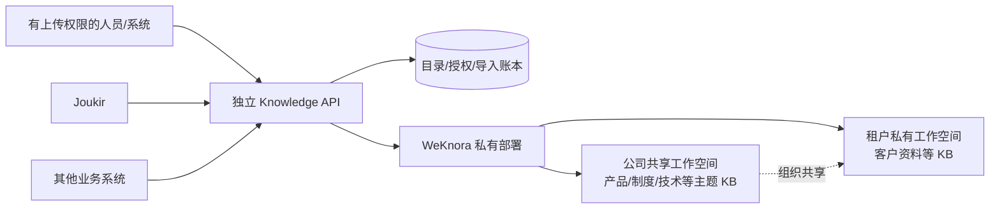
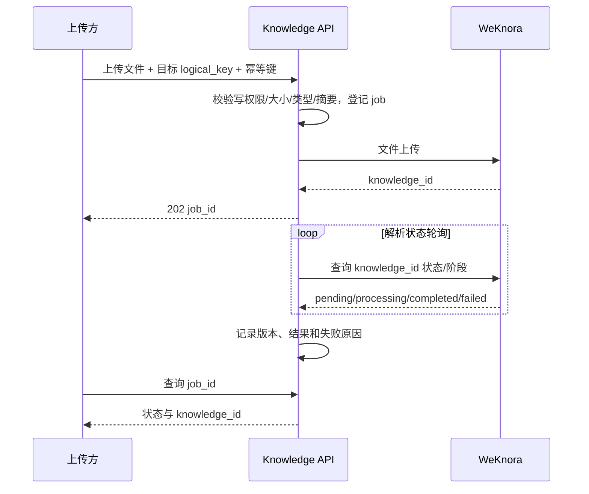

# WeKnora 独立知识平台设计（待 POC 验证）

## 目标与范围

WeKnora 独立部署，服务 Joukir 和其他业务系统。首期只接收文件，向接入方提供知识库/文档列表、解析后的正文和分块、授权下载原文件、检索以及仅依据知识库且带引用的问答。预留 URL、Markdown、FAQ 和业务系统同步的导入契约，但首期不开放这些写入实现。Joukir 的数字员工工作流继续归 Joukir，公共知识问答不经过数字员工人设或工具。

此设计只面向静态或低频更新的知识资料。实时库存、订单、价格等业务事实仍由业务 API 提供。

## 结构

Knowledge API 是独立运行的薄服务，可与 Joukir 同仓库存放源码，但拥有独立部署、身份、配置和凭证。只负责客户端鉴权、目录与授权、稳定接口、异步导入账本和 WeKnora 适配；解析、索引、召回和知识问答使用 WeKnora。各消费系统不持有 WeKnora 平台级密钥。公司共享 KB 由共享工作空间拥有；租户私有 KB 由对应租户工作空间拥有。组织共享供 UI 和可能的跨工作空间查询使用，能否由受限 API key 完整检索/问答必须在目标版本 POC 证实。若不能，Knowledge API 对已授权的共享与私有 KB 分别查询并合并结果；混合问答由独立、受约束的答案层对合并片段生成引用，不能假称 WeKnora 原生单请求支持。日常上传以角色或系统账号授权和审计，不要求预先指定一名固定维护人员。

## 目录与权限

- `workspace`: `company` 或 `tenant:<joukir_tenant_id>`，不以消费系统名称作为租户。一个 KB 只有一个内容属主，可授权多个系统读取。
- `knowledge_base`: `logical_key`、`weknora_workspace_id`、`weknora_kb_id`、`topic`、`visibility`（`company_shared`/`tenant_private`）、`status`、`active_revision`。
- `client_grant`: 客户端身份、允许的 workspace/KB、能力 `list/read/search/qa/download/ingest`、有效期。默认为拒绝；下载单独授权。普通客户端只能查询授权目录，平台运维的跨所有租户搜索需独立强权限和显式操作，不作为默认行为。
- 共享主题可为产品、制度、流程、技术、培训等；一个知识库对应主题与权限边界，文件夹/标签承载细分类。不要按文件格式或每个消费系统复制一份 KB。

## 文件导入与来源账本

账本至少保存 `source_system`、`source_record_id`、`source_version`、文件 SHA-256、上传者、目标 KB、WeKnora knowledge ID、导入 job、状态、时间和错误摘要，原始密钥/文件内容不写日志。唯一键 `(source_system, source_record_id, source_version, target_kb)` 加请求幂等键；相同文件与版本重试返回原 job。新版本先成功解析并通过抽检，再将旧版本停用或删除，避免更新失败导致内容消失；旧版保留期限由资料留存规则决定。上传来源当前可用 `manual-file`；未来 `POST /v1/imports/urls`、`POST /v1/imports/texts`、`POST /v1/imports/faq` 与连接器同步入口共用导入 job/状态/授权模型，首期只在 API 规范中预留，不部署空实现路由。批量文件导入生成批次，逐文件状态与失败重试，不把一个目录当作不可观测的大任务。

## 对外 API v1 契约

所有请求以客户端机器身份鉴权，服务端从授权目录解析 KB，不接受客户端任意传 WeKnora tenant ID。正文/分块和原文件是不同授权。

| 用途 | 统一接口 | 必要返回 |
| --- | --- | --- |
| 列目录 | `GET /v1/knowledge-bases` | logical key、名称、主题、可用能力 |
| 列文档 | `GET /v1/knowledge-bases/{key}/documents` | 分页、状态、来源、更新时间 |
| 文档详情 | `GET /v1/documents/{id}` | 文档元信息、解析状态、KB |
| 解析正文 | `GET /v1/documents/{id}/content` | 预览正文及格式、来源 ID |
| 结构化片段 | `GET /v1/documents/{id}/chunks` | 分页、片段 ID、内容、source locators |
| 原文件 | `GET /v1/documents/{id}/file` | 授权后的二进制流 |
| 检索 | `POST /v1/search` | 命中片段、分数、文档/KB ID、引用位置 |
| 知识问答 | `POST /v1/answers:stream` | SSE：answer、references、complete/error |
| 文件导入 | `POST /v1/imports/files` | 202、job ID、目标 KB |
| 导入状态 | `GET /v1/imports/{job_id}` | 排队/处理中/成功/失败、文档 ID、错误码 |

检索和问答的请求必须包含显式 `knowledge_base_keys`，服务端对每个 key 做授权交集校验，未授权直接 403，不能静默过滤后继续回答。空命中时答案为“知识库中没有足够依据”，不调用联网搜索或数字员工工具。问答引用至少包含 logical KB key、document ID、chunk ID、引用文本、source locator 和当次内容摘要；SSE `complete` 后才视为成功。原文件下载只有在 WeKnora 实际存有源文件并且 `download` 授权成立时开放，否则返回明确的 404/403，不用解析预览冒充原文件。

## Joukir 适配与迁移

Joukir 当前公开知识接口依附 agent，Harness 工具仍直接调用本地 `KnowledgeService`，工作任务还固定本地 KB version ID。迁移须分别处理：

1. 为 Joukir 的 tenant/agent 建立 `logical_key -> WeKnora KB` 授权绑定；公司共享 KB 可以绑定多个 tenant/agent，私有 KB 只能绑定所属 tenant。
2. 将 Harness 知识搜索和 `KnowledgeRuntime` 都路由到同一可切换的 provider；公共 `/agents/.../knowledge-bases` 路径先作为兼容层，翻译原 ID 与结果，新增跨系统接口由独立 Knowledge API 提供。
3. 当前 Joukir 原始上传内容在处理后可能不再保留；迁移按“源文件/备份 → 旧文档可恢复内容 → 无法迁移清单”盘点，不承诺全部可无损转换。先迁移公司共享资料，再试点一个私有租户，最后滚动扩展。
4. 不把 WeKnora 的可变 KB 当作 Joukir 的不可变 version。首期在任务启动时固定 logical KB/revision 映射，逐次检索持久化实际片段文本、位置和摘要；若业务要求整个任务期间严格复现原知识库，则采用新 KB 构建/验收后原子切换 logical key，保留旧 KB 至留存期结束。未完成这个语义验证前，任务路径不切换。
5. 双读比对覆盖召回质量、引用、权限和时延；发布开关按 agent/tenant 灰度。失败时只将未切换的流量留在旧服务，已切换回滚须恢复原绑定且不得丢失新导入资料。

## POC、上线门槛与风险

POC 固定 WeKnora 镜像/提交版本，部署隔离实例，接入实际选定的解析、embedding、rerank 和回答模型。用公司共享 KB、租户 A/B 私有 KB、至少两种文件格式验证：机器密钥访问共享 KB、混合检索和引用问答、分块定位、原文件下载权限、重复导入/失败重试、超时/断流、A/B 跨租户拒绝。尤其检查受限 key 对共享 KB 的查询与 `shared-knowledge-bases` 发现限制。POC 结果决定是否使用 WeKnora 原生共享问答或 Knowledge API 的分域检索与答案层。

上线前需完成身份和审计、配额与限流、文件大小和格式限制、恶意文件处理、模型和索引容量、备份/恢复演练、SSE 代理超时、导入积压/失败监控，并以真实授权客户端完成读写/隔离验收。不得以健康检查或模拟测试替代这些验收。

## 已核对的依据

- Joukir：`src/backend/app/public_api/resources.py`、`src/backend/app/core/harness_capability_invoker.py`、`src/backend/app/capabilities/contracts.py`、`src/backend/app/work_tasks/snapshots.py`。
- WeKnora：[API 认证与流式协议](https://github.com/Tencent/WeKnora/blob/main/website-docs/04-api/01-api-overview.md)、[知识与文件 API](https://github.com/Tencent/WeKnora/blob/main/website-docs/04-api/02-api-knowledge.md)、[检索与问答 API](https://github.com/Tencent/WeKnora/blob/main/website-docs/04-api/02-api-chat.md)、[组织共享 API](https://github.com/Tencent/WeKnora/blob/main/website-docs/04-api/02-api-org.md)、[分块 API](https://github.com/Tencent/WeKnora/blob/main/website-docs/04-api/02-api-chunks.md)。
